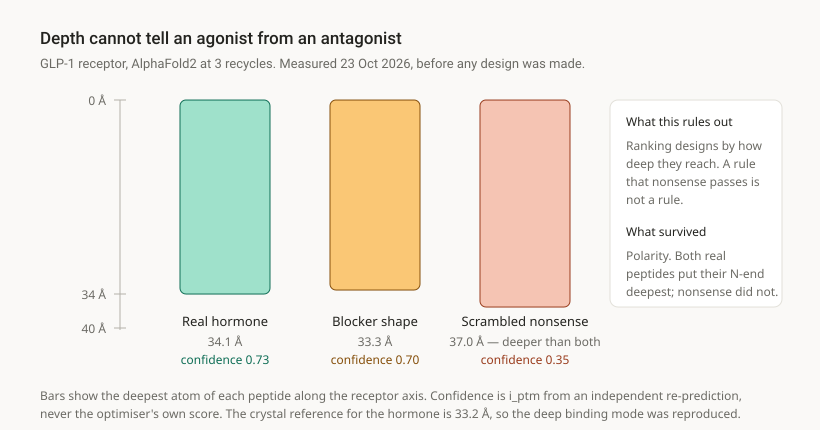

# De novo conditional protein binders

**Anthropic × Adaptyv Protein Design Competition 2026 — Track 3**

[](LICENSE)
[](https://proteinbase.com/competitions/anthropic-adaptyv-2026)
[-888780)](https://proteinbase.com/competitions/anthropic-adaptyv-2026)
[](#what-was-submitted)
[](docs/PROJECT-STORY.md)

Small proteins designed to bind a chosen human target **under a condition** — a pH window,
a second species, a mechanism, or a single-letter mutation — and submitted for wet-lab
testing. Five challenges, four of them entered, 65 designs now in the queue.

**[Interactive viewers →](https://wwwtalalahmed98-collab.github.io/ph-switch-binders/)**
Rotate the designs inside their targets, and pull the pH dial.

> **No wet-lab results exist yet.** Every number in this repository is a prediction, a
> geometric measurement on a predicted structure, or a correlation between the two.
> Characterisation is pending. Where that distinction matters, the text says so.

---

## Four results

The useful findings here are negative. Each came from checking something that already
looked like it was working.

### 1. We measured our own measuring stick, and it could not read

The last challenge ranked designs on an AlphaFold screen — 300 predictions over two runs.
Before trusting it we pushed two sequences through the identical pipeline: the **JDI
T-cell receptor from 7OW6**, a crystallographically confirmed binder of that exact target,
and one of our own designs with its letters **shuffled**, which cannot bind anything.

| | i-pTM on the target state |
|---|---|
| confirmed binder | 0.158 |
| shuffled nonsense | 0.134 |
| **separation** | **+0.024** |
| disagreement between two runs of the same input | 0.022 |

The gap *is* the noise. The confirmed binder's own preference for the mutant peptide over
the healthy one came out at **−0.001**. A second metric agreed, and put the real binder
marginally *worse* than the shuffle.

So the screen could not tell a real binder from a shuffle, and **the conclusion we had
already drawn from it — that none of our designs bound — was withdrawn as unmeasured**.
The submitted methods file leads with this rather than burying it:
[submission/challenge5_final20_methods.md](submission/challenge5_final20_methods.md).

The lesson is cheap and we learned it late: **run the control first, not last.**

### 2. Model confidence points the wrong way on this problem

For GLP-1R, a design only matters if it reaches the residues the natural hormone uses to
switch the receptor on. Ranking candidates by AlphaFold2 interface confidence — the
standard move — selects against exactly that.

| | correlation | n |
|---|---|---|
| first target | **−0.96** | 11 |
| rebuilt target | **−0.67** | 15 |
| two-domain designs only | **−0.80** | 7 |

Two targets, two design tasks, the same inverted sign. In the final batch the
highest-confidence design touches **1 of 30** mechanistically relevant residues; the
lowest-confidence touches **19**. The submission was selected *against* the confidence
metric, on direct geometric measurement, with the reasoning fixed before the ranking was
applied — [glp1r/select_v2.py](glp1r/select_v2.py) states its own limitations in its
header.

### 3. A truncated target invented a binding site

GLP-1R is a membrane receptor, and the usual way to make one computationally affordable is
to cut away everything far from the binding site. That crop removed the floor of the
transmembrane bundle, and designs were diving into the hole. At the depth they reached, the
real receptor has **211 atoms** and the cropped one had **4**.

The three highest-confidence threading designs all dived into it, including one scoring
i_ptm 0.800 — the best number this project has produced, and an artifact.

The target was rebuilt with the floor sealed, the natural hormone re-docked into it first
to confirm it reproduced published contacts, and the identical job re-run as a controlled
experiment with one variable changed. The channel-only designs failed again, which locates
the fault in the method rather than only in the crop —
[glp1r/results/THREADER_FAILURE.md](glp1r/results/THREADER_FAILURE.md).

### 4. A ranking metric with the wrong sign, caught before submission

The pH-switchable TNF-α binders were first ranked by the distance from each histidine to a
nearby charge. Checked afterwards against the effect it was supposed to predict, across
**35 histidine placements in 14 design lineages**, that metric correlated **+0.24** — the
wrong direction. Burial on binding correlated **−0.58**, and the set was rebuilt on it
before anything was submitted.

---

## Reproduce a result in two minutes

The analysis scripts need only `biopython`, `numpy` and `requests`, and download their own
reference data. They print their own verification rather than asking you to trust them.

```bash
python tfr1/conservation_map.py
```

That aligns human and mouse transferrin receptor, maps identity onto the ectodomain
surface, and checks every residue number against UniProt before using any geometry. It
reproduces two figures the competition publishes independently:

| our output | organizers' published figure |
|---|---|
| ectodomain identity **78.1 %** | 78 % |
| apical epitope **3 of 9** conserved | "differs at six of nine positions" |

plus `numbering check: 1278 residues compared, 0 mismatches`.

```bash
python tfr1/find_patches.py     # rank candidate epitopes by cross-species conservation
python tfr1/mouse_check.py      # does each patch survive the species swap, in shape as well as sequence
python glp1r/crosscheck_3iol.py # our GLP-1R epitope against the one Adaptyv's own tool hands out
```

GPU work ran on Kaggle (T4 ×2). Each file in `kaggle/` is one notebook cell carrying its
parameters and a comment explaining what the previous version got wrong.

---

## What was submitted

| | Target | The condition on top of binding | Designs |
|---|---|---|---|
| **Challenge 1** | EGFR ectodomain (6ARU) | hold on at pH 6.5, let go at 7.4 | 5 |
| **Challenge 2** | TNF-α trimer (1TNF) | the reverse switch, **and** cross-react with mouse | 20 |
| **Challenge 3** | GLP-1R (6X18) | **activate** the receptor, not block it | 20 |
| **Challenge 4** | TfR1 ectodomain (1IQC) | release in the endosome, **and** cross-react with mouse | designed, **never submitted** |
| **Challenge 5** | KRAS G12D on HLA-A\*11:01 (7OW6) | reject the healthy peptide that differs by **one letter** | 20 |

**65 designs submitted across four challenges. None has been made or measured yet.**

Challenge 4 is reported as it happened: one usable candidate, no fold check run on it, work
stopped on 29 October, nothing sent. Challenge 3 ships a methods file that opens with the
words *activation is unscreened*, because nothing in this pipeline tests it —
[submission/METHODS_GLP1R.md](submission/METHODS_GLP1R.md).

**All sequences are now published.** Each challenge's designs were withheld only while its
submission window was open; the last window closed 9 November 2026 and the final twenty
went into the repository with the methods file that cites them. The `.gitignore` keeps the
retired rules and the record of the five times the withholding pattern was written too
narrowly — it is a worked example of why such a rule has to match by pattern, not by name.

### Challenge 5, in one paragraph

KRAS G12D is a common cancer driver sitting *inside* the cell, out of reach. But cells
shred their own proteins and display the fragments on their surface in a holder called
HLA — so the mutated fragment `VVVGADGVGK` appears on the outside of a cancer cell, a flag
reading *this cell is malignant*. The healthy version `VVVGAGGVGK` differs by one letter
and is displayed by every healthy cell in the body. Bind that one and you have built an
autoimmune disease, which is why the competition scores rejecting it **first** and raw
strength last. Twenty designs went in from two independent routes, ten each: published de
novo scaffolds fully resurfaced by ProteinMPNN, and BoltzGen generation against the full
three-chain complex. An earlier BoltzGen run is reported in the methods too — β2-microglobulin
was left out of the target, and **all 172 harvested designs came back as β2-microglobulin**.
Leave a hole in the target and the model fills the hole.

---

## Method

1. **Choose the epitope before designing.** Cross-species conservation and surface
   chemistry decide the site, not the optimiser. A site the optimiser picks is picked for
   being easy, not for being useful.
2. **Generate** binders by AlphaFold2 hallucination (AfDesign / ColabDesign), three-stage
   logits → softmax → hard. Nothing is derived from a natural sequence.
3. **Score by independent re-prediction.** Every reported confidence comes from a fresh
   prediction of the discrete sequence at 3 recycles — never the optimiser's own number,
   which is optimistic by construction.
4. **Validate the selection rule against a case where the answer is already known**, before
   applying it to anything.
5. **Select, declare, submit.** The rule is written down before the designs exist, and any
   later change is recorded as a dated amendment rather than folded in silently.

---

## More findings

**Depth cannot distinguish a receptor agonist from an antagonist.** Nature supplies the
control: GLP-1(7-36) activates GLP-1R and the same peptide missing two residues is the
shape of a drug that blocks it. AlphaFold2 placed them 0.8 Å apart, and a scrambled
sequence reached *deeper than the real hormone*. What did separate sense from nonsense was
**polarity** — which end of the peptide points down the channel.



**Check residue numbering against the structure, not against your own map.** A chain
renumbered 1–322 with gaps is not indexable by ordinal. This class of error appeared three
times here; the one that survived longest "passed" a check that compared a map against
itself.

**Two histidines are not twice one.** Henderson–Hasselbalch says one histidine leaves 50 %
of molecules competent at pH 6.0 and two leaves 25 % — but only if both are doing work.
Every pair measured had a partner buried by ≤ 0.10, so the effective count was one and the
cost at pH 7.4 was two. Adjacent histidines shift each other's pKa, which is the mechanism
behind that observation and the reason the Challenge 4 design rule spaces them apart.

**Conserved sequence is not a conserved surface.** For TfR1, ranking candidate epitopes by
human/mouse identity alone promoted a patch whose central residue is R325Q — a positive
charge lost from the middle of the site. The structural check demoted it and promoted one
where every substitution preserves chemistry class (Lys→Arg, Glu→Asp) and the shape is
reproduced to 0.63 Å — [tfr1/results/EPITOPE_CHOICE.md](tfr1/results/EPITOPE_CHOICE.md).

---

## After the competition: does any of this work, for anyone?

Finding that our own screen was blind raised an obvious question — **is it our pipeline,
or are the field's metrics weak?** That is answerable now, because three large datasets
have been published that pair designed binders with their *measured* laboratory outcome.

[`benchmark/`](benchmark/) holds eight read-only scripts that download those datasets and
re-measure them. [`docs/RESEARCH-LANDSCAPE.md`](docs/RESEARCH-LANDSCAPE.md) is the written
dossier — every claim marked **[verified]** when it was downloaded and run here, or
**[reported]** when relayed from a paper. Nothing is cited from memory.

| dataset | designs | what it adds | licence |
|---|---|---|---|
| [Proteinbase](https://proteinbase.com/download) (Adaptyv) | 4,280 | one lab, one protocol, 40 targets, 1,062 affinities | ODC-BY |
| [Claude binder release](https://huggingface.co/datasets/Anthropic/claude-protein-binder-design) | 1,440 | **two** independent CROs, ten predictors, counter-screens | CC-BY-4.0 |
| [DTU meta-analysis](https://doi.org/10.5281/zenodo.15722219) | 3,676 | 312 features per design, re-predicted with AF2/AF3/Boltz-1 | CC-BY-4.0 |

Four things came out, and one of them was my own idea dying:

**ipSAE scores 0.56, 0.74 and 0.81 on the three datasets.** Same metric, same question,
real laboratory outcomes — a **0.25 AUC spread** driven by how it is computed and how
clean the labels are. Published filter thresholds do not transfer between pipelines. That
alone explains why our cheap screen was blind.

**Chai-1 and OpenFold3 beat AlphaFold3 at this job** (0.744 / 0.741 / 0.733), with Boltz-2
near the bottom at 0.692 — measured on 1,320 identical designs with dual-CRO labels, which
is the cleanest head-to-head available.

**Nothing predicts affinity.** Across 1,062 measured designs the best correlation is
−0.26, and a trained model under leave-one-target-out does *worse* than that single number.
Splitting affinity into on-rate and off-rate does not help either. Boltz-2's own
documentation confirms it **does not support protein–protein affinity at all**.

**A claim I had drafted turned out to be false.** I suspected published benchmarks were
inflated by pooling across targets. Measured: the drop is 0.036 and 0.003. The metrics
really do rank within a target. It is in the dossier as a failed hypothesis because it was
the most attractive idea I had.

---

## What is here

```
pmhc/         Challenge 5: three-state target build, docking, BoltzGen triage, selection
benchmark/    does the field's scoring actually work? scripts over three open datasets
tfr1/         Challenge 4: conservation mapping, epitope ranking, species check
glp1r/        Challenge 3: target scoping, depth analysis, selection rule
tnf/          Challenge 2: epitope selection, switch placement, submission assembly
scripts/      conservation, epitope finding, novelty screen, pipeline stages
kaggle/       the notebook cells that ran on GPU, one per run, with their failure notes
viz/          builders for the interactive structure viewers
docs/         the published viewers, PROJECT-STORY.md, RESEARCH-LANDSCAPE.md
submission/   designs, methods files and metrics for every challenge
```

[docs/PROJECT-STORY.md](docs/PROJECT-STORY.md) is the narrative record — **32 checkpoints**
of what was chosen, what was rejected, and which assumptions turned out to be wrong, newest
first. It is written for a reader who does not read code, and every reversal is logged as a
reversal. Checkpoint 31 retells the whole month from the problem that created it;
checkpoint 32 opens the three public datasets above.

[docs/RESEARCH-LANDSCAPE.md](docs/RESEARCH-LANDSCAPE.md) is the separate research dossier:
what validated data exists, who produced it, how trustworthy it is, what the field runs,
and where the holes are — including the patent claim that covers polypeptides *at least 35%
identical* to any of ~1,570 published designed miniproteins, which is worth knowing before
anyone commercialises a de novo binder.

---

## Citation

```bibtex
@misc{ahmed2026conditionalbinders,
  author = {Ahmed, Talal},
  title  = {De novo conditional protein binders for the
            Anthropic x Adaptyv Protein Design Competition 2026},
  year   = {2026},
  url    = {https://github.com/wwwtalalahmed98-collab/ph-switch-binders}
}
```

## Licence

MIT — see [LICENSE](LICENSE).
