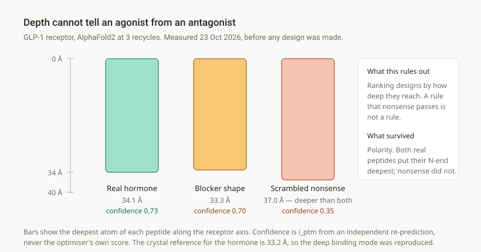

# De novo conditional protein binders

**Anthropic × Adaptyv Protein Design Competition 2026 — Track 3**

[](LICENSE)
[](https://proteinbase.com/competitions/anthropic-adaptyv-2026)
[-888780)](https://proteinbase.com/competitions/anthropic-adaptyv-2026)
[](#what-was-submitted)

Small proteins designed to bind a chosen human target **under a condition** — a pH window,
a second species, or a mechanism — and submitted for wet-lab testing.

**[Interactive viewers →](https://wwwtalalahmed98-collab.github.io/ph-switch-binders/)**
Rotate the designs inside their targets, and pull the pH dial.

> **No wet-lab results exist yet.** Every number in this repository is a prediction, a
> geometric measurement on a predicted structure, or a correlation between the two.
> Characterisation is pending. Where that distinction matters, the text says so.

---

## Three results

The useful findings here are negative. Each came from checking something that already
looked like it was working.

### 1. Model confidence points the wrong way on this problem

For GLP-1R, a design only matters if it reaches the residues the natural hormone uses to
switch the receptor on. Ranking candidates by AlphaFold2 interface confidence — the
standard move — selects against exactly that.

| | correlation | n |
|---|---|---|
| first target | **−0.96** | 11 |
| rebuilt target | **−0.67** | 15 |
| two-domain designs only | **−0.80** | 7 |

Two targets, two design tasks, the same inverted sign. In the final batch the
highest-confidence design touches **1 of 30** mechanistically relevant residues; the
lowest-confidence touches **19**. The submission was selected *against* the confidence
metric, on direct geometric measurement, with the reasoning fixed before the ranking was
applied — [glp1r/select_v2.py](glp1r/select_v2.py) states its own limitations in its
header.

### 2. A truncated target invented a binding site

GLP-1R is a membrane receptor, and the usual way to make one computationally affordable is
to cut away everything far from the binding site. That crop removed the floor of the
transmembrane bundle, and designs were diving into the hole. At the depth they reached, the
real receptor has **211 atoms** and the cropped one had **4**.

The three highest-confidence threading designs all dived into it, including one scoring
i_ptm 0.800 — the best number this project has produced, and an artifact.

The target was rebuilt with the floor sealed, the natural hormone re-docked into it first
to confirm it reproduced published contacts, and the identical job re-run as a controlled
experiment with one variable changed. The channel-only designs failed again, which locates
the fault in the method rather than only in the crop —
[glp1r/results/THREADER_FAILURE.md](glp1r/results/THREADER_FAILURE.md).

### 3. A ranking metric with the wrong sign, caught before submission

The pH-switchable TNF-α binders were first ranked by the distance from each histidine to a
nearby charge. Checked afterwards against the effect it was supposed to predict, across
**35 histidine placements in 14 design lineages**, that metric correlated **+0.24** — the
wrong direction. Burial on binding correlated **−0.58**, and the set was rebuilt on it
before anything was submitted.

---

## Reproduce a result in two minutes

The analysis scripts need only `biopython`, `numpy` and `requests`, and download their own
reference data. They print their own verification rather than asking you to trust them.

```bash
python tfr1/conservation_map.py
```

That aligns human and mouse transferrin receptor, maps identity onto the ectodomain
surface, and checks every residue number against UniProt before using any geometry. It
reproduces two figures the competition publishes independently:

| our output | organizers' published figure |
|---|---|
| ectodomain identity **78.1 %** | 78 % |
| apical epitope **3 of 9** conserved | "differs at six of nine positions" |

plus `numbering check: 1278 residues compared, 0 mismatches`.

```bash
python tfr1/find_patches.py     # rank candidate epitopes by cross-species conservation
python tfr1/mouse_check.py      # does each patch survive the species swap, in shape as well as sequence
python glp1r/crosscheck_3iol.py # our GLP-1R epitope against the one Adaptyv's own tool hands out
```

GPU work ran on Kaggle (T4 ×2). Each file in `kaggle/` is one notebook cell carrying its
parameters and a comment explaining what the previous version got wrong.

---

## What was submitted

| | Target | The condition on top of binding | Designs |
|---|---|---|---|
| **Challenge 1** | EGFR ectodomain (6ARU) | hold on at pH 6.5, let go at 7.4 | 5 |
| **Challenge 2** | TNF-α trimer (1TNF) | the reverse switch, **and** cross-react with mouse | 20 |
| **Challenge 3** | GLP-1R (6X18) | **activate** the receptor, not block it | 20 |
| **Challenge 4** | TfR1 ectodomain (11QC) | release in the endosome, **and** cross-react with mouse | in progress |

Challenge 3 ships a methods file that opens with the words *activation is unscreened*,
because nothing in this pipeline tests it —
[submission/METHODS_GLP1R.md](submission/METHODS_GLP1R.md).

Challenge 1 sequences are in the repository. Challenges 2 and 3 are withheld pending lab
results, by pattern in `.gitignore`. Structures and reference data are downloaded by the
scripts rather than committed.

---

## Method

1. **Choose the epitope before designing.** Cross-species conservation and surface
   chemistry decide the site, not the optimiser. A site the optimiser picks is picked for
   being easy, not for being useful.
2. **Generate** binders by AlphaFold2 hallucination (AfDesign / ColabDesign), three-stage
   logits → softmax → hard. Nothing is derived from a natural sequence.
3. **Score by independent re-prediction.** Every reported confidence comes from a fresh
   prediction of the discrete sequence at 3 recycles — never the optimiser's own number,
   which is optimistic by construction.
4. **Validate the selection rule against a case where the answer is already known**, before
   applying it to anything.
5. **Select, declare, submit.** The rule is written down before the designs exist, and any
   later change is recorded as a dated amendment rather than folded in silently.

---

## More findings

**Depth cannot distinguish a receptor agonist from an antagonist.** Nature supplies the
control: GLP-1(7-36) activates GLP-1R and the same peptide missing two residues is the
shape of a drug that blocks it. AlphaFold2 placed them 0.8 Å apart, and a scrambled
sequence reached *deeper than the real hormone*. What did separate sense from nonsense was
**polarity** — which end of the peptide points down the channel.



**Check residue numbering against the structure, not against your own map.** A chain
renumbered 1–322 with gaps is not indexable by ordinal. This class of error appeared three
times here; the one that survived longest "passed" a check that compared a map against
itself.

**Two histidines are not twice one.** Henderson–Hasselbalch says one histidine leaves 50 %
of molecules competent at pH 6.0 and two leaves 25 % — but only if both are doing work.
Every pair measured had a partner buried by ≤ 0.10, so the effective count was one and the
cost at pH 7.4 was two. Adjacent histidines shift each other's pKa, which is the mechanism
behind that observation and the reason the Challenge 4 design rule spaces them apart.

**Conserved sequence is not a conserved surface.** For TfR1, ranking candidate epitopes by
human/mouse identity alone promoted a patch whose central residue is R325Q — a positive
charge lost from the middle of the site. The structural check demoted it and promoted one
where every substitution preserves chemistry class (Lys→Arg, Glu→Asp) and the shape is
reproduced to 0.63 Å — [tfr1/results/EPITOPE_CHOICE.md](tfr1/results/EPITOPE_CHOICE.md).

---

## What is here

```
tfr1/         Challenge 4: conservation mapping, epitope ranking, species check
glp1r/        Challenge 3: target scoping, depth analysis, selection rule
tnf/          Challenge 2: epitope selection, switch placement, submission assembly
scripts/      conservation, epitope finding, novelty screen, pipeline stages
kaggle/       the notebook cells that ran on GPU, one per run, with their failure notes
viz/          builders for the interactive structure viewers
docs/         the published viewers, and PROJECT-STORY.md
submission/   methods files and metrics for each challenge
```

[docs/PROJECT-STORY.md](docs/PROJECT-STORY.md) is the narrative record — eleven checkpoints
of what was chosen, what was rejected, and which assumptions turned out to be wrong. It is
written for a reader who does not read code.

---

## Citation

```bibtex
@misc{ahmed2026conditionalbinders,
  author = {Ahmed, Talal},
  title  = {De novo conditional protein binders for the
            Anthropic x Adaptyv Protein Design Competition 2026},
  year   = {2026},
  url    = {https://github.com/wwwtalalahmed98-collab/ph-switch-binders}
}
```

## Licence

MIT — see [LICENSE](LICENSE).
