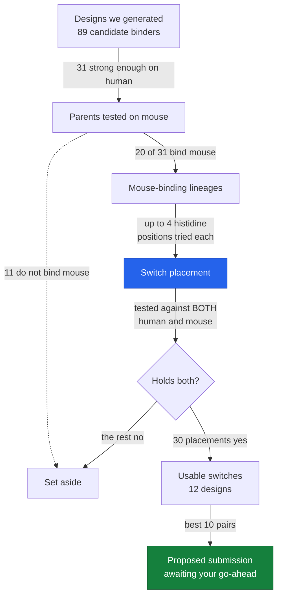

# Project story

A running, plain-English record of what this project is doing and why. Newest entry at the top.

| # | Date | Checkpoint |
|---|---|---|
| 1 | 2026-10-17 | Measuring the mouse instead of guessing it |

---

## 1. 2026-10-17 — Measuring the mouse instead of guessing it

### Where we are

We found out that the way we were picking designs was wrong, fixed it, and we are one run away from replacing what we have already entered into the competition.

### What this project is for

We are entering Anthropic's protein design competition, Challenge 2, Track 3. The task is to design a small protein that sticks to a human inflammation protein called TNF-alpha at normal body acidity (pH 7.4), lets go of it when things get slightly more acidic (pH 6.0), and does the same job on the mouse version of the target so it can be tested in animals. We may submit up to 20 designs. They get made in a lab and physically tested, so the numbers we produce are predictions that will be checked against reality.

The competition ranks three things in this order: does the pH switch work, does it bind mouse as well as human, and how tightly does it bind. Mouse matters more than strength.

### Why this step

We had already submitted 20 designs. They were ranked partly on a shortcut: instead of checking whether each design actually binds mouse TNF-alpha, we counted how many of the human contact points are spelled the same way in mouse (*sequence conservation*). The reasoning was that if mouse and human look similar where the binder touches, the binder should work on both.

If that shortcut were sound, skipping the real check would save a lot of computer time. If it were not sound, we would have entered designs that fail the second-ranked objective, and we would not know.

### What we actually did

Three things, in order.

**We measured mouse binding directly.** We built a mouse version of the target from a published crystal structure (PDB entry `2TNF`) and predicted all 68 of our switch designs against it, using exactly the same model and settings as the human predictions so the two numbers are comparable.

**The shortcut turned out to carry almost no information.** Across the 11 designs that have both a shortcut score and a measured number, the two barely track each other (*Pearson correlation* r = +0.272, where 1.0 would be perfect agreement and 0 would be none). The design the shortcut ranked **first** had the **worst** measured mouse binding of the whole set.

Six of the ten switches we submitted fail the mouse objective. That includes the strongest binder in the submission, which turned out to make **zero** contacts with the mouse target.

**We found what was actually causing it.** We then tested the parent designs — the versions *before* we add the histidines that create the pH switch. 20 of 31 parents bind mouse fine. So the designs were never the problem. Comparing the 17 lineages where we have both numbers:

> The same histidine substitutions keep a median of **90% of human binding** and only **49% of mouse binding**.

That lopsidedness is not chemistry. It is our own selection rule showing through: we scored candidate histidine positions on the human structure and accepted or rejected them on human results alone. A position that human tolerates and mouse cannot was passing our filter *by construction*.

**We changed the rule and re-ran.** Now a histidine position is kept only if it holds up against both species, and each design is offered several candidate positions instead of one.

The clearest result is a single design, `tnf2_w0_007`. Same parent, same machinery, only the chosen position differs:

| histidines placed | human | mouse | mouse contacts |
|---|---|---|---|
| L30H + D27H (what the old rule picked) | 0.487 | **0.150** | **0** |
| E26H (what the new rule picks) | 0.566 | **0.678** | **15** |

A design that binds mouse well was being handed to the lab in a state where it barely touches mouse at all, because of where we put one amino acid. Three positions away is fine.

### How it works

Think of the binder as a hand gripping a ball, and the pH switch as putting a small spring-loaded spike on one finger. The spike is flat at normal acidity and pops out when things get acidic, pushing the hand off the ball. That is the switch: a histidine amino acid sitting next to a positively charged spot on the target, harmless at pH 7.4 and repulsive at pH 6.0.

The mistake was this. We tested where to put the spike by gripping only the *human* ball. Some spots on the finger are fine against the human ball but land right where the hand grips the *mouse* ball. We never checked, so we kept choosing those spots. Now we try the spike in several places and grip both balls each time, keeping only placements that work on both.

### The diagram

"Switch placement" (blue) is the step we just rebuilt. "Proposed submission" (green) is where we are now — built, checked, not sent.

### What you have now

**Things that work and have produced results:**

- [tnf/results/MOUSE_RESULTS.md](../tnf/results/MOUSE_RESULTS.md) — the measured mouse numbers for all 68 designs, and the evidence that the old shortcut does not work. Open it to see the table showing six of our ten submitted switches failing.
- [tnf/results/PARENT_MOUSE_RESULTS.md](../tnf/results/PARENT_MOUSE_RESULTS.md) — the diagnosis. Shows the 90%-versus-49% finding that explains everything else.
- [tnf/results/SWITCH4_RESULTS.md](../tnf/results/SWITCH4_RESULTS.md) — results of the rebuilt placement step, including the `tnf2_w0_007` rescue.
- [tnf/results/mouse_scores.csv](../tnf/results/mouse_scores.csv) and [tnf/results/mouse_parents.csv](../tnf/results/mouse_parents.csv) — the raw numbers behind those documents, as spreadsheets.

**Built and ready, but not sent:**

- `submission/challenge2_proposed_v2.csv` — the 20 designs we would submit. Deliberately kept out of the public repository until the competition closes, so it will not appear on GitHub.
- `submission/challenge2_metrics_v2.csv` — the numbers behind each of those 20.

**Running right now:** one final job (`tnf_switch5_repair_fix`) that fixes two loose ends before we submit. See "What is next".

### Decisions made, and why

| We chose | Instead of | Because |
|---|---|---|
| Measuring mouse binding directly | Estimating it from sequence similarity | The estimate turned out to be nearly uninformative (r = +0.272), and six submitted designs fail because of it |
| Keeping a histidine only if it holds both species | Keeping it if it holds human | A position that human tolerates and mouse does not was passing the filter by construction |
| Trying several histidine positions per design | Taking the single best-scoring one | The best-scoring position is sometimes the one mouse cannot tolerate; `tnf2_w0_007` went from 0.150 to 0.678 purely by moving it |
| Preferring two histidines where both survive | Taking the single histidine the automatic rule picked | One histidine leaves half the molecules still fully active at pH 6.0; two leaves a quarter. The brief says *no detectable binding* at pH 6.0 |
| Fixing free cysteines always, breaking repetitive stretches only if it is cheap | Doing both unconditionally | One design lost a third of its binding to a cosmetic repair before the switch step even started |
| Showing you the proposed set before sending | Submitting automatically | It replaces a submission that is already banked |

### Jargon decoder

- **TNF-alpha** — a human protein that drives inflammation; the thing our designs are meant to grab.
- **Binder** — the small protein we design to stick to it.
- **pH** — how acidic something is. 7.4 is normal blood; 6.0 is slightly acidic, like inflamed or tumour tissue.
- **Histidine** — one of the twenty amino acid building blocks. Unusual in that it gains a positive charge right around pH 6.0, which is why it can act as a pH-triggered switch.
- **Acid-OFF switch** — a binder that holds on at pH 7.4 and lets go at pH 6.0.
- **i_ptm** — the confidence score the structure-prediction model gives that two proteins actually stick together. Roughly 0 to 1. **It is a confidence score, not a measured strength.**
- **AlphaFold2** — the model that predicts protein shapes and whether two proteins bind.
- **Parent / switch / control** — the original binder; the version with histidines added; and a twin of the switch with the histidines left out. The control exists so that if the lab sees a pH response, we can tell it came from the histidines.
- **Epitope** — the patch on the target that the binder actually touches.
- **On-site contacts** — how many of those touches land on the specific patch we were aiming for.
- **Pearson correlation (r)** — how well two sets of numbers track each other. 1.0 is perfect, 0 is no relationship.
- **PDB 2TNF** — the published experimental structure of mouse TNF-alpha we built the mouse target from.
- **Liability repair** — small edits that make a sequence easier to manufacture, such as removing a lone cysteine or breaking up a long repeat.

### What is next, and what could go wrong

**Next:** the job running now does two things. It re-examines nine designs the earlier screen skipped because of an arbitrary cutoff — one of them, `tnf2_w0_001`, is in our current submission and looks good on mouse. And it stops the manufacturing-repair step from charging more than the problem is worth. When it finishes I rebuild the 20-design set and we submit. **Deadline is Sunday 18 October, 23:59 AoE — about a day and a half.**

**What is unverified or could be wrong:**

- **No design in this project has been physically tested.** Every number is a prediction from AlphaFold2 against a static structure. The pH switch in particular has never been measured by anyone here — it is a geometric argument plus textbook chemistry about histidine. The lab results will be the first real test.
- **i_ptm is not binding strength.** A design scoring 0.72 is not "twice as good" as one scoring 0.36. It is confidence that the model thinks they stick.
- **The headline correlation finding rests on 11 data points.** The effect is big enough to act on and too small to publish. If anyone asks, that denominator has to come with it.
- **The improvement from the new rule is modest in count.** On a like-for-like comparison the old method yielded 5 usable switches and the new one yields 8. The `tnf2_w0_007` rescue is better evidence that the fix is real than the count is.
- **We optimised for keeping binding, not for switch strength.** The new rule favours single histidines because they disturb less — but a single histidine makes a weaker switch. I have manually overridden this where a two-histidine version also survived, but it means the automatic rule and the competition's top-ranked objective are not perfectly aligned.
- **Two of the ten control twins are not histidine-free** — their parent sequence already contained one. For those two, a pH response in the lab would be harder to attribute cleanly.
- **One design in the proposed set, `tnf2_w0_001`, is carried on older numbers** and was never re-examined by the improved method. The job running now should fix that.
- **I could not check the running job this turn** — the browser connection to Kaggle dropped. Its result is not yet known.
