# Project story

A running, plain-English record of what this project is doing and why. Newest entry at the top.

| # | Date | Checkpoint |
|---|---|---|
| 28 | 2026-11-08 | The gate opened and the structure prediction said no |
| 27 | 2026-11-07 | The judges published their own marking scheme, and we had been optimising the wrong order |
| 26 | 2026-11-07 | Twenty designs, and the first time we have measured the thing we are judged on |
| 25 | 2026-11-06 | Somebody already solved this, and published the parts |
| 24 | 2026-11-05 | The test we set in advance came back no |
| 23 | 2026-11-04 | Aiming at a target the size of a full stop |
| 22 | 2026-11-03 | The audit that pointed the wrong way |
| 21 | 2026-11-03 | Challenge 4 ended unsubmitted; challenge 5 is open |
| 20 | 2026-10-29 | One out of four hundred and eighty |
| 19 | 2026-10-29 | We have never made one that is both |
| 18 | 2026-10-28 | The fix worked on one spot and broke the other |
| 17 | 2026-10-28 | We had been doing half the pipeline |
| 16 | 2026-10-28 | We were measuring in inches and asking in yards |
| 15 | 2026-10-28 | The binders went to the hole in the wall |
| 14 | 2026-10-28 | 47 designs, none of them measured |
| 13 | 2026-10-27 | The acid switch becomes a sum, and where to put the histidines |
| 12 | 2026-10-27 | Sugar moved the target spot, and why it moved three times |
| 11 | 2026-10-26 | Challenge 4 plan: the pH switch becomes a calculation |
| 10 | 2026-10-25 | Sequences retrieved, 20 chosen, and a liability I never checked |
| 9 | 2026-10-25 | The whole project so far, all three challenges, in plain English |
| 8 | 2026-10-25 | The competition published its own tool, and it told us where we stand |
| 7 | 2026-10-24 | The optimiser found the hole in our target before it found the binding site |
| 6 | 2026-10-23 | Depth is not the signal, and we have never once looked at a design |
| 5 | 2026-10-18 | Submitted, and what we would tell the next person |
| 4 | 2026-10-17 | One good histidine out of thirty-five |
| 3 | 2026-10-17 | Submitted, then asked what is actually weak |
| 2 | 2026-10-17 | The set is built and verified; one click left |
| 1 | 2026-10-17 | Measuring the mouse instead of guessing it |

---

## 28. 2026-11-08 — The gate opened and the structure prediction said no

### Where we are

Our twenty designs are allowed into the competition — the organisers' own screen passed every one of them — and the first independent check of whether they actually bind came back negative.

### What this project is for

Challenge 5: a protein that grabs the KRAS G12D mutation while it is displayed on HLA-A*11:01, and ignores the wild-type version that differs by one atom-group. Adaptyv's robot lab measures the selected designs. Submissions close **tonight, 8 November 23:59 Anywhere-on-Earth** (9 November 11:59 UTC).

### Why this step

Checkpoint 27 found the organisers' published rubric and their public screening code. This step ran both against what we had, instead of reasoning about them. Three jobs went to Kaggle overnight.

### What we actually did, and what came back

**1. The official pre-submission screen: 49 of 49 passed.** This is the real gate, `adaptyvbio/binder-prescreen`, run with every reference database it ships except the USPTO patent arm — PDB, Swiss-Prot, PLAbDab, PLAbDab-nano, Thera-SAbDab, THPdb and the published Proteinbase designs. Every design came back `verdict: pass`, with prior-art similarity, existing-design similarity and target similarity all **0.0**. Its classifier also typed them as `miniprotein`, agreeing with what we declared.

That closes the worry I raised in checkpoint 27 about reusing published scaffolds — at the sequence level, measured, not argued. The separate structural novelty level from ProteinTyper is still not measured.

**2. The three-state AlphaFold screen: a clear no.** 24 designs × 3 states × 2 models, 2 hours 8 minutes of GPU. The numbers were the same for every design:

| Quantity | What it measures | Result |
|---|---|---|
| pLDDT ≈ 0.86 | is the binder a real, folded protein? | **yes** |
| pTM ≈ 0.81 | is its overall shape confident? | **yes** |
| i_pTM ≈ 0.12–0.15 | does it bind the target? | **no** |
| margin vs wild type | does it prefer G12D? | **±0.001, i.e. nothing** |
| model-to-model noise | how much scatter is there? | 0.004–0.036 |

Every margin is smaller than its own noise floor. Not one of the 24 clears the gate I set in advance. Read plainly: AlphaFold thinks these are well-made little proteins that do not bind this target, and cannot tell the mutant from the wild type.

**3. ipSAE failed on all 144 predictions** and I have not diagnosed why. The error text came back empty, so I cannot currently distinguish "ipsae.py found no interface to score", which would be consistent with the low i_pTM and would be a true negative, from "ipsae.py did not run properly", which would be my bug. I am reporting it as undiagnosed rather than as either.

**4. BoltzGen's first run died in five minutes** on a missing file. `data/` is gitignored, so the crystal structures are not in the repository clone and the target builder found no `7OW6.cif`. That is the same mistake as the last three Kaggle failures — assuming the environment contained something instead of checking. Fixed, relaunched, now running.

**5. I was wrong about the driver.** I said Kaggle's T4 nodes could not run BoltzGen's ESMFold2 scoring because it needs a CUDA 13 driver. The probe printed **580.178.04**, which qualifies. The relaunched run now banks its sequences first, then attempts the full scoring pipeline — so BoltzGen's own quality filter is available after all.

### The honest limit of finding 2

There is no positive control. I did not run anything that is **known** to bind this target through the same pipeline, so I cannot yet separate "these designs are bad" from "this pipeline scores everything at 0.13". With a 384-residue target and a 56-residue binder, the interface score is diluted by construction.

The control arrives for free: the BoltzGen designs go through the identical screen. If they score materially higher, the pipeline works and our scaffold-docked designs are genuinely weak. If they also sit at 0.13, the measurement is the problem, not the molecules. Either way we learn it before submitting.

### How it works

The project has been judging designs by asking a sequence model which amino acid it expects in the peptide's sixth position — a question about *sequence preference*. AlphaFold asks a different question: fold these two chains together and say how confident you are that they touch. The first question we were scoring well on. The second one, asked for the first time, we fail.

It is the difference between a lock-maker checking that the key's teeth look plausible, and someone trying the key in the lock.

### The diagram

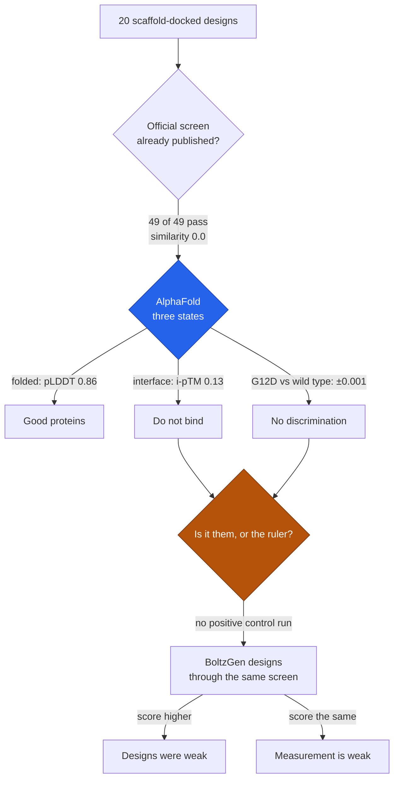

"Now" is the blue box, just finished, and the amber box, which is the question we cannot yet answer.

### What you have now

- `submission/challenge5_kras_g12d.csv` — 20 designs. Admissible, screened clean, and with **no structural evidence that they bind**. Still a complete submission.
- `pmhc/rank_official.py` — ranks on the organisers' published goal order behind a noise-floor gate. Tested on fixtures; it correctly demotes a large margin swamped by scatter. It has not yet been given real data worth ranking.
- `kaggle/cellPMHCl_prescreen.py` — the official screen, which produced finding 1.
- `kaggle/cellPMHCk_boltzgen.py` — running now.
- Kaggle outputs `report_full_report.csv` and `af2_ipsae_results.json`.

### Decisions made, and why

| Decision | Chosen against | Why |
|---|---|---|
| Report the AF2 result as a failure of the designs | Quietly re-ranking on the old MPNN score | The old score is the one AF2 just contradicted; keeping it as the headline would be presenting a number I now have reason to disbelieve |
| Do not spend GPU on a dedicated positive control | Running a known binder through the pipeline | The BoltzGen batch supplies the same control for free, and GPU hours are the scarce thing today |
| Bank BoltzGen sequences before scoring them | Running its full pipeline in one go | Its first run cost five minutes and produced nothing; staging means a late failure cannot destroy the generation work |
| Keep the existing 20 as the submission of record | Withdrawing them | They are admissible and screened; a weak submission beats none, and the lab result is what settles it |

### Jargon decoder

- **i_pTM (interface predicted TM-score)** — AlphaFold's confidence that two chains touch where it has placed them. Low means "I do not believe this interface".
- **pTM** — the same kind of confidence for the whole structure, not the interface.
- **pLDDT** — per-residue confidence in the local shape. High means a well-defined fold.
- **Noise floor** — here, the disagreement between two AlphaFold models shown the same thing. A difference smaller than this is not evidence.
- **Positive control** — something known to work, run through the same measurement, to check the measurement.
- **Prior art** — anything already published that a submission might be a copy of.
- **Verdict `pass`** — the screen found no match to any public sequence or known binder of this target.
- **ipSAE** — a sharper interface score than i_pTM; it needs an interface to exist before it can score one.

### What is next, and what could go wrong

1. BoltzGen finishes and we see whether a model that was *told* to bind the peptide produces anything AlphaFold believes in.
2. Those designs go through the same three-state screen — which doubles as the missing control.
3. Whatever ranks best under the published goal order gets submitted tonight.

Risks, stated plainly:

- **BoltzGen may produce nothing usable in time.** It is one attempt with one fix applied, on hardware slower than it was built for.
- **It may also score 0.13.** Then we submit the existing 20 and say openly that no structure prediction supported them.
- The ipSAE failure is undiagnosed, so the sharper of our two interface measures is unavailable.
- The structural novelty level is still unmeasured and could still cap these designs below the level-3 floor.
- There are hours left, not days. Anything not working by tonight does not exist.

## 27. 2026-11-07 — The judges published their own marking scheme, and we had been optimising the wrong order

### Where we are

The people who will judge this challenge have published the exact instructions they use to judge it, and reading them tells us we have been ranking our twenty designs by the wrong thing.

### What this project is for

Challenge 5 of the Anthropic × Adaptyv competition. We design a protein that grabs a cancer mutation — a single changed letter in the KRAS protein, G12D — while it is being held up for display on the surface of a cell by a molecule called HLA. Adaptyv's robot lab makes the winners and measures them for real. The deadline is **8 November 23:59 Anywhere-on-Earth**, which is 9 November 11:59 UTC, so roughly two days from now.

### Why this step

You asked what models and design methods Adaptyv lists and how we could use them. Looking for that turned up something more valuable than a model list: the competition's **selection prompt is public**. Adaptyv and Anthropic wrote it before the first challenge opened, and they publish it at `proteinbase.com/competitions/anthropic-adaptyv-2026/selection`. It is the literal text handed to the AI that reads every submission and recommends which go to the lab.

Skipping this would have meant submitting a set tuned to a scoring function I invented, into a competition that had already published its real one.

### What we actually did

Read four things and compared them with what we have built:

1. **The method catalogue** (`proteinbase.com/design-methods`) — twenty methods with Adaptyv's own counts of how many designs each produced and how many were actually tested in their lab.
2. **The selection prompt**, all nine sections, including the parameters specific to our challenge.
3. **The novelty definition** (`adaptyvbio.com/blog/novelty`) — the four-level scale, and the hard rule that a submission must reach level 3.
4. **The official pre-submission screen** (`github.com/adaptyvbio/binder-prescreen`) — source-available code that decides whether a sequence is allowed in at all.

### The three findings that change what we do

**Finding 1 — we are ranking by the wrong thing.** The prompt states the goals for our challenge *hardest first*, and says "that order is what the model weighs":

| Rank | Goal |
|---|---|
| a) | **no** binding to the wild-type peptide `VVVGAGGVGK` |
| b) | **no** binding to the HLA with no peptide at all |
| c) | strong binding to the G12D complex |

Rejecting the near-identical wild type is the *top* goal, and raw strength is the *bottom* one. Our `pmhc/build_submission.py` currently ranks on a specificity score I built myself from ProteinMPNN. The three-state AlphaFold job running on Kaggle right now measures exactly goals (a) and (b) — so the measurement is right and the **ranking formula is wrong**. That is a one-file fix, not new science.

**Finding 2 — self-reported numbers barely count.** The prompt says plainly: *"Self-reported metrics compare only within a submission; check what you can; unverifiable claims weigh little."* My shuffle-controlled specificity score is exactly such a claim — nobody can recompute it. Meanwhile the prompt names **three screens it records for every design**: pLDDT, ipSAE against the target, and **mean Kyte–Doolittle hydropathy**. We compute the first two. We have never computed the third, and it takes about ten lines.

**Finding 3 — our scaffold reuse is allowed, and I had been worrying about the wrong risk.** I had flagged that building on published scaffolds might break the de-novo rule. The screen's own README settles it: *"This pipeline does not judge whether the scaffold is de novo. Reusing a published framework is allowed in these competitions"*, and framework reuse is reported as context that *"never disqualifies"*. For our target specifically, the known-binder set is **144 references, all T-cell receptors**, with *"no TCR-mimic antibody or designed-binder sequences available for this pMHC"* — our miniproteins cannot collide with it.

**But a different novelty risk is real and unresolved.** Separately from the screen, ProteinTyper assigns a novelty *level*, and level 3 is a hard floor. Level 4 needs sequence identity ≤30% to anything known **and** less than moderate structural similarity. Our designs keep a published scaffold's backbone exactly, so their *fold* matches a known structure closely. On the published table, high structural similarity alone caps a design at **level 2** — below the floor. I cannot resolve this from the documents: it depends on whether those specific scaffolds are in the databases they search. It is a genuine threat to the set we have and I have not tested it.

### How it works

Think of the competition as a school that has published its marking rubric before the exam. Three separate gates stand between our file and a test tube:

- **The door** — the pre-submission screen. Asks only "is this already somebody's published sequence?" Our designs are 25–35% identical to their parents, so they should walk through. Not yet tested.
- **The register** — the novelty level. A clerk checks that your work is not a copy. It looks at the words *and* the shape. We are confident on words, exposed on shape.
- **The examiner** — the Claude selection prompt. Marks against the published rubric, hardest goal first, and explicitly rewards a well-argued method description.

I had spent the project polishing the answer and never read the rubric.

### The diagram

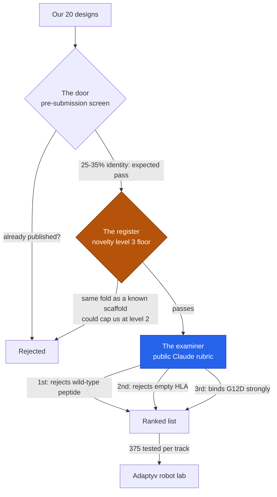

"Now" is the two coloured boxes: the novelty gate we have not tested, and the rubric we have just read and must re-rank against.

### What you have now

Nothing new was built this turn — this was reading, and it changed the plan. What exists:

- `submission/challenge5_kras_g12d.csv` — 20 designs, validated, **ranked by the wrong criterion**. Still a complete submission if everything else fails.
- `pmhc/build_submission.py` — the ranking script that needs the goal order corrected.
- Kaggle notebook `notebook4f6bc6039a` **Version 3** — running since 21:15 on 7 Nov, measuring goals (a) and (b) with AlphaFold on 24 candidates across three states. Not finished, not verified.
- `docs/PROJECT-STORY.md` — this record.

### The method catalogue, and what is worth taking

Adaptyv's twenty catalogued methods, with their own lab counts. The top of the list is not what it was a year ago:

| Method | Who | Generated | Tested in Adaptyv's lab |
|---|---|---|---|
| **BoltzGen** | MIT | 1,752 | **532** |
| RFdiffusion | Baker Lab | 1,592 | 164 |
| BindCraft | EPFL/MIT | 600 | 177 |
| Mosaic | Escalante Bio | 338 | 63 |
| PXDesign | ByteDance | 38 | 38 |

**BoltzGen is the one worth the remaining time**, for three specific reasons rather than because it is new:

1. Its design-specification language has exactly the constraint this challenge is about. You can write `binding: 6` on the peptide chain and `not_binding: "all"` on the HLA chain — "touch the mutation, avoid the scaffolding". Every previous attempt of ours filtered for that *after* generating. BoltzGen asks for it *during*.
2. It installs with `pip install boltzgen` and officially supports **Python 3.13** — which is precisely the thing that made Boltz-2 impossible on Kaggle yesterday (`dm-tree` had no Python 3.13 wheel, 22 minutes to fail).
3. The selection prompt reserves quota for method diversity, and says new methods, *even untested*, should get **at least about a tenth** of the selected designs.

Known risks: it wants ~39 GB of model weights, and its ESMFold2 scoring step needs a CUDA 13 driver that Kaggle's T4 machines probably do not have. The `--steps` flag can skip steps, and `--reuse` survives an interrupted run. Untested by us.

### Decisions made, and why

| Decision | Chosen against | Why |
|---|---|---|
| Re-rank on the published goal order | Keeping my own shuffle-controlled score as the headline | The judges published their order; mine is unverifiable by them and so "weighs little" |
| Add mean Kyte–Doolittle hydropathy | Leaving the three named screens at two of three | It is explicitly one of three recorded per design, and costs ten lines |
| Run the official pre-submission screen | Assuming we pass | It is the actual gate, it is public, and it runs in 30 seconds without downloads |
| Try BoltzGen overnight | BindCraft, PXDesign, Mosaic, Germinal | Only BoltzGen expresses the peptide-vs-MHC constraint natively *and* supports Python 3.13; there is time for one attempt, not four |
| Keep the existing 20 as the fallback | Betting everything on BoltzGen | A validated submission in hand beats an unproven one, and one submission per 24 h means we can improve it tomorrow |

### Jargon decoder

- **Selection prompt** — the published text instructing the AI that recommends which designs go to the lab.
- **ProteinTyper** — Adaptyv's pipeline that labels each design's class, novelty level and closest prior art.
- **Novelty level 1–4** — 4 means no known sequence *and* no known fold resembles it; 3 means only one of the two; the competition floor is 3.
- **Pre-submission screen** — public code that checks whether a submitted sequence is already published or is a known binder in disguise.
- **MMseqs2** — fast sequence-search tool; the screen uses it against eight databases.
- **FoldSeek / TM-score** — tools for "does this shape already exist"; TM-score 1.0 is identical, 0.5 is roughly the same fold.
- **ipSAE** — a confidence score for a predicted interface between two chains; better than its predecessors at predicting whether binding is real.
- **pLDDT** — AlphaFold's per-residue confidence that it got the local shape right.
- **Kyte–Doolittle hydropathy** — a per-residue water-hating scale; the mean over a sequence flags designs likely to clump instead of dissolve.
- **BoltzGen** — an all-atom generative model that designs sequence and 3D structure together, with a language for stating which parts of a target to bind and which to avoid.
- **ANARCI** — numbering tool used to recognise antibody formats.

### What is next, and what could go wrong

Next, in order:

1. Correct the ranking in `pmhc/build_submission.py` to the published goal order.
2. Compute mean Kyte–Doolittle hydropathy for all designs.
3. Run `binder-prescreen` with `--target kras-pmhc` on our 20.
4. Collect Version 3's AlphaFold results and re-rank.
5. If time allows, one BoltzGen run with the peptide-binding constraint.

What could go wrong, honestly:

- **The novelty level is the real danger and I have not measured it.** If reusing a scaffold backbone caps us at level 2, the whole set is inadmissible and only a genuinely new fold — BoltzGen — saves it. This is a live, untested risk.
- Version 3 may fail again. Three of my last four Kaggle runs failed on environment and path problems, not science.
- BoltzGen may not install or may not fit Kaggle's disk and driver. It is one attempt, not a plan.
- `mmseqs2` is awkward on Windows, so the prescreen may need to run on Kaggle or WSL rather than locally.
- Everything above assumes the published prompt is the one actually used. It says so; I cannot verify it.

## 26. 2026-11-07 - Twenty designs, and the first time we have measured the thing we are judged on

### Where we are

We have twenty finished designs, ready to submit, and for the first time in five
challenges we have actually measured whether they can tell the cancer peptide from the
healthy one — which is the thing the competition scores us on.

### What this project is for

Challenge 5 of the Anthropic × Adaptyv competition. Design up to twenty small proteins
that stick to a **mutated** peptide (KRAS G12D) being displayed on a cell's surface,
and *do not* stick to the normal version, which differs at a single position. We are
ranked on that discrimination first, and on binding strength only as a tie-break. The
deadline is tomorrow; the first submission should go in today so a second attempt stays
available.

### Why this step

Yesterday we threw away three runs' worth of work and started again from published
parts. Today was the test of whether that was the right call.

### What we actually did

Four things, in order.

**One: wrote the sequences.** Taking the 63 docked shapes from yesterday, we replaced
every single amino acid in each one, 48 different ways, using the sequence-writing
program (*ProteinMPNN*). 3,024 sequences. The pre-registered test — the one the old
approach failed — was whether the program would return something other than
glycine-proline mush. It did:

| | Old approach | New approach |
|---|---|---|
| Sequences that could plausibly fold | **0 of 720** | **552 of 3,024** |

**Two: hit the de novo problem head-on.** The sequences came back 50–60% identical to
the published shapes they were built on. That is not a bug — given a fixed shape, the
program recovers a near-native sequence, because the shape largely dictates it. But the
rules say *"de novo only; modifying an existing binder is not allowed"*, and 55%
identical is uncomfortably close to what that forbids.

Turning up the randomness barely helped. So instead we told the program, at every
single position, *you may not use the residue the original had there*. That pulled the
median identity from 55% down to 42%, and gave us 179 sequences below 35% identity.

It also did something I did not predict and would have been wrong about: the proportion
of sequences passing our fold-and-express check **went up**, from 2.2% to 18.8%. Pushing
away from the originals moved the chemistry *towards* natural, because those published
shapes carry idealised, unusually repetitive sequences. I had described the penalty as
purely a cost. It was not.

**Three: measured discrimination, finally.** Hold the design in place, rub out the
peptide's identity, and ask the program *which peptide belongs in this pocket?* A design
that truly grips the mutation answers with the mutated letter.

The control is what makes this honest, and building it changed the answer twice:

- The **empty groove, with no design at all**, already prefers the mutant letter by
  +0.44. That is the display molecule's own chemistry. Without measuring it we would
  have claimed a large part of it as ours.
- Then a smoke test on **two nonsense sequences** — meaningless repeating helices —
  scored +0.52 and +0.62 against that empty-groove baseline. So even the corrected
  number was largely rewarding *"a protein is sitting here"*.

So each design is now compared against **a shuffle of its own sequence on its own
shape**: same position, same length, same ingredients, only the order changed. What
survives that subtraction is the design's own doing. Forty of fifty-six beat their own
shuffle.

**Four: a second measure, which failed.** We also asked the reverse question — does this
design's sequence suit the mutant background better than the healthy one? It produced
almost no variation at all (a range of 0.16 against 1.15 for the first measure) and
agreed with the first measure not at all (correlation −0.03). We are reporting it as a
failed measurement and leaving it out of the ranking. A number with no spread that
agrees with nothing is not a second opinion.

### How it works

Carrying on yesterday's bridge analogy: we had 152 bridges cast for near-identical
rivers, and we had lined the good ones up over ours.

- **Rebuilding the deck** is writing the sequence: keep the span, replace every plank.
- **The de novo penalty** is a rule that no plank may be the same kind as the one that
  was there before. The bridge still spans, but it is visibly not the old bridge.
- **The flow test** is the discrimination screen: block the riverbed and ask the bridge
  which stone is underneath it.
- **The shuffle control** is the bit that makes the flow test mean something: run the
  same test with the same planks nailed up in a scrambled order. Any bridge "detects"
  the stone a bit just by standing over it. We only count the part that scrambling
  destroys.

### The diagram

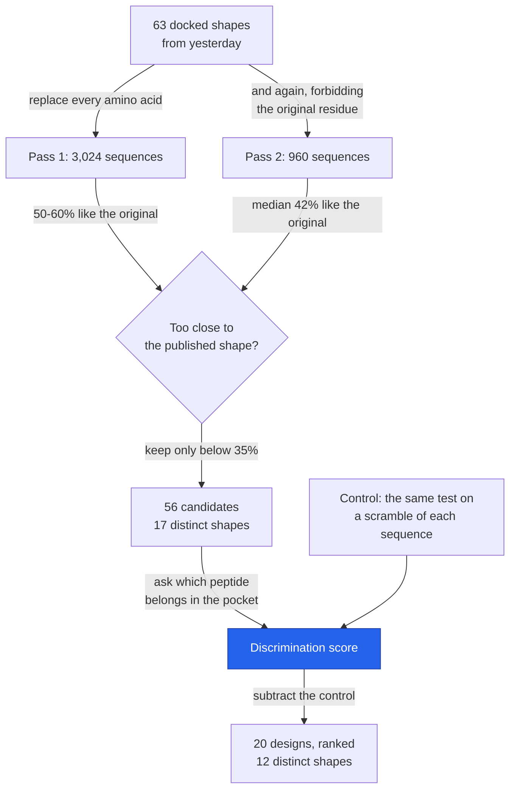

"Now" is the blue box. Everything shown has run; the only thing after the last box is
submitting.

### What you have now

**Things that work now, and have produced real output:**

- `submission/challenge5_kras_g12d.csv` — the twenty designs. Validated: 20 rows, the
  three required columns, all 54–103 amino acids, no cysteines, no duplicates.
- `submission/challenge5_kras_g12d_detail.tsv` — every number behind each design,
  including which published shape it came from and how similar it still is.
- `submission/challenge5_methods.md` — the write-up, including the de novo declaration
  and the failed second measure.
- [pmhc/specificity_screen.py](pmhc/specificity_screen.py) — the discrimination
  measurement, with both controls.
- [pmhc/run_mpnn_divergent.py](pmhc/run_mpnn_divergent.py) — the pass that pushes away
  from the published sequences.
- [pmhc/merge_candidates.py](pmhc/merge_candidates.py) — combines both passes, applying
  the identity limit *first*.

These three files are deliberately **not** published to GitHub yet; they go up when the
submission window closes, as with the previous four challenges.

**Not done:** no structure has been predicted for any of these twenty sequences, so we
have no confidence scores and no ipSAE. That needs a graphics card, and the Chrome
extension went down mid-session so Kaggle is unreachable. It is an optional extra, not
a requirement.

### Decisions made, and why

| Chose | Chose against | Why |
|---|---|---|
| Run everything on this laptop | Kaggle | The browser failed mid-session; moving sequence design local removed the whole dependency and cost nothing |
| Identity limit of 35% | 30% or 40% | Fixed on the de novo argument *before* seeing any discrimination score. 30% left only 9 shapes; 40% weakened the claim for material we did not need |
| Rank on the shuffle-controlled score | The raw score, or the empty-groove comparison | Nonsense sequences scored +0.52 on the empty-groove comparison, so it partly measures occupancy |
| Report the second measure as failed | Quietly dropping it, or presenting it as support | It had no spread and agreed with nothing |
| Declare the shape provenance in the submission | Not mentioning it | The sequences are public either way; the organisers should judge it with the facts |

### Jargon decoder

- **de novo** — designed from scratch rather than copied from nature or from an
  existing binder.
- **Sequence identity** — what fraction of positions hold the same amino acid in two
  sequences. 100% is identical, ~30% is around the point where relatedness stops being
  detectable from sequence alone.
- **ProteinMPNN** — the program that writes an amino-acid sequence for a given shape.
- **Bias** — a thumb on the scales telling that program to prefer or avoid particular
  amino acids at particular positions. How we enforced the de novo penalty.
- **Log-probability** — how strongly a model expects something, on a scale where
  differences add up rather than multiply. A margin of +0.44 means "noticeably
  preferred", not "certain".
- **Correlation** — how much two measurements move together. −0.03 means essentially
  not at all.

### What is next, and what could go wrong

Next: submit. Then, if a graphics card becomes reachable, add structure predictions and
ipSAE and resubmit tomorrow, since one submission per 24 hours is allowed.

Honest risks, unchanged or newly sharpened:

- **The de novo rule is still the biggest risk, and lowering identity did not remove
  it.** The shapes are still published scaffolds. Only generating new shapes would
  settle it, and we could not get that running in the time. If the organisers read the
  rule strictly, all twenty could be ruled ineligible. They will be able to see exactly
  why, because we say so in the submission.
- **The discrimination score is a sequence model's opinion, not a binding measurement.**
  It is not a KD, it is not an affinity, and a positive score is not a promise. It is
  the cheapest honest estimate of the quantity we are ranked on.
- **The healthy-peptide comparison shares one backbone with the mutant.** We make it by
  renaming one residue. That is cleaner than reality, so our margins are an upper bound
  on how easy this discrimination actually is.
- **Nothing has been folded.** Every design passed a chemistry-and-composition check,
  not a structure prediction. A sequence that passes that check can still fail to fold.
- **Sixteen of fifty-six candidates did no better than their own scramble.** They were
  ranked out, but it is a reminder that the method does not work on every design.

---

## 25. 2026-11-06 - Somebody already solved this, and published the parts

### Where we are

We stopped trying to invent binders from nothing and found a published method that
already works on exactly this problem — including the ready-made parts, free to
download. We are now building on those instead.

### What this project is for

The Anthropic × Adaptyv protein design competition, challenge 5. We must design up to
20 small proteins that stick to a **mutated** cancer peptide (KRAS G12D) while it is
being displayed on a cell's surface, and crucially *do not* stick to the normal version
of the same peptide, which differs by a single atom's worth of chemistry at one
position. We are scored first on that discrimination, and only then on how tightly we
bind. Designs are picked for real laboratory testing; the deadline is Sunday 8 November.

### Why this step

For three runs we had been making the binder shape ourselves, by running a structure
prediction program backwards until it imagined a protein that looked like it would
stick. The checkpoint before this one recorded that this failed a test we had set in
advance: when we asked a second program to write a real amino-acid sequence for our
imagined shapes, it returned nonsense on all fifteen we tried — 720 sequences, none
usable.

That nonsense was informative. The second program (*ProteinMPNN*) only produces
glycine-and-proline mush when the shape it has been handed is not a real, foldable
protein. In other words: we had not been designing proteins. We had been polishing
noise, carefully, for sixteen hours of borrowed graphics-card time.

If we had skipped this step and simply tried harder — a fourth run, different settings —
we would have spent the remaining time the same way.

### What we actually did

We went and read the literature properly, which is what I should have done at the start
of the challenge rather than after three failures.

In July 2025 the Baker lab published exactly this problem and solved it: *Design of
high-specificity binders for peptide–MHC-I complexes* (Science 389:386–391). Eleven
different displayed peptides, binders that stick in the nanomolar range, discrimination
against the near-identical wrong peptides confirmed in live cells, and one case
confirmed by crystal structure. Two sentences from it reframed our whole position.

The first explains our failure. On generating shapes from scratch, they write that
*only a small fraction of trajectories yield backbones that interact extensively with
the peptide while largely avoiding the MHC*. Our approach was not merely unlucky; it is
known to be wasteful, and we were running it on a fraction of their compute.

The second is their fix: **stop generating shapes and reuse ones already known to
work.** Because every one of these displayed-peptide targets has nearly the same shape,
a binder designed to arch over one of them can be lifted onto another.

And they published the parts. A public archive holds **152 binder shapes** already shown
to arch over this exact kind of target, each saved alongside the target it was built
for, plus the filters and the scoring scripts.

So we built the step that moves those shapes onto our target. Think of it as a set of
152 bridges, each cast for a slightly different river, and all the rivers are nearly
identical. To try a bridge on our river, line up *its* riverbanks with *our* riverbanks,
then keep the bridge and discard the old banks.

That lining-up either works or it does not, and it is a number we can read. **It works:
the riverbanks match to within 0.5–0.7 ångström** — about a fifth of the width of a
single atom. The shapes land on our target in very nearly the pose they were designed
to adopt.

We also found the idea that may matter more than the shapes. Their test for
discrimination is to hold a finished design in place, rub out the peptide's identity,
and ask the sequence-writing program *what peptide belongs in this pocket?* A design
that genuinely reads the mutation will answer with the mutated letter. One that is
merely resting on the surface will not care which letter is there. This runs on an
ordinary processor in minutes, costs nothing, and measures the exact quantity the
competition ranks us on. **We have had no measurement of discrimination at all until
now** — in four challenges.

### How it works

The bridge analogy, carried through:

- **The river** is the displayed peptide sitting in its groove, with the mutated
  position as a single stone in the riverbed we must touch.
- **The 152 bridges** are the published binder shapes. Someone else cast them, tested
  them, and showed they span this kind of river.
- **Lining up the banks** is the docking step we just built. The banks are the
  near-identical scaffolding either side of the groove.
- **Rebuilding the bridge deck** is sequence redesign: we keep the shape and replace
  every single amino acid, choosing ones that grip *our* stone.
- **The flow test** is the discrimination screen: block the riverbed, ask which stone
  the bridge thinks is underneath it.

### The diagram

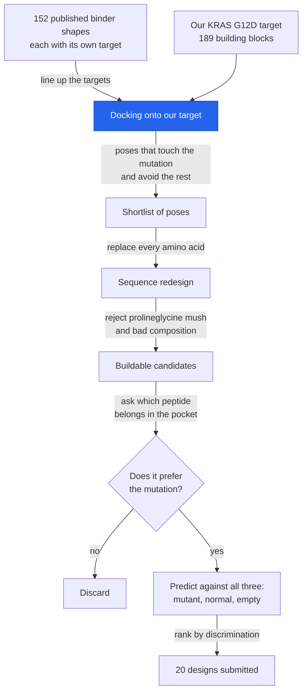

"Now" is the blue box: docking is built and running. Everything to its right is designed
but not yet built or run.

### What you have now

**Things that work now:**

- [pmhc/dock_scaffolds.py](pmhc/dock_scaffolds.py) — moves the published shapes onto our
  target and measures each pose. Open it and you get the reasoning for every threshold,
  including two bugs it caught in itself.
- [pmhc/inspect_scaffolds.py](pmhc/inspect_scaffolds.py) — reads the downloaded shape set
  and reports what is actually in it rather than what the paper implies. This is how we
  know the binders are 54–118 amino acids and contain **no cysteines at all**, which
  happens to remove a liability that bit us on the previous challenge.
- [pmhc/results/docked_poses.json](pmhc/results/docked_poses.json) — the measurements for
  every pose that docked.

**Plans, not working things:**

- [pmhc/PLAN5_SCAFFOLD.md](pmhc/PLAN5_SCAFFOLD.md) — the revised seven-step plan, the
  compute budget, and a rule risk written out in full (below).

**Already built earlier and still good:** the three-state target files, the
three-state screen with its unit tests, the composition screen including the
proline/glycine gate, and the ipSAE input converter.

### Decisions made, and why

| Chose | Chose against | Why |
|---|---|---|
| Reuse 152 published binder shapes | A fourth from-scratch generation run | Three runs, zero usable designs, and the paper says from-scratch is known to be wasteful for this target type |
| Reimplement the docking in Biopython | Running their script as-is | Theirs needs PyMOL, which we do not have; ours reports the alignment quality as a number instead of trusting it silently |
| Measure backbone-only clashes separately | Rejecting poses on all-atom clashes | All-atom clashes include side chains we are about to delete and replace; rejecting on those would have thrown away every pose |
| One prediction pass over all three states | Validate first, then discriminate | Halves the graphics-card bill, and that is where all three previous runs died |
| Declare the shape provenance in the submission | Quietly redesigning and not mentioning it | See the rule risk below; the sequences are public either way |

### Jargon decoder

- **Scaffold** — a protein shape without a committed amino-acid sequence; the bridge
  before the deck is laid.
- **Docking** — positioning one molecule against another to test a pose.
- **Ångström** — a ten-billionth of a metre. An atom is roughly 1–3 across.
- **RMSD** — the average distance between two shapes after you line them up as well as
  possible. 0.5 Å means near-perfect agreement.
- **ProteinMPNN** — the program that writes an amino-acid sequence for a given shape.
- **Proline and glycine** — two amino acids with unusual rigidity and floppiness. A
  sequence made mostly of them is a sign the shape was never foldable.
- **Cysteine** — an amino acid that forms bonds with other cysteines; unpaired ones make
  proteins misbehave when manufactured.
- **de novo** — designed from scratch, as opposed to copied from nature.

### What is next, and what could go wrong

Next: finish docking, shortlist the poses that touch the mutation without a backbone
clash, redesign their sequences, run the discrimination screen, then one graphics-card
pass over all three states, then rank and submit. The first submission needs to go in
**Saturday 7 November**, because only one submission is allowed per 24 hours and we want
a second attempt available.

Honest risks:

- **The rule risk, which is real.** Track 3 says *"De novo only. Modifying an existing
  binder is not allowed."* These shapes are themselves de novo designs, and they were
  built for *different* targets, not ours. Starting from a shape library and rewriting
  the sequence is completely standard in this field. But a strict reading of that
  sentence could cover what we are doing, and I cannot settle it from the rules text. So
  we will replace 100% of each sequence, measure and report how similar each design
  still is to the shape it came from, drop any that stay too close, and name the source
  paper in the submission. If the organisers judge it ineligible they will be able to see
  exactly why from the submission itself. I am flagging this before we spend the time,
  not after.
- **The discrimination screen may come back flat.** It is the published method, but we
  have not yet shown it separates anything on *our* target. If every design scores the
  same, it tells us nothing and we are back to ranking on confidence alone.
- **Confidence scores do not predict binding strength.** The BindCraft authors state
  this outright, and the Baker paper leans on experiments rather than metrics for
  affinity. We should not present our rankings as predicted affinities.
- **Our "normal peptide" comparison is a model, not a structure.** We make it by
  stripping one side chain and renaming the residue. The real structure of the normal
  version exists and we are not using it. That makes the comparison cleaner than reality
  and should be read as a lower bound on how hard discrimination is.
- **Only around 14 of 30 graphics-card hours remain this week**, and the one remaining
  graphics-card step is the only thing between us and a submission.

---

## 24. 2026-11-05 - The test we set in advance came back no

### Where we are

We changed the one setting the evidence pointed at, ran it, and **it did not work**. We
had written down beforehand what would count as failure, and that is what came back. So
we are stopping this approach rather than tuning it further.

### What we suspected, now confirmed as a measurement

The program balances competing instructions by weight. We suspected one instruction -
"touch the target spot" - was drowning out everything else, including "be a real
protein". This run printed the actual settings before changing them:

    touch the spot ........ 1.0
    be a real protein ..... 0.1
    everything else ....... 0

Ten to one. The suspicion was right, and it is now a reading rather than an inference.

### What happened when we fixed it

We rebalanced so being a real protein mattered properly, and ran two versions side by
side: one demanding a close touch, one allowing a looser one, to separate "the balance
was wrong" from "what we are asking is physically impossible".

| | designs | hit the spot | fold quality | reaching effort |
|---|---|---|---|---|
| close demand | 18 | 4 | 0.45 | stalls |
| looser demand | 16 | 2 | 0.45 | stalls |
| *previous run* | 28 | 4 | 0.40 | stalls |

Fold quality moved from 0.40 to 0.45 - barely. Hitting the spot did not improve. And the
"reaching effort" number **stalls at the same place whether we demand a close touch or a
loose one**, which means the problem is not that we were asking for too much.

### The conclusion, taken as written

Before the run I wrote: *"If it stalls at both demands, the method is wrong for this
target and no amount of tuning fixes it."* It stalled at both. So that is the answer, and
I am taking it rather than inventing a third thing to adjust - which would be moving the
goalposts after seeing the result.

**Why it is wrong**: the spot we must touch is 11% exposed at the bottom of a trench
whose walls are identical in the healthy version. Reaching it needs a protruding finger.
Natural immune receptors have one. Purpose-built tools for this kind of target grow one
deliberately. We have been shaping a compact blob and hoping it reaches in.

### But two rounds did produce something

62 designs, every one with its confidence file. A handful are much better than anything
earlier, and one in particular:

    W_cut8_015   touches the spot | fold quality 0.73

That is the first design in this challenge that is **both plausibly a real protein and
touching the spot that matters**. One out of 62. On the previous challenge the equivalent
count was one out of 480, so this is not nothing.

### The diagram

The rendered diagram in chat shows the two questions this run was built to separate, and
the answer each got.

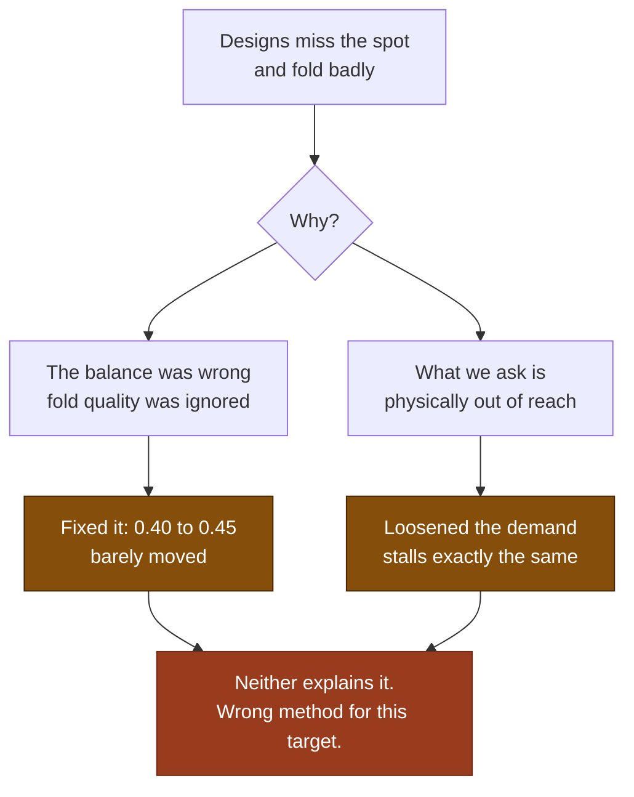

### What you have now

- [pmhc/results/PHASE2B.md](pmhc/results/PHASE2B.md) - the settings, the numbers, the
  conclusion and what it does and does not claim.
- 62 designs with confidence files, on Kaggle.
- The three-way comparison built and tested, not yet run.
- The organisers' quality score is finally computable, and the conversion for it is
  written and tested against the two ways it can silently give wrong answers.

Not done:

- **No design is a confirmed binder.** The best one touches the spot with a single
  contact point.
- Nothing has been through the three-way comparison.
- Nothing submitted. Deadline Sunday; everything final Saturday.

### Decisions made, and why

| Chose | Chose against | Why |
|---|---|---|
| Print the settings before changing them | Assume the defaults | The real ratio was 10:1 and guessing it wrong would have wasted five hours |
| Two demands side by side | Change one thing and hope | It separates "wrongly balanced" from "physically impossible"; both came back no |
| Accept the stated conclusion | Tune a third thing | The criterion was written before the data; changing it afterwards is not evidence |
| Spend the rest on comparing and submitting | Another generation attempt | Two rounds agree, and the remaining time is better spent ranking what we have honestly |

### Jargon decoder

- **weights** - how much the program cares about each competing instruction.
- **fold quality (pLDDT)** - confidence the shape is real. 0.4 is "probably not a
  protein"; 0.73 is respectable.
- **stalls** - the number stops improving, meaning the program cannot do what is asked.

### What is next, and what could go wrong

Run the three-way comparison on the best designs, rank them by how much more weakly they
bind the healthy version, pick twenty, and write the method up honestly including this
negative result.

Honestly:

- **The entry is now most likely a well-documented negative result with a few
  speculative designs attached**, not a strong set of binders. That is worth submitting -
  selection weighs method and honesty, not claimed strength - but it should not be dressed
  up as more.
- The comparison itself rests on a prediction the software is not known to be good at.
  We measure its own noise so we can say which differences are too small to mean anything,
  which is the most we can honestly claim.
- Two days left, about 16 hours of card time.

## 23. 2026-11-04 - Aiming at a target the size of a full stop

### Where we are

The first real generation run for challenge 5 finished: 28 designs, no crashes. Almost
none of them hit the spot we need. But we now know *why*, in a way we can act on, and one
thing that has failed in all four challenges finally worked.

### The honest result

| | designs | hit the mutation | average |
|---|---|---|---|
| tight aim (our choice) | 17 | **4 (24%)** | 0.24 |
| broad aim | 11 | 1 (9%) | 0.09 |

Our choice is about two and a half times better. **It is also not a real result** - with
numbers this small, a difference that size happens by chance about 60% of the time. To
prove it we would need roughly 60 designs per side, which is about 19 of our 22 remaining
hours.

So I am taking the better-looking option and **calling it a judgement call rather than a
finding**. It was also the one the earlier measurements argued for, so it is not a coin
flip, but it is not proven either.

### A mistake of mine that skewed the comparison

The two sides were supposed to get equal time. One side got 17 designs and the other 11,
and that is my fault, not a property of the methods.

Each side ran as its own process, writing progress into a pipe back to the main one. The
main process emptied the first side's pipe completely before looking at the second's. A
pipe holds about 64 kilobytes; the design program prints a line for every single step, so
the second side filled its pipe and **froze for roughly two hours waiting to be read**.

I had specifically considered this risk when launching and dismissed it - by counting
only my own log lines and forgetting the design program's. About two hours of graphics
card time went to nothing.

### Why so few designs reach the target

The piece of the target that distinguishes the cancer version from the healthy one is
**11% exposed** - about the area of a full stop on this page - and it sits in a trench,
surrounded by walls that are identical in both versions.

Watching the run's own numbers: the instruction to "touch that spot" accounts for about
**99% of everything the program is trying to satisfy**, and it never succeeds - it gets
partway and stalls. So the program spends the entire run reaching for something it cannot
grasp, with nothing left over to make the design a sensible protein. That is exactly what
we see: the designs are badly folded.

This is fixable. The balance between "touch the spot" and "be a real protein" is a
setting, and it is currently pinned to one extreme.

### The thing that finally worked

**Every one of the 28 designs saved its confidence file.** For four challenges we have
reported that we could not compute the organisers' own quality score, and the reason was
never complicated: the score needs a file we were not saving. We are saving it now.

### The diagram

The rendered diagram in chat shows where the designs are landing: on the walls of the
trench, not on the spot at the bottom.

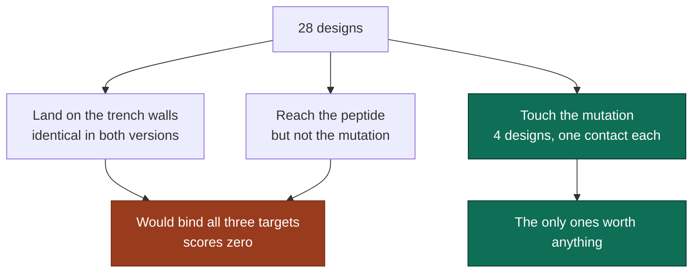

### What you have now

- [pmhc/results/PHASE2.md](pmhc/results/PHASE2.md) - the run, the comparison, the bug.
- [pmhc/results/PHASE4_DESIGN.md](pmhc/results/PHASE4_DESIGN.md) - the three-way
  comparison, built and tested on a processor while the graphics cards were busy.
- 28 designs with their confidence files, on Kaggle.

Two designs are worth keeping. Both touch the mutation and are better folded than the
rest, though still not good.

Not done:

- **No design is a credible binder.** 4 of 28 touch the mutation, one contact each.
- Nothing has been through the three-way comparison yet.
- Nothing submitted. Deadline Sunday; everything final Saturday.

### Decisions made, and why

| Chose | Chose against | Why |
|---|---|---|
| Adopt the tight aim | Run 60 per side to prove it | Proving it costs 19 of our 22 remaining hours |
| Report it as a judgement call | Report 24% vs 9% as a finding | A difference that size is chance 60% of the time at this sample size |
| Rebalance the objective next | Generate more of the same | The run's own numbers show one instruction crowding out everything else |
| Build the three-way comparison during the run | Wait for the cards | It needs no card, and it caught a bug of its own |

### Jargon decoder

- **pLDDT** - how confident the prediction is about the shape. 0.4 means "probably not a
  real protein"; above 0.7 is respectable.
- **pipe** - the channel a background task writes its progress into. If nobody empties
  it, the task stops.
- **confidence file (PAE)** - a by-product of the prediction, needed for the organisers'
  quality score. We never saved it before.

### What is next, and what could go wrong

Rebalance the objective so "be a real protein" is not crowded out, fix the pipe bug, and
generate again. Then the three-way comparison on whatever comes out.

Honestly:

- **This may be the wrong method for this target.** Published work on this kind of target
  uses purpose-built tools that grow a reaching loop; we are shaping a blob and hoping it
  reaches into a trench. If the rebalanced run still lands on the walls, that is the
  answer, not a tuning problem.
- Three days left, about 22 hours of card time.
- The fallback remains submitting a small, clearly labelled set with the negative result
  written up plainly.

## 22. 2026-11-03 - The audit that pointed the wrong way

### Where we are

Phase 0 of challenge 5 is done. We have the target built, the three states defined, and
the one real decision of this phase settled by measurement. No graphics card used.

### What phase 0 had to decide

The thing we design against has to be a cut-down piece of the real protein, because the
whole thing is 384 building blocks and every design has to be tested three times over.
Too big and we get almost no designs in the days left.

But cutting a protein exposes oily surface that is hidden inside the real one, and a
design program will happily glue itself to that fake surface. That is precisely how
challenge 3 went wrong.

So: which cut?

### The measurement, and the mistake in it

I measured eight candidate cuts for how much fake oily surface each one creates. The
first table said that keeping the small partner protein underneath the groove was almost
perfectly clean - 14 units of fake surface, against 250 or more for everything else. I
was one sentence away from recommending it.

It was wrong. **I had only counted the fake surface appearing on the main chain, not on
the small partner protein itself.** Cutting away the lower section leaves that partner's
own underside bare, and my count could not see it. Counted properly it is 309 units -
not the cleanest option but one of the worst, and bigger as well, so it loses twice.

The corrected answer: **no cut is clean.** Every one of them opens roughly as much fake
oily surface as the target peptide itself occupies.

### Why we proceed anyway

Here the fake surface is the same in all three states. A design that sticks to it sticks
to all three equally, and the three-way comparison throws it out. It wastes design
effort; it does not corrupt the answer. That reasoning would not hold on a challenge
scored by strength - it holds here only because this one is scored by specificity.

Chosen: everything within 20 angstroms of the peptide. 189 building blocks, the joint
cleanest option.

### The diagram

The rendered diagram in chat shows the candidate cuts, how big each is, and how much
fake surface each creates. The one marked is what we are designing against.

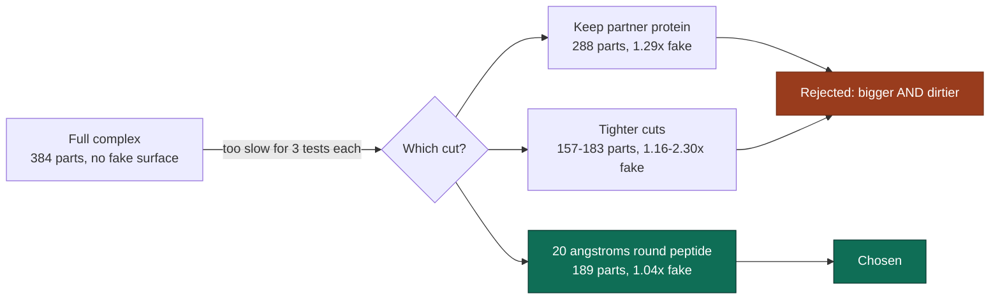

### What you have now

- [pmhc/results/PHASE0.md](pmhc/results/PHASE0.md) - the checks, the full comparison
  table, the corrected numbers, and the measured hotspots.
- [pmhc/build_states.py](pmhc/build_states.py) - builds the target. It refuses to write
  anything unless both peptide sequences are exactly what the specification says and
  differ at exactly one position.
- [pmhc/crop_sweep.py](pmhc/crop_sweep.py) - the comparison, now counting every chain.

Confirmed by running: both peptides are as specified and differ only at position 6; all
three states share one background, so the only difference between the mutant and normal
states is that single change.

Not done:

- **Nothing generated. No graphics card used yet on this challenge.**
- The hotspots are measured but not chosen - that is phase 1.
- The empty-groove comparison is defined by sequence only. Real empty grooves are
  unstable and AlphaFold will predict a tidy one, so our test there is easier than the
  laboratory's. That belongs in the write-up and is in the phase 0 notes.

### Decisions made, and why

| Chose | Chose against | Why |
|---|---|---|
| One shared background for all three states | Each state from its own crystal | Otherwise a difference could come from two crystals, not from the mutation |
| Recount the audit across every chain | Trust the first table | The first table was about to pick the worst option |
| Accept a cut face | Design against the full complex | The face is identical in all three states, so the three-way comparison rejects anything that binds it |
| 20 angstroms round the peptide | The domain-based cut | Same size and fake surface; peptide-centred is the more relevant shape |

### Jargon decoder

- **crop / cut** - a piece of the target protein, small enough to compute with.
- **fake oily surface** - interior that becomes exposed only because we cut. Designs
  stick to it and the binding means nothing.
- **hotspot** - the specific spots we instruct the design to touch.
- **angstrom** - a ten-billionth of a metre; touching atoms are about 4 apart.

### What is next, and what could go wrong

Phase 1: choose which of the 18 measured hotspots to aim at. The whole specificity story
is "we touch the mutated spot", so the set has to be weighted onto the peptide rather
than spread across the groove - spreading a contact instruction too thin is part of why
the first TfR1 round aimed at nothing.

Honestly: phase 0 proves nothing about whether this will work. It builds the target and
removes two ways of being silently wrong. Four days remain, and the hard part - telling
apart one buried building block - has not been attempted yet.

## 21. 2026-11-03 - Challenge 4 ended unsubmitted; challenge 5 is open

### Where we are

The TfR1 challenge closed on 1 November and **we did not submit**. Work stopped on
29 October with one usable candidate and no fold check run on it. That is the fourth
challenge and still nothing experimentally confirmed.

Challenge 5 opened on 26 October and closes **Sunday 8 November, 23:59 AoE**. Five
days. It is a harder target than anything we have attempted.

### What challenge 5 asks for

Design a binder for the **KRAS G12D peptide sitting in an HLA-A\*11:01 groove** - a
cancer mutation displayed on the outside of a cell for the immune system to see.

The hard part is not binding it. It is binding **only** it. The design must not bind:

1. the same groove holding the **normal** version of the peptide, which differs by a
   single amino acid, and
2. the same groove holding **no peptide at all**.

That one-letter difference sits down in the groove. A binder that grips the groove
walls instead of the peptide will stick to all three and score nothing.

### Why that changes how we work

In every previous challenge we designed first and checked for off-target problems at
the end. On TfR1 that is how we discovered, late, that three designs blocked the
receptor's actual job.

Here the off-target check **is** the score. The competition ranks on two ratios
before it ever looks at strength:

| rank step | what it measures |
|---|---|
| 1 | how much more weakly it binds the normal peptide |
| 2 | how much more weakly it binds the empty groove |
| 3 | strength, only as a tie-break |

So a weak design that is clean beats a strong design that is sticky. The plan builds
the three-way comparison in from the first hour.

### What we published today

All four submission windows are closed, so the design sequences that were held back
are now public, alongside the write-ups that cite them: 20 TNF-alpha designs across
four rounds, 20 GLP-1R designs with their methodology, and the TNF round 1 and 2
sequence sets.

The withholding rule stays in place, rewritten to match by pattern rather than by
name - it was written too narrowly twice before and leaked a file each time - and now
points at challenge 5, whose window is open.

### The diagram

The rendered diagram in chat shows the three states the design has to tell apart. Teal
is the one to bind; coral are the two to avoid.

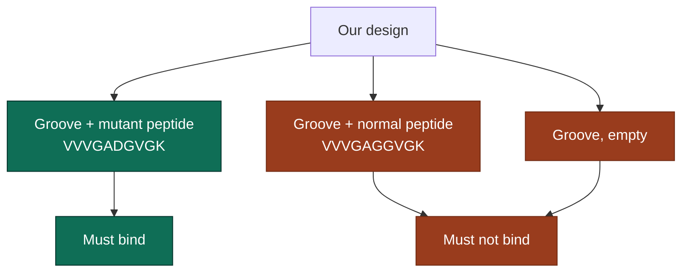

### What you have now

- [pmhc/PLAN.md](pmhc/PLAN.md) - the challenge 5 specification copied from the official
  page, and a five-phase plan with the time each phase needs.
- The design sequences for all four closed challenges, now public in the repository.
- Everything pushed. The repository is up to date with the local work for the first
  time since 29 October.

Not done:

- **Challenge 4 was never submitted.** Nothing was lost by the vacation; the work had
  already stopped.
- The TfR1 raw measurement files are still only on Kaggle, not in the repository. The
  write-ups quote their numbers but a reader cannot yet check them.
- No work has started on challenge 5 beyond the plan.

### Decisions made, and why

| Chose | Chose against | Why |
|---|---|---|
| Publish all four challenges' sequences | Hold the TfR1 ones back | The windows are closed, which was the only reason to withhold |
| Enter challenge 5 | Treat the competition as over | It is open for five more days and the pipeline is now debugged |
| Build the three-way comparison into the objective | Add it as a final filter | It is the score, not a safety check |
| Stop trying to scrape Kaggle through the browser | Keep clicking | A proper access key is two minutes of your time and also makes the next five days scriptable |

### Jargon decoder

- **pMHC** - a short piece of a protein held in a groove on the cell surface, shown to
  the immune system. Our target is a cancer-mutated piece in that groove.
- **HLA-A\*11:01** - the particular groove. One of many in the population.
- **de novo** - designed from scratch. Modifying a known binder is banned here.
- **AoE** - Anywhere on Earth. The deadline passes when it has passed everywhere.

### What is next, and what could go wrong

Next: build the three target states from the published structures, then generate.

Honestly:

- **Five days, and four previous rounds each lost most of their time to one silent
  bug.** The guards we added catch the bugs that already happened, not new ones.
- **The ranking depends on a prediction AlphaFold is not known to be good at.** We
  will be ranking designs by a predicted ability to tell two near-identical targets
  apart. That is the weakest joint in the plan and it belongs in the methods text.
- Telling apart one buried amino acid is a research-grade problem. Published work on
  it uses a purpose-built pipeline.
- The realistic goal is twenty designs with an honest three-way screen and methods
  that state the limits - not a claim of high affinity.

## 20. 2026-10-29 - One out of four hundred and eighty

### Where we are

For the first time in this project we hold **one** design that is both aimed at the
target spot and plausible as a real protein. Yesterday the answer was zero. The run that
produced it reported twelve, and eleven of those twelve do not survive a check I had not
thought to write.

### What we did

We took the ten shapes from the main run that actually reach the target spot, held each
shape fixed, and asked the sequence-writing program for 48 fresh sequences each - 480 in
total. It cost no graphics card time and took five minutes.

Nine of the ten shapes produced something. One produced nothing at all out of 48 tries.

### The twelve that became one

The program's own summary said twelve sequences were both well-aimed and
composition-plausible. Then I counted prolines.

Proline is an amino acid that kinks a chain and cannot make the bond that holds a fold
together. Real compact proteins are about **5% proline**. Four of the twelve "good"
sequences were **25% to 32% proline**. That is not a protein that happens to be
proline-rich; it is a stiff rod.

With a proline limit added:

| | count |
|---|---|
| candidates | 41 |
| pass the proline limit | 3 |
| and were rated "good" | **1** |

### I made the same mistake twice in two days

Yesterday's quality screen had a limit on one side of each measure and not the other, so
it awarded "good" to a 64%-oily aggregate. Today's screen had **no proline term at all**,
so it awarded "good" to a polyproline rod.

Both times I wrote the screen to catch the failure I had just been bitten by, and it
silently waved through the next one. The screen now checks three things. It is still not
a prediction of whether something folds - it is a list of ways to be obviously wrong, and
that list is incomplete by construction.

### The one survivor

`tfr1b_e559_003_r02`, 62 residues. 8% proline, 35% charged, 40% oily, oiliness score
-0.65 - all in the range real soluble proteins occupy. It sits on a shape that makes four
contacts with the target spot.

**And it has never been folded.** The four contacts belong to its *parent shape*. Whether
this sequence still binds there is the thing we do not know, and sequence-writing programs
routinely produce sequences that fold into something other than the shape they were given.
So the honest claim is not "we have a binder". It is "we have one sequence worth spending
graphics card time on".

### The diagram

The rendered diagram in chat shows the funnel. Note how much of it is the screens, and
that the last box is a question rather than a result.

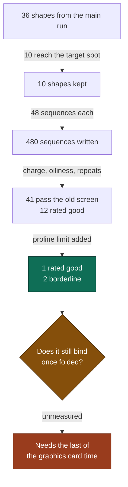

### What you have now

- [tfr1/results/MPNN2_RESULT.md](tfr1/results/MPNN2_RESULT.md) - the run, the twelve, the
  one, and why the eleven were dropped.
- [tfr1/results/mpnn2_candidates.tsv](tfr1/results/mpnn2_candidates.tsv) - all 41
  candidates with their numbers, copied out of the run's log.
- [tfr1/rescreen_proline.py](tfr1/rescreen_proline.py) - the proline check. It also
  recomputes the oiliness of every sequence and compares it against what the run printed,
  so that a mistake in copying the table out of the log would show up rather than pass
  quietly. It matched on all 41 rows.

Not done:

- **The survivor has not been folded.** Nothing is confirmed to bind.
- Run 2's designs have never been checked against the transferrin site - the receptor's
  day job. That check has only been run on the first run's designs, where 3 of 47 blocked
  it.
- No acid-release switch has been measured on anything. That is what this challenge
  scores.
- Nothing is submitted.

Budget: **1 hour 28 minutes** of Kaggle graphics time this week, plus Colab.

### Decisions made, and why

| Chose | Chose against | Why |
|---|---|---|
| Add a proline limit before reporting | Report the twelve | Four of the twelve were 25-32% proline |
| Report "one", not "twelve" | Lead with the first-ever "both" | Twelve was the number my own blind spot produced |
| Copy the candidate table out of the log and re-check it locally | Trust the printed numbers | It was transcribed by hand; recomputing catches a slip |
| Keep the two borderline sequences visible | Report only the clean one | Three candidates is thin enough that the next step needs more than one input |

### Jargon decoder

- **proline** - an amino acid that stiffens and kinks a chain. Fine in small amounts,
  fatal in bulk.
- **backbone / shape** - the fold, before deciding which amino acids fill it.
- **folding it** - running the prediction program on the new sequence to see what shape it
  actually makes, and whether it still touches the target.
- **oiliness score (Kyte-Doolittle)** - one number for how water-repelling a sequence is.
  Real soluble proteins sit around -0.3 to -1.0.

### What is next, and what could go wrong

The next step is the one graphics-card pass, and the result above changes what it should
contain. There is now one clean candidate rather than twelve, which is too few to fill a
pass on its own - so it should go in alongside the borderline ones and the best unrewritten
shapes, and it should save the confidence file the organisers' score needs while it is
running.

Honestly:

- **One survivor out of 480 is a low yield.** It may simply be luck, and folding it may
  show it does not bind at all.
- Its parent shape has weak fold confidence (0.50-0.56), so even a successful fold check
  would be evidence about a shape we are not confident in.
- There is no second attempt at the graphics card this week.
- Everything must be final tomorrow afternoon, because only one submission is allowed per
  24 hours and the deadline is Sunday.

## 19. 2026-10-29 - We have never made one that is both

### Where we are

The main run finished cleanly. The aim fix holds up at full size. And a check I wrote
yesterday has turned up the single most important fact in this challenge so far, which is
not good news.

### The fact

Every design we hold that **looks like a real protein** touches the target spot **zero**
times. Every design that **touches the target spot** does not look like a real protein.

Across 47 designs from the first run, 36 from the second, and 19 from the test, we have
**never once produced a design that is both**.

That is not a near miss. The two lists do not overlap at all.

### How we know, and why we did not know before

Yesterday's quality screen was bent - it had a limit on one side of each measure and not the
other, so it awarded "good" to designs that were 64% oily with eight identical residues in a
row. Fixed to check both sides, the numbers changed completely:

| | good | marginal | fail |
|---|---|---|---|
| first run's own sequences, 47 | 5 | 15 | 27 |
| the rewritten sequences, 39 | **0** | 13 | 26 |

And then cross-referencing those five "good" ones against where they bind: all five have zero
contacts with the chosen spot. The best-looking sequence we own is a design that binds
nothing we care about.

**Any sequence-quality comparison from before this fix should be ignored.** It was measured
with the bent ruler.

### The aim fix, confirmed at full size

| | designs | average touches | reached 4+ |
|---|---|---|---|
| first run, e559 | 27 | 1.22 | 3 (11%) |
| second run, e559, Kaggle | 21 | 2.71 | 8 (38%) |
| second run, e559, Colab | 11 | 3.27 | 5 (45%) |
| **second run, both** | **32** | **2.9** | **13 (41%)** |

Roughly four times as many designs reach the target spot. Two machines, different random
starts, same answer. The diagnosis was right.

The other spot, l537, is confirmed dead under the same setting: **15 designs, average 0.07,
none reaching even two.** Same change, opposite outcome.

### What this means, plainly

We solved aim. We did not solve folding, and the two have been trading off against each
other the whole time:

- push for folding quality -> the design binds the wrong surface
- push for aim -> the design stops being a protein

Nothing in the pipeline has yet produced both at once, and **two days remain**.

### The diagram

The rendered diagram in chat shows the two lists and the empty space between them. The empty
box is the entire problem.

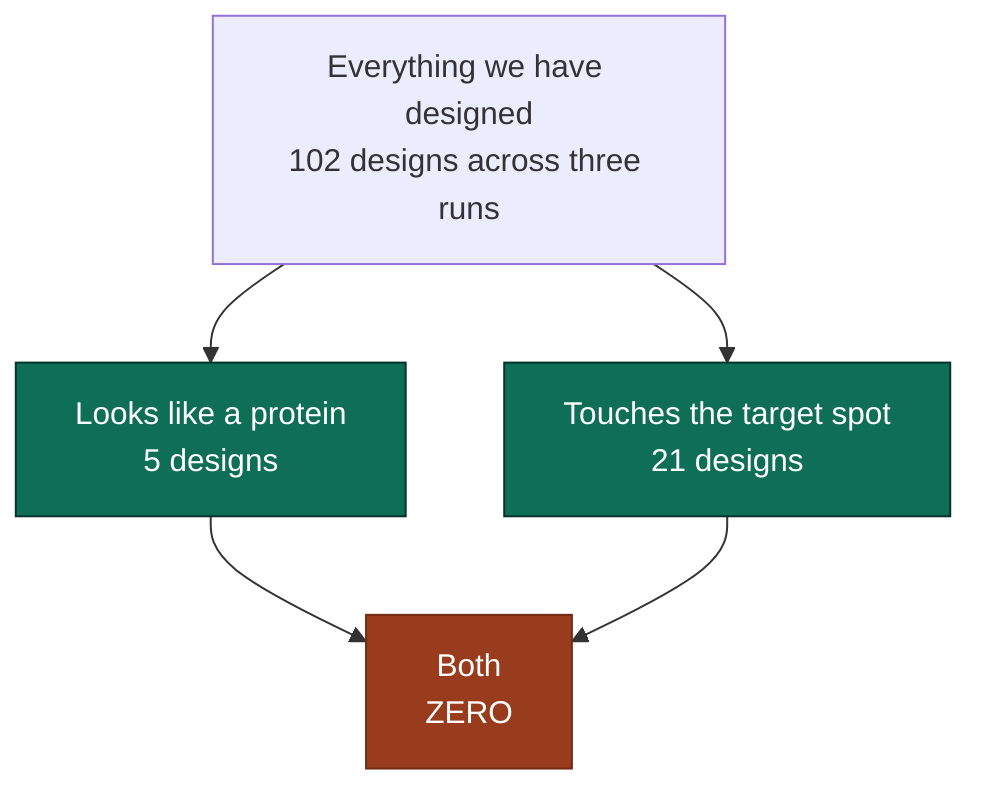

### What you have now

Finished and read:

- Kaggle run 2: 4 h 21 m, 36 designs, successful.
- Colab: 11 designs before its session ended. Its designs are in the notebook output.
- The audit, with the corrected two-sided screen.

Eight designs from the main run reach four or more contacts on the chosen spot. Their folding
confidence runs 0.44 to 0.64, and their sequences contain runs of up to 22 identical
residues. Those are the shapes worth rewriting - and rewriting them has not been tried yet,
because yesterday's rewrite was done on the first run's shapes, not these.

Not done:

- **No design is both on target and buildable.**
- No design has a measured acid-release switch, which is what this challenge scores.
- The organisers' own score still cannot be computed - we do not save the file it needs.
- Nothing is submitted.

Budget: **1 hour 28 minutes** of Kaggle graphics time left this week, plus whatever Colab
gives.

### Decisions made, and why

| Chose | Chose against | Why |
|---|---|---|
| Fix the screen before trusting it | Act on yesterday's ranking | The bent version called a 64% oily aggregate "good" |
| Cross-check quality against aim | Report the two separately | Separately they look like progress; together they show no overlap |
| Report "never both" as the headline | Lead with the fourfold aim improvement | The aim improvement is real and does not matter on its own |
| Accept l537 as dead for now | Keep spending on it | 15 designs, average 0.07, with the last of the quota running out |

### Jargon decoder

- **composition** - the mix of amino acid types. Too charged will not fold; too oily will not
  dissolve. Both ends are failures.
- **Kyte-Doolittle** - one number for how oily a sequence is. Positive is trouble.
- **folding confidence (pLDDT)** - how sure AlphaFold is about the shape. Below about 0.7 is
  weak evidence that it is a real protein at all.

### What is next, and what could go wrong

Next, and it has to fit in 1 hour 28 minutes: rewrite the sequences of the eight well-aimed
shapes from the main run, then one graphics-card pass that does three jobs at once - check
the rewrites still fold and still bind, save the file the organisers' score needs, and feed
the acid-switch measurement.

Honestly:

- **This may not work.** If the rewrites of well-aimed shapes are still unbuildable, then the
  shapes themselves are not proteins and no amount of sequence work will help.
- There is no second attempt. This is the last of the week's quota.
- Even if it works, we would then be measuring the acid switch for the first time, on the
  final day, with no room to iterate on the result.
- The honest fallback is submitting the least-bad twenty with the limitations written plainly
  in the methods, which is what the methods file is for.

## 18. 2026-10-28 - The fix worked on one spot and broke the other

### Where we are

The change we made this afternoon works. On one of the two target spots the designs now
land where we asked, about four times as often as before, and two separate computers running
different random seeds agree. On the other spot the same change made things worse - the
designs stopped touching the target at all. And the aim came at a price: the shapes are now
noticeably worse folded.

### The one-line version

We asked for "touch within 8 angstrom" instead of "be within 21", and the designs started
touching. They also started looking less like real proteins while doing it.

### The numbers, for the spot where it worked

| | designs | average touches | reached 4+ |
|---|---|---|---|
| before the fix | 27 | 1.22 | 3 (11%) |
| after, on Kaggle | 9 | 2.78 | 3 (33%) |
| after, on Colab | 8 | 3.25 | 4 (50%) |
| **after, both** | **17** | **3.0** | **7 (41%)** |

Two machines, different random starting points, same answer. That is the strongest evidence
this project has produced for anything.

### The spot where it broke

Six designs, **zero** touches on the target - and barely any touches anywhere. The binder
simply does not engage. The likely reason is that the new demand is impossible on that spot,
so the instruction gives no useful direction and the design drifts off. Same change, opposite
result, which is worth knowing: this dial is not universally better.

### The price

The shapes are less confident folds than before. The program's own confidence dropped from a
best of 0.78 to mostly 0.10-0.50, and the separate fold-quality number from around 0.75 to
around 0.50. Some sequences contain 23 identical residues in a row.

So we have swapped one problem for another:

- before: **well-folded, badly aimed**
- now: **well-aimed, badly folded**

Whether that is progress depends on whether the sequence-rewriting step can put a real
protein onto a well-aimed shape. That is unproven and is the next thing to find out.

### Two things the audit caught

**One of the best designs blocks the receptor's day job.** Three of 47 designs touch the
transferrin site - the part of the receptor that does its actual work - and one of them is
the second-best-aimed design we had, which also produced four of the rewritten sequence
candidates. We spent three rounds of filtering choosing a spot away from that site and then
never checked whether a design reached it anyway. Now we do.

**My own quality screen was flattering junk.** It had a ceiling on charged residues and a
floor on oily ones, so it caught one kind of nonsense and awarded "good" to the opposite
kind - a design that is 64% oily with eight identical residues in a row passed cleanly. That
is exactly the problem that bit us on the previous challenge. The screen now has limits on
both sides of every measure. **Any earlier comparison of sequence quality should be ignored:
it was measuring with a bent ruler.**

### The diagram

The rendered diagram in chat shows the trade. Teal is where we now are on aim; coral is what
it cost in folding.

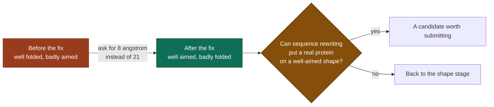

### What you have now

Confirmed by running, not by reasoning:

- The targeting diagnosis was right. Two platforms agree on roughly a fourfold improvement
  at the e559 spot.
- [tfr1/results/PROBE_RESULT.md](tfr1/results/PROBE_RESULT.md) - why the old setting failed.
- [kaggle/cellTFR1h_audit.py](kaggle/cellTFR1h_audit.py) - the transferrin check and the
  two-sided quality screen.

Still true:

- **Nothing is submitted and nothing is confirmed as a working binder.**
- No design has a measured acid-release switch, which is the thing this challenge scores.
- The organisers' own score still cannot be computed, because we do not save the file it
  needs. Requires a short run on a graphics card.

### Decisions made, and why

| Chose | Chose against | Why |
|---|---|---|
| Run the same job on two platforms | One platform, more designs | Agreement between independent seeds is what made tonight's result believable |
| Hold the histidine work back | Run it on tonight's shapes | Rewriting a badly folded shape just produces tidier nonsense |
| Make the quality screen two-sided | Keep the simpler version | The one-sided version awarded "good" to a 64% oily aggregate |
| Report the l537 failure as a failure | Average it away with e559 | Averaging would have hidden that the dial is not universally good |

### Jargon decoder

- **angstrom** - a ten-billionth of a metre. Atoms touching are about 4 apart.
- **on-site touches** - contacts on the chosen spot. The number we judge aim by.
- **transferrin site** - the part of the receptor that carries iron. Blocking it is a
  functional problem, not just a miss.
- **Kyte-Doolittle** - a single number for how oily a sequence is. Positive means trouble
  for making it in a tube.

### What is next, and what could go wrong

Next: let the main run finish, then decide whether to spend the last of the week's graphics
card time on rewriting the well-aimed shapes, or on another generation attempt.

Honestly:

- **The fold quality may be fatal.** A shape that AlphaFold is only 50% confident about may
  not be a real protein at all, in which case good aim is worthless.
- The l537 spot currently has nothing. If it stays that way we are down to one target spot
  and less diversity in the twenty we submit.
- About an hour and twenty minutes of Kaggle graphics time will remain after the main run,
  plus whatever Colab allows.
- Two days left.

## 17. 2026-10-28 - We had been doing half the pipeline

### Where we are

Three jobs running at once on two platforms. The important one is not more computing power -
it is a step we had been skipping since the first challenge.

### The missing half

The standard way to design a binder has two stages:

1. **Shape it.** Work out a physical shape that fits the target.
2. **Write it.** Work out which amino acids to use for that shape.

We have only ever done stage 1. The design program does both at once, badly - which is
exactly what our measurements showed. The three designs that reached the target spot had
sequences containing eight prolines in a row and nine asparagines in a row. **Those are
writing defects, not shape defects.** The shapes were sitting on the right spot.

**ProteinMPNN** does stage 2 properly: hold the shape fixed, rewrite the sequence for it. It
turns out to be bundled inside the software we already install, weights and all, so there was
nothing to download, it needs no graphics card, and it ran while both cards were busy.

I should be plain that this is a gap in how I have run all three challenges, not a new idea.

### A second thing I got wrong

I have told you three times that we have never computed the score the organisers record
alongside ours. I never checked *why*. That score needs two files - the structure and a
confidence matrix - and **we only ever save the structure**. So it was not merely undone, it
was impossible, and the run going on right now will not produce the input for it either.

It needs a short run on a graphics card to produce that second file for the final designs.
A few minutes, but it has to be scheduled.

### A second platform, and the trap in it

Kaggle gives 30 hours of graphics card a week and we are nearly out. Colab has a separate
free allowance, so the same job runs there too.

The trap: Colab's current setup ships a numerical library five major versions newer than our
design software expects, and it would almost certainly have broken. Colab lets you pick an
older setup, so I did, and **ran a two-line compatibility test as its own step before
committing any design time.** It passed. That check cost two minutes and would have cost an
hour of confused debugging if skipped.

### The diagram

The rendered diagram in chat shows the three jobs and what each one needs from the others.
Green needs no graphics card at all.

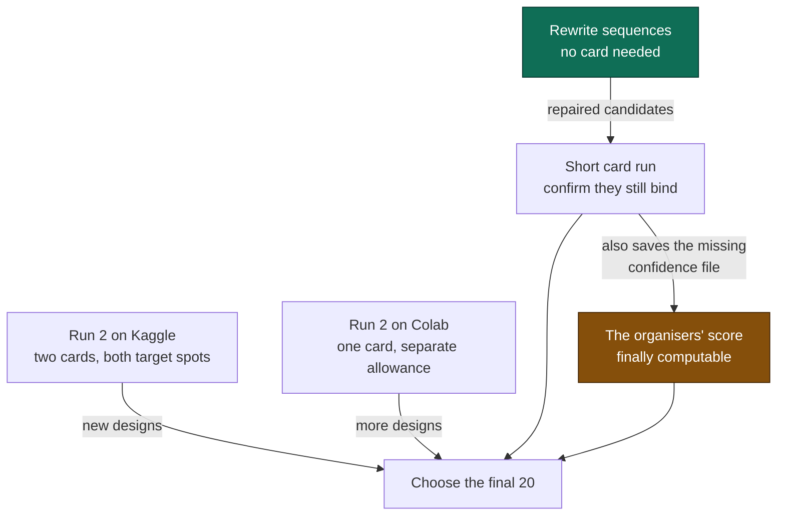

### What you have now

Running:

- Kaggle `notebook2e4cbf5468` - generation run 2, two cards, both target spots, 4 h 10 m.
- Kaggle `notebook62537b8821` - the sequence rewrite. **No graphics card, so no quota.**
- Colab - the same generation on one card, from its own free allowance.

New:

- [kaggle/cellTFR1g_mpnn.py](kaggle/cellTFR1g_mpnn.py) - the rewrite step. It refuses to run
  unless it knows which shapes are on target, because rewriting the sequence of a shape stuck
  to the wrong surface just produces a tidier wrong answer.
- [colab/tfr1_run2_colab.py](colab/tfr1_run2_colab.py) - the second platform.

Not done:

- **Nothing is confirmed.** Rewritten sequences still have to fold and still have to bind,
  and that check has not run.
- The organisers' score is still not computed, for the reason above.
- Nothing is submitted. Deadline Sunday, final Saturday afternoon.

### Decisions made, and why

| Chose | Chose against | Why |
|---|---|---|
| Add the sequence-rewriting step | Only add more computing power | Our failure was writing, not shape, on the designs that mattered |
| Run it without a graphics card | Queue it behind the big runs | It needs none, so it costs nothing to run now |
| Refuse to rewrite off-target shapes | Rewrite everything | A tidy sequence on the wrong surface is still wrong, and would look better than it is |
| Test compatibility as its own step | Launch and hope | The library gap was five major versions; this would have failed an hour in |
| Pick an older Colab setup | Use the current one | The current one ships a library our software predates |

### Jargon decoder

- **ProteinMPNN** - software that writes a sequence for a shape you give it.
- **backbone / shape** - the fold, without deciding which amino acids fill it.
- **homopolymer run** - eight prolines in a row. What a stuck optimiser writes.
- **confidence matrix (PAE)** - a by-product of the folding prediction. We never saved it,
  which is why the organisers' score was impossible.

### What is next, and what could go wrong

Next: read the first designs out of both generation runs, and the rewrite results.

Honestly:

- **Rewriting sequences does not fix aim.** If run 2's binders still miss the spot, the
  rewrite has nothing good to work from.
- The rewritten sequences are unverified in the strongest sense: the software that wrote them
  is the software judging them. An independent fold check is required and has not run.
- Running three jobs at once raises the chance I misread which result came from where. The
  measurement code is identical across platforms and every design records its origin, which
  is the guard against that.
- Three days left.

## 16. 2026-10-28 - We were measuring in inches and asking in yards

### Where we are

We know why last night's designs went to the wrong place, and it is not what I thought
twice. The one-hour test came back with both of my explanations wrong, and reading the
design program's own source code gave the real answer. The fix is a single setting. Five
hours of graphics-card time are left this week and run 2 is written and ready.

### What the test said

Two arms, one hour, on budget to the minute. Neither worked:

| what we tried | designs | average touches on target | reached 4+ |
|---|---|---|---|
| last night, for comparison | 47 | 0.96 | 3 |
| pull harder toward the spot | 8 | 1.25 | 1 |
| hand over a smaller piece | 11 | **0.00** | 0 |

Pulling harder did nothing you could distinguish from chance. The smaller piece was worse -
zero, across eleven designs.

### The real answer, in the analogy

Keep the house. We cut out one wall and asked the designer to bind the doorway. Thirty-two
of forty-seven bound the raw cut edge instead.

I assumed the "aim for the doorway" instruction was being outvoted. It was not. **It was
being satisfied.**

Buried in the program's settings is what counts as "touching". We check our designs at
**4.5 angstrom** - close enough that atoms are genuinely in contact. The program's own
instruction counted anything closer than **21.4 angstrom** as touching. That is roughly five
times further away. And the raw cut edge sits 6.5 angstrom from the doorway.

So a design gripping the cut edge was comfortably "within 21 angstrom of the doorway", the
instruction read as fully met, and nothing pushed it any closer. **We asked for "be in the
same room as the doorway" and then graded on "has a hand on the handle."**

That also explains both failed arms at once. Pulling harder on an instruction that is
already satisfied changes nothing. And a smaller piece of wall makes "within 21 angstrom"
easier still, while leaving less to grip - which is exactly the zero we measured.

For scale, the same settings file asks for 14 angstrom when checking the design's contacts
with *itself*. The interface was the loosest of the two by a wide margin.

### How we found it

Not by guessing. The test printed the settings actually in force, and one line stood out:
every term in the scoring had a weight of zero except the interface one. So "weight it
higher" could not have been the problem - it was already the whole score. That pointed at
*what the term measures* rather than *how much it counts*, and the program's source code is
public, so I read it.

This is worth noting because the first two explanations were both mine and both wrong. The
test was worth its hour for eliminating them, not for what it produced.

### The diagram

The rendered diagram in chat shows the two distances side by side. The grey bar is what the
designer was asked for; the teal bar is what we grade on; the coral marker is where the cut
edge sits.

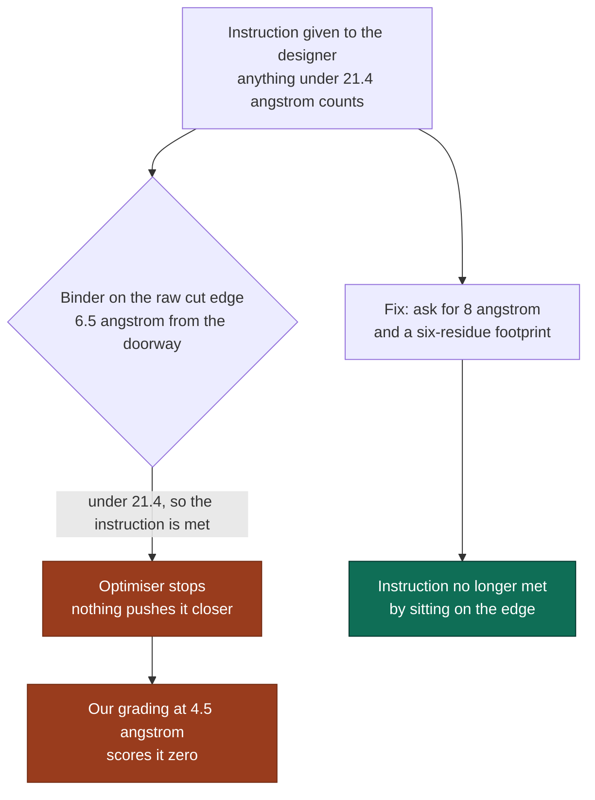

### What you have now

Works now, and ran:

- The probe, on Kaggle as `tfr1_probe`: 1 h 00 m 39 s, successful, 19 designs, no overrun.
- [tfr1/results/PROBE_RESULT.md](tfr1/results/PROBE_RESULT.md) - the measurements, the source
  reading and the fix. This is the one to open.

Written, not yet run:

- [kaggle/cellTFR1f_run2.py](kaggle/cellTFR1f_run2.py) - run 2. One change from last night:
  ask for 8 angstrom instead of 21.4, and for six real contacts rather than an average over
  all thirteen. It **refuses to start a design if the setting did not actually take effect**,
  rather than spending the last of the quota repeating last night. It prints each design's
  on-target count as it finishes, so it can be stopped early if it is still not working.

Corrected, so you are not left with the old version:

- [tfr1/results/GENERATION_RESULT.md](tfr1/results/GENERATION_RESULT.md) says the aiming hint
  "biases but does not constrain, and the bias lost". That is wrong. The hint was satisfied
  at 21 angstrom. The file now points at the newer one.

Not done:

- **Still zero usable designs.** Run 2 has not started.
- Nothing is submitted. Deadline Sunday 1 November, final Saturday afternoon.

### Decisions made, and why

| Chose | Chose against | Why |
|---|---|---|
| Spend an hour testing before five | Commit all six hours to a guess | Both guesses were wrong; the hour bought the real answer |
| Read the program's source | Try a third setting | The printed weights ruled out the weight explanation outright |
| Keep last night's piece of wall | Keep tightening it | The smaller piece measured zero across eleven designs |
| Ask for six contacts, not all thirteen | Demand the whole patch | A 65-residue binder cannot reach thirteen spread-out residues, and an impossible target gives as little guidance as an already-met one |
| Make run 2 refuse if the setting does not bite | Trust it and watch the log | A silent no-op would cost the rest of the week |

### Jargon decoder

- **angstrom** - a ten-billionth of a metre. Atoms in contact are about 4 apart; 21 is far.
- **cutoff** - the distance the program is told to treat as "touching". The whole story.
- **the interface term** - the part of the score covering the join between the two proteins.
- **footprint** - how many residues of the target a binder actually sits on.
- **weight** - how much a part of the score counts. Was never the problem here.

### What is next, and what could go wrong

Next: launch run 2 with the corrected setting, and read it after the first few designs rather
than at the end.

Honestly:

- **The fix removes a reason the designs could not work. It does not prove they will.** There
  may be a second reason behind the first.
- Asking for 8 angstrom is a much harder target than 21. The designs may come back with
  fewer, lower-confidence results that reach the epitope but are not buildable - which is
  what the three on-target designs from last night already looked like.
- This is the last of the week's quota. If run 2 fails there is no second attempt before the
  deadline, only whatever can be salvaged from the designs we have.
- Three days left.

## 15. 2026-10-28 - The binders went to the hole in the wall

### Where we are

The measurement is recovered, and the answer is bad: 32 of the 47 designs never touch the
spot we chose. The five that look best touch it least. This run produced nothing we can
submit, and we have 6 hours 50 minutes of graphics-card time left this week.

### The analogy, carried through

Last time I described the target as a **house with numbered rooms**, and the problem as the
design program renumbering every room from 1. That is fixed - the numbers read back
correctly, verified on a test case first.

Here is the new problem, in the same house. To design against the house we do not hand the
program the whole building - too big, too slow. We **cut out one wall** and hand it that.
Cutting a wall out of a house leaves raw edges: brick, insulation, pipe ends. About 3,400
square angstrom of surface that does not exist when the wall is part of the building, and
roughly half of it oily, which is exactly what a protein likes to stick to.

We told the program to aim for the doorway. **It stuck to the raw edge instead.**

That instruction - "aim here" - turns out to be a suggestion, not a rule. The program is
free to ignore it, and on this target it did.

### The numbers

Out of 47 designs:

| | out of 47 |
|---|---|
| touch the chosen spot not at all | **32** |
| touch it at least twice | 15 |
| touch it at least four times | 3 |
| touch it at least six times | 1 |

And the part that settles what to do next - the five most confident designs:

| design | confidence | touches on target | touches elsewhere |
|---|---|---|---|
| l537_014 | 0.78 | **0** | 31 |
| e559_001 | 0.74 | **0** | 18 |
| l537_002 | 0.74 | **0** | 13 |
| e559_006 | 0.70 | **0** | 21 |
| l537_016 | 0.66 | **0** | 15 |

Every one of them is a well-made protein gripping the raw edge of the cut.

Meanwhile the three that *do* reach the doorway are the ones the program gave up on -
confidence 0.15 to 0.46, and sequences containing eight prolines or nine asparagines in a
row. **Not one design in the set is both well-made and on target.**

### A second thing we learned, which cuts the other way

On the previous challenge we found that higher confidence meant *worse* targeting - a
strong, reliable, backwards relationship. I did not assume it held here; the script measured
it. It does not hold. The relationship here is **+0.10, which is nothing.**

So confidence tells us nothing about where a binder sits on this target - not forwards, not
backwards. It cannot be used to screen. That is worth knowing and it also removes a tool we
were counting on.

### Was the overnight run wasted?

Mostly, yes, and it cost 5 hours 48 minutes of a 30-hour weekly allowance. I am not going to
dress that up.

What it did buy: the measuring pipeline now works end to end and is checked against a case
with known answers; we know the cut edge is a real competitor for the binding site with a
number attached rather than as a worry; and we know confidence screening is off the table
here. The previous challenge cost about twenty failed runs to learn one thing. This cost one
run to learn three.

### The diagram

The rendered diagram in chat shows where the designs actually went. The coral path is what
happened to 32 of 47; the teal path is what we asked for and got from 3.

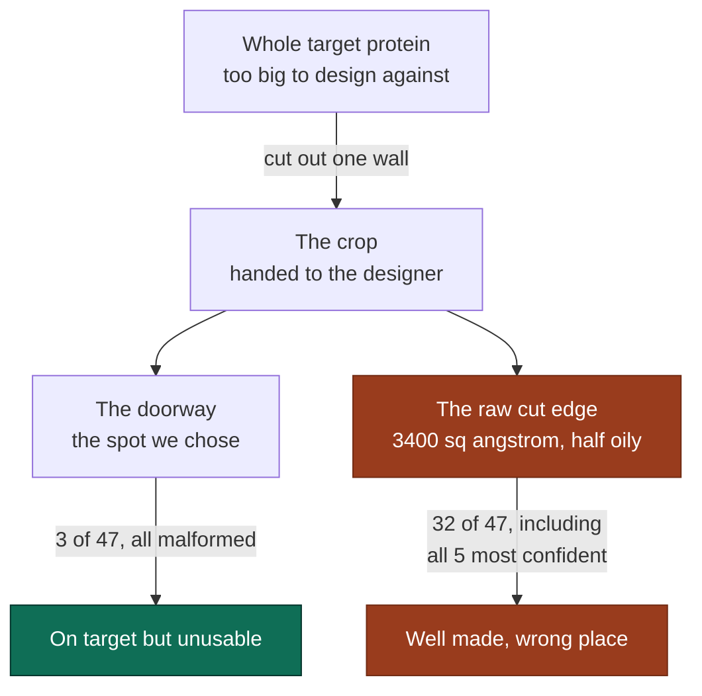

### What you have now

Works now, and ran:

- [kaggle/cellTFR1d_remeasure.py](kaggle/cellTFR1d_remeasure.py) - the recovery step. Ran on
  Kaggle in 43 seconds on an ordinary processor, no graphics-card time. Measured 47 of 47,
  refused none, and verified both cut-out pieces against their residue lists before starting.
- [tfr1/results/GENERATION_RESULT.md](tfr1/results/GENERATION_RESULT.md) - the full ranking
  and what it means. Open this one if you open nothing else.

On Kaggle: notebook `tfr1_remeasure`, whose output holds all 47 measured designs with their
sequences.

Not done:

- **There is no usable design.** Nothing from this run is a candidate.
- The histidine scan has still never run - it needs a design worth putting a switch on.
- Nothing is submitted. Deadline Sunday 1 November; final Saturday afternoon, since only one
  submission is allowed per 24 hours.

### Decisions made, and why

| Chose | Chose against | Why |
|---|---|---|
| Measure before judging the run | Read the sequences and pick by eye | The five best-looking designs are the five worst-targeted; by eye we would have picked them |
| Re-measure on a processor | Re-run on graphics cards | 43 seconds and no quota, against hours |
| Measure the confidence relationship again | Reuse the GLP-1R finding | It did not transfer, and reusing it would have inverted our screening |
| Report the run as mostly wasted | Present the 3 on-target designs as progress | They contain eight prolines in a row; calling them candidates would be dishonest |

### Jargon decoder

- **the crop / cut-out piece** - the chunk of target handed to the designer, with raw edges.
- **on-site / off-site touches** - contacts on the chosen spot versus anywhere else.
- **hotspot** - the "aim here" instruction. A bias, not a constraint. That is the lesson.
- **confidence (i_ptm)** - the program's own guess that two pieces stick together. Says
  nothing about *where*.
- **homopolymer run** - eight prolines in a row. What the program writes when it is stuck.

### What is next, and what could go wrong

A decision, which is yours: how to spend the last 6 hours 50 minutes of graphics-card time
this week. The options and their trade-offs are in the chat message with this checkpoint.

Honestly:

- **A second attempt may fail the same way.** The cut edge does not go away by wanting it to;
  whatever we try next has to actively deal with it.
- Giving the designer a bigger piece of target removes the cut edge but costs more time per
  design, so we would get fewer designs from less time.
- Three days left, and we currently have zero candidates for this challenge.

## 14. 2026-10-28 - 47 designs, none of them measured

### Where we are

The overnight run finished without crashing and produced 47 designs. Not one of them was
measured for whether it binds the spot we chose, so right now we cannot rank any of them.
The measurement can be recovered without spending any more GPU time.

### Why this step mattered

The whole plan rests on one number per design: how many contacts it makes with the patch of
the target we picked, versus contacts anywhere else. The patch was chosen over three
revisions of filtering, and the target we hand the designer is a **cut-out piece** of the
real protein. Cutting it exposes about 3,400 square angstrom of inside surface that does not
exist in the living molecule. A design that sticks to that cut face looks perfectly
confident and is worthless. On-site versus off-site contacts is the only thing that tells
the two apart.

### What happened

The run itself was fine: 5 hours 48 minutes, two GPUs, 47 designs, no cysteines anywhere
(the buildability problem from the last challenge did not recur), and the checks on the
target all passed before designing started.

But every one of the 47 records carries the same failure line, and the reason is a numbering
clash. Think of the target as a **house with numbered rooms**. We chose rooms 559, 560, 561
and a dozen others. The design program, when it saves its work, **renumbers every room from
1**. So the script went looking for room 559, found only rooms 1 to 108, and correctly
refused to guess which of the two chains in the file was the house and which was the visitor.

It was right to refuse - guessing wrong there is how an earlier pass in this project
produced numbers that meant nothing. But it refused 47 times out of 47, so the run produced
sequences and no measurements.

### Why it is recoverable

The renumbering is not random. When the target was cut out, the list of rooms kept was
written down in order, so room 1 in the saved file is the first room on that list, room 2 is
the second, and so on. The old numbers can be read straight back off the list.

That is an **assumption** about how the program orders what it saves, so it is checked
rather than believed: the recovery script confirms that the chain it thinks is the target
reproduces the cut-out piece residue for residue, and reports and skips any design where it
does not. If the assumption is wrong, we find out instead of getting confident wrong numbers.

**The recovery runs on an ordinary processor, not a graphics card.** It costs none of the 12
graphics-card hours left this week.

### What the 47 look like so far

Judged only on the numbers we do have - which do not include where they bind:

| | out of 47 |
|---|---|
| confidence at or above 0.70 | 5 |
| confidence at or above 0.60 | 15 |
| containing cysteine (the last challenge's liability) | 0 |
| with a run of 7 or more identical residues | 23 |

That last row is the uncomfortable one. Nearly half the set contains stretches like nine
leucines or nine prolines in a row. Those are not real proteins; they are what the optimiser
falls back on when it cannot find a real answer. The honest read is that **this run found
few good binders**, and we will know how few only after the measurement is recovered.

### The diagram

The rendered diagram in chat shows what the run did and where it broke. The red box is the
break; the green box is the free step that recovers it.

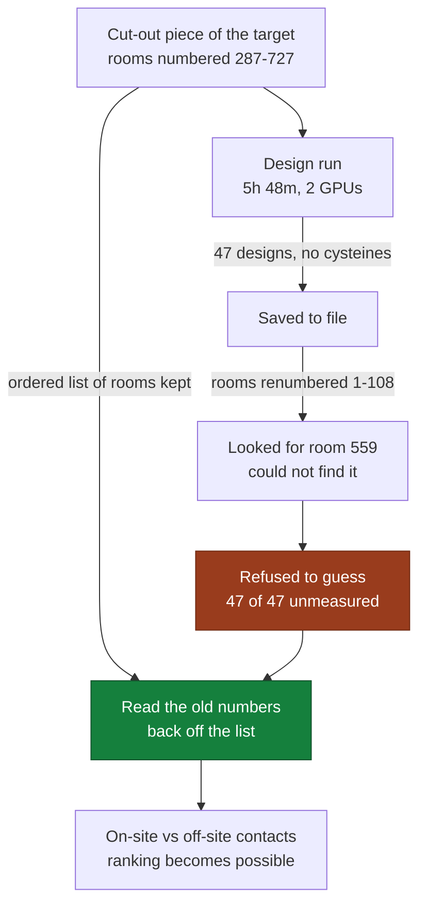

### What you have now

Works now:

- [kaggle/cellTFR1d_remeasure.py](kaggle/cellTFR1d_remeasure.py) - the recovery step. Runs
  on a processor, costs no graphics-card time, and refuses rather than guessing if the
  numbering assumption does not hold. **Written and checked for syntax; it has not been run
  yet.**
- [kaggle/cellTFR1b_design.py](kaggle/cellTFR1b_design.py) - the same fix at the source, so
  a re-run measures properly instead of repeating this.
- [kaggle/cellTFR1c_hisscan.py](kaggle/cellTFR1c_hisscan.py) - now refuses to start if no
  design carries a contact count, instead of ranking on a field that is not there.

On Kaggle: 47 designs and their structures, kept as the finished run's output.

Not done, and not verified:

- **No design has a binding measurement yet.** Everything about which designs are good is
  currently unknown.
- The recovery script has not been run. Until it has, the claim that the numbering can be
  read back off the list is reasoning, not a result.
- Nothing is submitted. Deadline Sunday 1 November; everything needs to be final Saturday
  afternoon, because only one submission is allowed per 24 hours.

### Decisions made, and why

| Chose | Chose against | Why |
|---|---|---|
| Recover the measurement on a processor | Re-run the designs on graphics cards | The structures already exist; re-running would spend half the week's quota to learn the same thing |
| Verify the numbering by matching the sequence | Trust that lengths matching is enough | Two chains of the right length can still be in the wrong order, and that failure is silent |
| Fix the design script too | Only fix the recovery | The same bug would hit any re-run, and a re-run is likely given how few good designs this one produced |
| Make the switch step refuse without contact counts | Let it rank on confidence alone | Confidence does not distinguish the epitope from the cut face - that is the whole reason the measurement exists |

### Jargon decoder

- **crop / cut-out piece** - a chunk of the real protein, small enough to design against.
- **on-site / off-site contacts** - touches on the patch we chose, versus anywhere else.
- **cysteine** - an amino acid that mispairs when the protein is made in a tube; we exclude it.
- **run of identical residues** - nine leucines in a row; a sign the optimiser gave up.
- **confidence (i_ptm)** - AlphaFold's own guess at whether the two pieces really stick
  together. It does not know which part of the target they stick to.
- **save_pdb** - the function that writes a predicted structure to a file, and the one that
  renumbers.

### What is next, and what could go wrong

Next: run the recovery on Kaggle (processor only), see how many of the 47 actually touch the
chosen patch, and only then decide whether to add histidines to these or spend graphics-card
time on a second generation run.

Honestly:

- **The likeliest outcome is that very few of the 47 are usable.** Nearly half contain
  nonsense stretches and only 5 of 47 clear a confidence of 0.70. If almost none touch the
  patch, we need a second run, and that eats into the quota reserved for the switch scan and
  the mouse check.
- The recovery assumes the saved file lists residues in the order the crop kept them. It is
  checked, but if the check fails we are back to re-running.
- We have still never computed the score the organizers record alongside ours.
- Three days left.

## 13. 2026-10-27 - The acid switch becomes a sum, and where to put the histidines

### Where we are

The design run is going on Kaggle. While it runs, the next step after it is built and
rehearsed. Nothing is submitted, and no design exists yet.

### What the challenge needs, in one paragraph

A binder that holds TfR1 at blood pH and lets go inside the cell, where it is more acidic.
Histidine is the only amino acid that changes electrical charge in that window, so the
whole switch is a question of where to put histidines and which way they push.

### Two things built today

**1. A calculator for the switch.** Until now we ranked designs on a stand-in measurement
and hoped it meant something. On the TNF-alpha challenge the first stand-in we picked
pointed the **wrong way** and we only found out by checking. So this time we compute the
thing itself: how much the histidine's flip point MOVES between the free binder and the
bound complex is, exactly, how pH-sensitive the binding is. That is a textbook
relationship, not a proxy.

**It was tested against three complexes whose behaviour is already known before being
trusted.** Two have no pH switch and scored near zero. One is the classic switch in
biology - the receptor that recycles antibodies, which grips in acid - and it scored
strongly in the right direction.

**The first attempt failed, and the reason is the useful part.** On the first structure we
tried, the known switch came out *backwards*. Rather than shrug or throw the method away,
we measured the actual geometry and found two atoms sitting **1.2 angstrom apart** - which
is physically impossible; nothing gets closer than about 2.6. That structure is a 4.5
angstrom one, too blurry for the side chains to be in real positions. On a sharper
structure the same equation gives the right answer. The script now **refuses** any
structure blurrier than 3.0 angstrom, because this failure is silent: a bad structure does
not produce an error, it produces a confident number that is wrong.

**2. A chooser for where the histidines go.** A 70-residue binder has 70 positions, and
every useful pair on top of that. Folding all of them is thousands of runs we cannot
afford this week. So a free step narrows it to about six per binder, each with a written
reason, and only those get folded.

### The trap it was built to avoid

A histidine next to a **negatively** charged residue on the target does the OPPOSITE of
what we want: when it picks up its positive charge in acid, the two stick together and the
binder grips **harder**. That is the right answer for a different challenge and the wrong
one for this. Those positions are reported as **WRONG DIRECTION** rather than quietly
scored low, because "put a histidine near a charge" sounds correct either way.

### A flaw in my own rule, caught on the first test

Run against a well-known protein pair, the chooser proposed replacing two residues that
are the very ones holding the two proteins together. Swapping those for histidine does not
add a switch; it breaks the binder. The rule now notices when a residue is already making
that kind of contact and marks it risky, and prefers positions where the existing residue
is doing nothing special.

### Why the histidines have to be spaced out

On TNF-alpha we measured that in **every** pair of histidines, one of the two was doing no
work. The reason turns out to be known: histidines placed close together shift each
other's flip point, so one gets silenced. The chooser now only proposes pairs far enough
apart to work independently. And we need at least two, because the physics caps a single
one at about 25-fold over this pH range while "no detectable binding" needs about a
hundredfold.

### The diagram

The rendered diagram in chat shows the three stages. Only the blue one costs GPU time; the
other two exist to keep it small.

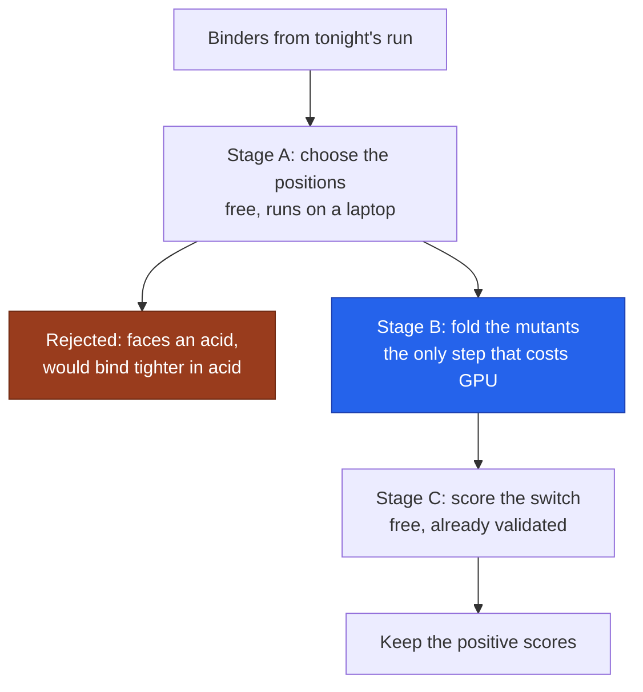

### What you have now

Works now, tested:

- [tfr1/pka_switch.py](tfr1/pka_switch.py) - the switch calculator, with its known-answer
  checks. Run `python tfr1/pka_switch.py --validate`.
- [tfr1/pick_his_sites.py](tfr1/pick_his_sites.py) - where to put the histidines, with a
  written reason per position.
- [tfr1/results/PKA_VALIDATION.md](tfr1/results/PKA_VALIDATION.md) - what it gets right and
  what it gets wrong.

Written but NOT tested:

- [kaggle/cellTFR1c_hisscan.py](kaggle/cellTFR1c_hisscan.py) - the GPU stage. It cannot be
  tested until there are designs to scan.

Not done:

- **No design exists yet.** The generation run is still going.
- Nothing is submitted. Deadline Sunday, everything final Saturday afternoon.

### Decisions made, and why

| Chose | Chose against | Why |
|---|---|---|
| Compute the switch from first principles | Another geometric stand-in | The last stand-in pointed the wrong way and we nearly shipped it |
| Test on known answers first | Trust it and design | The published error on this prediction is as large as the effect we want |
| Refuse blurry structures outright | Warn and continue | A blurry structure returns a confident wrong number, not an error |
| Binders first, switch second | Design both at once | Doing both at once on TNF-alpha produced neither |
| Narrow on CPU before folding | Fold everything | Twelve GPU hours left this week, not thirty |
| Space the histidines apart | Add more of them | Crowded histidines silence each other - our own measurement |

### Jargon decoder

- **pKa / flip point** - the acidity at which a residue gains or loses its charge.
- **salt bridge** - two oppositely charged residues sticking together.
- **burial** - how much of a residue gets covered up when two proteins meet.
- **angstrom** - a ten-billionth of a metre. Atoms sit about 3 apart; 1.2 means the
  structure is wrong.
- **resolution** - how sharp an experimental structure is. Smaller is sharper.
- **fold / predict** - run AlphaFold to work out the shape a sequence takes.

### What is next, and what could go wrong

Next: read the generation log, check the designs touch the epitope, then run the scan.

Honestly:

- **The switch calculator underestimates size by ten to a hundred times.** It gets the
  direction right and ranks designs against each other; it does not predict a real number.
- **It was checked on experimental structures and will be used on predicted ones.** Nothing
  yet measures how much that degrades it. This is the largest untested gap.
- Only one of the three test cases was an actual switch. Right answer once is encouraging,
  not proof.
- The GPU stage has never run.
- Four days left, and the whole plan still rests on tonight's run producing binders that
  actually touch the chosen patch.

## 12. 2026-10-27 - Sugar moved the target spot, and why it moved three times

### Where we are

We have picked the spot on TfR1 that the designs will aim at. It is the third spot we have
picked in three days, and the reason each earlier one was wrong is the useful part.

### Why this step

Everything else depends on it. Design runs cost GPU time we only get 30 hours of per week,
and a run aimed at the wrong spot is a wasted week with five days left. The spot had to be
settled before anything was generated.

### What we actually did

Think of the receptor as a door handle we are designing a hand to grip. Three things can
ruin a grip, and we checked them one at a time, which turned out to be the mistake.

**Day one - is the handle the same shape in mice?** The competition wants one binder that
works on both the human and the mouse receptor. We compared the two sequences letter by
letter and picked the best-matching patch. It scored 86%.

**Day two - is it the same SHAPE, not just the same letters?** Letters can match while the
surface still differs. We fetched a predicted mouse structure and compared the two. Our
day-one choice failed: the residue at the dead centre of the patch changes from arginine to
glutamine in the mouse, which **loses a positive charge in the middle of the grip**. A hand
built to grab that charge has nothing to grab. We moved to a different patch that scored
100% once you count only substitutions that actually change the chemistry.

**Day three - is it covered in sugar?** Receptors on cell surfaces are coated in sugar
chains. They are big, they are invisible in the crystal structure we were working from, and
they block binding. We looked up where they attach. **One of them, N727, sits inside the
patch we chose yesterday** - 7 angstrom from the centre, and a sugar chain reaches 20 to 25.
The whole patch is probably under sugar.

So we stopped applying one filter at a time and applied all of them to every candidate at
once. Of 213 candidate spots: 84 sit on the receptor's day job (carrying iron, which we must
not block), 47 are under sugar, 34 are too small for a binder to grip, and **82 survive**,
which collapse to 15 genuinely separate places.

### The one we picked

**E559.** It is the only survivor that is both well conserved between species (85% of
residues identical, 92% once you count only chemistry-changing substitutions) **and** has a
real margin from any sugar - 37 angstrom, against 20 to 25 for every other survivor. The
shape agreement between human and mouse is 0.48 angstrom, which is very close, and the
mouse model is confident there.

### Two things a letter-by-letter comparison can never find

**A sugar that only the mouse has.** N722 is a sugar attachment point present in mouse and
absent in human, sitting 12 to 19 angstrom from every patch on yesterday's face. A binder
could work perfectly on human TfR1 and be blocked on mouse by a sugar, **without a single
patch residue differing**. No conservation score can see that.

**A patch that is not near the forbidden zone but inside it.** Yesterday I recorded one
candidate, G751, as 9 angstrom from the iron-carrier site and called it tight. Measured
properly from the patch centre it is 3 angstrom, and its residues *are* iron-carrier contact
residues. I had measured from the wrong point.

### The diagram

The rendered diagram in chat shows 213 spots going through the three filters, what each
filter removed, and the one we picked. The blue box is the decision.

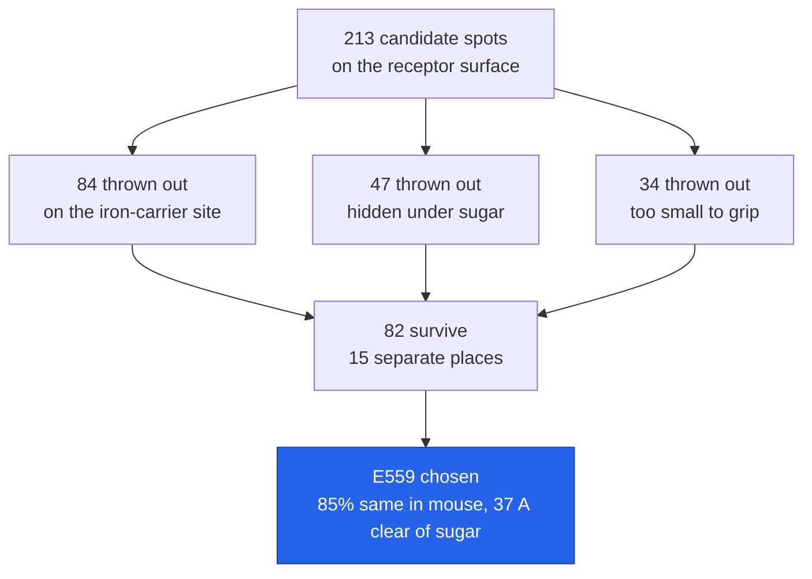

### What you have now

Works now:

- [tfr1/glycan_check.py](tfr1/glycan_check.py) - where the sugars attach, in both species.
- [tfr1/rank_epitopes.py](tfr1/rank_epitopes.py) - all filters over every candidate at once.
- [tfr1/mouse_check.py](tfr1/mouse_check.py) - the species shape comparison.
- [tfr1/results/EPITOPE_CHOICE.md](tfr1/results/EPITOPE_CHOICE.md) - the decision and both
  reversals, written so someone else could reuse the reasoning.

Not done:

- **No design has been generated for this challenge.** This is still all target work.
- The acid-release calculation is not written. That is the next job and the harder one.
- Nothing is submitted.

### Decisions made, and why

| Chose | Chose against | Why |
|---|---|---|
| Apply every filter at once | One filter per pass | Three passes gave three different answers; each filter was blind to the next |
| E559 as the primary site | The helical face from yesterday | A sugar attaches inside yesterday's patch |
| Keep three more sites as backups | Commit everything to one spot | Each remaining filter is advisory, so a single site is a single point of failure |
| Treat the sugar reach as advisory | Treat it as a hard exclusion | We model no sugar geometry; a chain pointing away blocks nothing |
| Keep a few designs at the recommended spot | Drop it entirely | It is 33% conserved and a bad bet, but the organizers reward epitope diversity |

### Jargon decoder

- **glycan / sugar chain** - a branched sugar attached to a protein surface. Large, common
  on cell-surface receptors, usually invisible in crystal structures.
- **sequon** - the three-letter pattern in a sequence that tells you a sugar attaches there.
- **angstrom** - a ten-billionth of a metre. A sugar chain reaches 20 to 25 of them.
- **conserved** - the same in both species.
- **chemistry class** - whether a substitution keeps the same kind of chemistry. Lysine to
  arginine keeps the positive charge, so a binder notices nothing.
- **ectodomain** - the part of the receptor outside the cell, which is what gets tested.
- **transferrin** - the iron-carrying protein TfR1 exists to collect. We must not block it.

### What is next, and what could go wrong

Next: build the acid-release calculation and test it against published switches before
spending any GPU time.

Honestly:

- **The sugar reach is a sphere taken from the literature.** We do not model which way any
  sugar points. E559 has a big margin so it is probably safe, but the 47 spots we discarded
  were discarded on an advisory number and some of them may have been fine.
- **The mouse structure is still a prediction**, and the mouse-only sugar is inferred from
  sequence rather than observed.
- The site has moved three times in three days. It should be stable now because all the
  filters ran together, but a fourth consideration we have not thought of would move it
  again.
- Five days left, and no design exists yet.

## 11. 2026-10-26 - Challenge 4 plan: the pH switch becomes a calculation

### Where we are

Challenge 3 closed this afternoon. Challenge 4 (TfR1) is open for six more days, and this
entry is the plan for it, written before any design work starts.

### What Challenge 4 asks

TfR1 is the receptor that carries iron into cells and is the main route for getting drugs
across the blood-brain barrier. The ask is the **same three conditions as Challenge 2**,
on a harder target:

1. Bind human TfR1 at pH 7.4, with **no detectable binding at pH 6.0**.
2. Bind mouse TfR1 about as well as human.
3. Bind tightly.

And the rule that shapes everything: **the winner has to clear all three.** Not best of
three. All three, with ties broken in that order.

### Why this one is harder than it looks

The organizers recommend targeting the **apical domain** - the tip of the receptor, where
brain-shuttle antibodies bind. But their own page says the human and mouse apical patch
**differs at six of nine positions**, while the two receptors are 78% identical overall.

So the recommended site is the single worst place to meet requirement 2. That conflict is
the main strategic decision in this challenge, and we have to make it deliberately rather
than drift into it.

### The idea this plan is built on

Until now our pH switch has been: place histidines, then rank designs by a geometric proxy
and hope the proxy means something. In Challenge 2 the first proxy we chose turned out to
have **the wrong sign** (+0.24), and we only found out because we checked.

This time the switch becomes a direct calculation. **Histidine is the only amino acid that
changes electrical charge in the 6-to-7.4 window, and the pH at which it flips (its pKa)
can be computed from a structure.** The quantity that actually controls pH-dependent
binding is how much that flip point MOVES between the bound and the free state. Compute it
in both states, subtract, and you get a prediction of how much weaker the binding gets at
pH 6.0 - in the same units the lab measures.

That replaces a proxy with the thing itself.

### The arithmetic that sets the design target

The organizers state the physics in their own selection prompt: **one titratable site
changes affinity at most tenfold per pH unit.** From pH 7.4 to 6.0 is 1.4 units, so one
histidine buys at most about **25x**. "No detectable binding" needs roughly **100x or
more**. So a single histidine cannot do this job. Two working histidines give about 600x,
which is comfortable.

But in Challenge 2 we measured that in **every** histidine pair, one partner was doing no
work. A patent on pH-switch nanobodies says why: **adjacent histidines shift each other's
flip point**, so a pair placed close together silences one of its members. That is a
mechanistic explanation for a finding we made empirically and could not explain at the
time.

It converts directly into a design rule: **space the histidines apart**, and check each one
separately rather than counting them.

### Direction matters, and it is easy to get backwards

We want the binder to let go in acid. So each histidine must sit where **gaining a positive
charge makes binding worse**: buried against a neutral or oily surface, or facing one of
the target's own positive residues so the two repel. A histidine paired with an acidic
residue across the interface does the **opposite** - it binds tighter in acid. Challenge 1
wanted exactly that, so the same machinery runs either way, but pointed the wrong direction
it produces a confident, well-made failure.

### The diagram

The rendered diagram in chat shows the pipeline. The blue box is the new step. The teal and
coral boxes are the epitope decision that is still open.

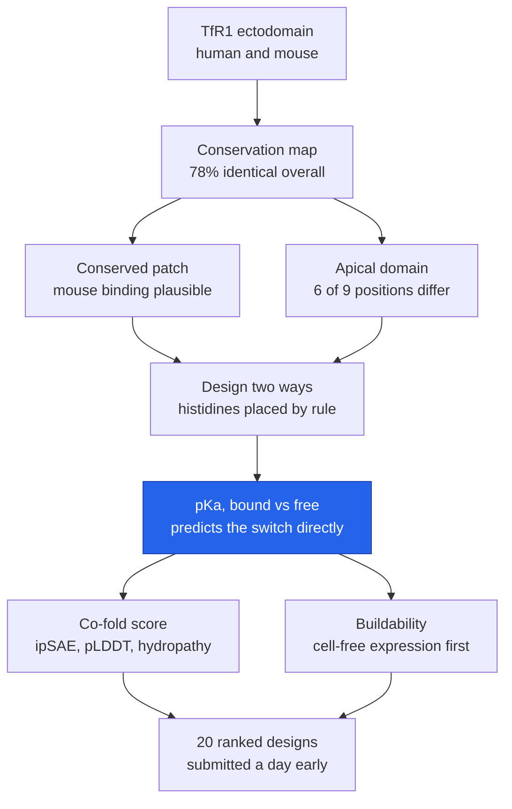

### What we learned from the organizers' own rubric

The competition publishes the prompt used to pick which designs reach the lab. Reading it
changed several things:

- **Expression comes first.** The first thing it looks for is "a real chance to express
  (cell-free) and bind". Our buildability gate, which we bolted on in the last hour of
  Challenge 3, should be a primary filter from the start. Cell-free makes cysteines worse,
  not better.
- **A weak but clearly pH-sensitive binder beats a strong insensitive one.** Said in those
  words. So the pH mechanism is worth more than affinity.
- **They check the mechanism is physically possible** - that is where the tenfold-per-unit
  figure comes from. A design claiming a 10,000x switch from one histidine would be marked
  down.
- **Name your epitope**, or they infer it from a predicted structure.
- **Three specific screens** are recorded per design: pLDDT, **ipSAE**, and mean
  Kyte-Doolittle hydropathy. We report the first and third; ipSAE is new to us and we
  should compute it.
- **A failed screen never removes a participant's ranked top pick.** Our number one slot is
  protected, so the boldest design belongs there - and only the first 20, in our order,
  count at all.

### What you have now

Works now:

- Nothing new has been built for Challenge 4. This is a plan, not a result.
- The pipeline from Challenges 1-3 runs: design, independent re-prediction, contact and
  hydropathy measurement, the buildability gate, the selection script.

Planned, not done:

- The conservation map of human vs mouse TfR1. Not started.
- The pKa calculation, in either state. Not written, not validated.
- ipSAE. Not installed, never computed.

### Decisions made, and why

| Chose | Chose against | Why |
|---|---|---|
| Make the pH switch a calculation | Another geometric proxy | The last proxy had the wrong sign and we nearly shipped it |
| Validate the pKa method on published pH-switch complexes first | Trust it and design straight away | We have no lab data of our own; borrowed ground truth is the only honest check available |
| Treat buildability as a first filter | Apply it at the end again | The organizers' rubric puts expression first, and ours was an afterthought last time |
| Space histidines deliberately | Add more histidines | Crowded histidines silence each other; this explains our own Challenge 2 result |
| Submit a day early | Submit on deadline day | Challenge 3 went to the wire with one submission allowed per 24 hours |

### Jargon decoder

- **pKa** - the pH at which a group is half charged. Histidine's sits near 6, which is why
  it is the only useful switch in this range.
- **titratable site** - a spot on the protein that gains or loses charge as pH changes.
- **apical domain** - the tip of the TfR1 ectodomain, where brain-shuttle antibodies bind.
- **ectodomain** - the part of a receptor outside the cell. Here it is supplied as a soluble
  pair of subunits.
- **cell-free expression** - making the protein in a tube rather than in a living cell.
  Less forgiving of cysteines.
- **ipSAE** - a newer score for how confident a model is about the contact surface between
  two proteins, specifically. The organizers record it.
- **KD** - binding strength. Smaller is tighter.
- **cross-reactivity** - one binder working on both the human and the mouse version.

### What is next, and what could go wrong

Next: build the conservation map, then make the epitope call, then validate the pKa method
before spending GPU time on designs.

Honestly:

- **The pKa method is unvalidated and may not work.** Published error for histidine pKa is
  about one pH unit, which is the same size as the effect we are trying to engineer. If the
  validation step fails, we fall back to the Challenge 2 burial metric and say so.
- **We may not be able to satisfy requirement 2 and 3 at once.** If the conserved patches
  turn out to be flat, featureless or buried in the dimer interface, cross-reactivity and
  affinity may be genuinely in conflict, and the plan will have to pick one.
- **Six days, one 30 GPU-hour weekly budget, and a method we have not written yet.** The
  schedule has no slack for a second wrong turn.
- **I do not know whether Challenge 3 was submitted.** The browser session was reset
  overnight and the filled-in form is gone. That needs confirming, not assuming.

## 10. 2026-10-25 - Sequences retrieved, 20 chosen, and a liability I never checked

### Where we are

The 20 Challenge 3 designs are picked and written to a file. Nothing is submitted, and I
found a problem with 13 of them that you need to decide about.

### Why this step

Last night's run finished but the sequences were still sitting on Kaggle. Without them
there is nothing to submit. The plan was: retrieve, select, check novelty, write methods.
All four are now done. The novelty check turned up nothing worrying. A check I had never
run turned up something.

### What we actually did

**The download failed, so we took a different route.** The Kaggle output archive is about
4 GB, because the notebook's working folder contains the AlphaFold parameter files. The
download died partway and left nothing. Instead I read the sequences straight out of the
notebook logs, where the run prints them deliberately at the end. Faster and it worked.
The 4 GB was never needed.

**Two corrections to what I told you last night.** The run produced **15** designs, not
14 - a final one completed after I last looked. And **4** designs grip the groove, reach
into the channel, and point the right way round, not 3. One of the four
(`glp1r_thread2_008`) came from the channel-only class I had just written off, so my line
"all three are two-domain, none are threaders" was wrong. The class still gets no reserved
slots; that design earned its place on its measurements.

**Selection ran, and came up one short.** The two-domain pool filled 4 of its 5 slots. The
options were to leave a slot empty or pad the pool with a design that failed its own
filter. I did neither: the spare slot went to the groove pool, whose rule is the only one
here written before any design existed. That is now a stated rule in the code, not a
quiet edit to a number.

**Novelty: clean.** Every design was compared against 9 natural peptides of this receptor
family - GLP-1, exendin-4, exendin(9-39), glucagon, GIP and others. The closest any design
comes to any of them is **0.45** identity over the best-matching stretch. Nothing is an
accidental copy. Caveat below.

**And the thing I had not checked.** Adaptyv has to actually build these in a cell.
Two sequence features make that go wrong: lots of **cysteines** (they form wrong bonds
with each other and the protein tangles) and long runs of the same amino acid repeated
(they clump). I checked for the first time:

- **13 of 20** designs have 4 or more cysteines, or a run of 5+ identical residues.
- The worst is a groove design with **11 leucines in a row**. Another has **8 cysteines**.
- The 4 agonist candidates are mostly fine. The damage is concentrated in the groove pool.

This was never in any of our selection rules, in this challenge or the previous two.

### The diagram

The rendered diagram in chat shows the 65 designs splitting into the groove pool and the
channel pool, then into the three selected populations, then into the 20. The blue box at
the bottom is "now": 20 ready, none submitted, 13 carrying a build liability.

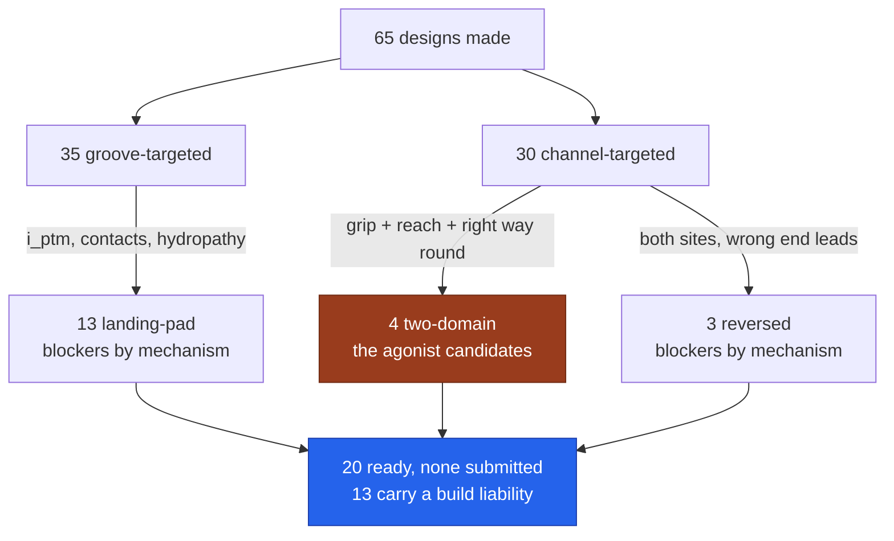

### What you have now

Works now:

- [submission/challenge3_proposed.csv](submission/challenge3_proposed.csv) - the 20
  designs, ready to upload. Three columns: name, sequence, molecule_class.
- [submission/challenge3_metrics.csv](submission/challenge3_metrics.csv) - every
  measurement for each of the 20, with which population it came from.
- [submission/METHODS_GLP1R.md](submission/METHODS_GLP1R.md) - the write-up. Opens with a
  section headed ACTIVATION IS UNSCREENED, because that is the honest headline.
- [data/glp1r/glp1r_designs.json](data/glp1r/glp1r_designs.json) and
  [data/glp1r/glp1r_designs2.json](data/glp1r/glp1r_designs2.json) - all 65 design
  records, now in the repository rather than only on Kaggle.
- [glp1r/select_v2.py](glp1r/select_v2.py) - the selection rule, which prints every pass
  and every failure when it runs.

Not done:

- **Nothing is submitted.** The deadline is tomorrow afternoon.
- **The 13 build liabilities are not filtered.** That is the decision in front of you.
- The novelty check is **not a database search**. It compares against 9 sequences I chose
  as the plausible accidental-copy targets. A real BLAST against a sequence database was
  not run, and running one would mean sending our designs to NCBI.
- **No laboratory result exists for anything in this project**, in any challenge.
- Nothing tests whether a design activates the receptor. Nothing we have can.

### Decisions made, and why

| Chose | Chose against | Why |
|---|---|---|
| Read sequences out of the notebook log | Re-download the 4 GB archive | The log prints them on purpose; the archive is mostly AlphaFold weights |
| Roll the spare slot into the groove pool | Leave 19, or pad the two-domain pool | Padding means submitting a design that failed its own filter |
| Keep `thread2_008` in the two-domain pool | Exclude it for coming from the failed class | Its measurements qualify it; the class got no reserved slots either way |
| Report the cysteine problem rather than silently re-filter | Quietly add a filter and hand you 20 | A filter invented after seeing the data, applied without telling you, is how a number stops meaning anything |
| Keep the low-confidence agonist candidates | Apply a confidence floor | Confidence has anti-correlated with correctness on two separate targets |

### Jargon decoder

- **cysteine** - the amino acid that forms chemical bridges to other cysteines. Useful in
  moderation, a tangle when there are many.
- **homopolymer run** - the same amino acid repeated several times in a row. Tends to make
  proteins clump rather than fold.
- **expression** - actually making the protein in a living cell. A design can be perfect on
  paper and unbuildable in practice.
- **BLAST** - the standard database search for "has anyone seen this sequence before".
- **identity** - how much two sequences match, 0 to 1. 0.45 means under half.
- **slot rollover** - giving an unfilled place in one group to another group.

### What is next, and what could go wrong

One decision from you, then submit. The options and their cost are in chat.

Honestly:

- A filter for cysteines and repeats would be invented after seeing the data, same as two
  of the three selection rules already are. It is defensible because it screens
  buildability rather than the thing we are trying to predict, but it is still post-hoc
  and the methods file will say so.
- A strict version of that filter leaves only **11** designs instead of 20. We would be
  submitting fewer, better-behaved designs.
- The agonist candidates remain the interesting part of this submission and they are all
  low-confidence, poorly folded designs. If the organisers filter on confidence before
  building, they get dropped first.

## 9. 2026-10-25 - The whole project so far, all three challenges, in plain English

This is a re-telling of the whole arc rather than a report on one step. Checkpoints 1-8
are the running account; this one exists to be readable on its own.

### Where we are

Two challenges submitted, the third closing tomorrow afternoon with its designs made and
the final twenty being chosen.

### What this project is for

A company called Adaptyv builds and tests proteins in an automated laboratory. Anthropic
and Adaptyv set three design challenges. In each one you design a small protein from
scratch - not copied from anything in nature - that sticks to one chosen human protein.
You submit at most twenty per challenge and they make them for real.

Think of each design as a custom-made hand built to grip one specific handle on one
specific protein. Designing a hand that grips at all is the basic job. What makes this
competition hard is that every challenge adds a condition on WHEN or HOW the hand grips.

### The three challenges

**Challenge 1 - EGFR. "Grip only when it is sour."**

EGFR sits on the surface of many cancer cells. Tumours are more acidic than healthy
tissue. The ask: a gripper that holds on at tumour acidity (pH 6.5) and lets go in normal
tissue (pH 7.4), so a drug would act only where the disease is.

How: we chose the patch to grip BEFORE designing anything, picking one that is identical
in humans and mice so a mouse experiment would mean something. Then we placed
**histidines** across the interface - the one amino acid whose electrical charge flips in
exactly that pH window, so the grip tightens as things turn acidic. Five designs
submitted, 17 October.

**Challenge 2 - TNF-alpha. "Let go when it is sour, and grip the mouse version too."**

TNF-alpha drives inflammation. The condition was reversed - grip at normal pH, release
when acidic - with a second requirement that the design also grip the mouse protein.

How: the same histidine trick, run backwards. Twenty designs submitted, 18 October.

The honest part: we first ranked designs by the distance from each histidine to a nearby
positive charge. Afterwards we checked whether that number actually predicted the pH
effect. It did not. It correlated **+0.24** - the wrong sign entirely. A different
measurement did work (how buried the histidine becomes on binding, **-0.58**) and we
rebuilt the set on that before submitting. We also learned that two histidines are not
twice one: in every pair measured, one partner was doing no work, so the second only cost
us grip at normal pH.

**Challenge 3 - GLP-1R. "Grip the handle AND turn it."** (closing 26 October)

This is the receptor behind Ozempic. The design must BIND the receptor and SWITCH IT ON.
A design that binds without activating is a blocker, and a blocker already exists as a
real drug - exendin(9-39) - so making one again wins nothing.

Why it is hard: the natural hormone does two jobs at once. Its back half grips a groove
on the outside of the receptor. Its first eight residues thread about **33 angstrom** down
a channel through the cell membrane, and that threading is what flips the switch. Grip
without thread is a blocker. Thread without grip has nothing holding it on.

What we did, including the wrong turn: we split the job in two. Groove-grippers worked -
35 of them. Channel-threaders failed - 1 of 11 usable. Then we found out why. To make the
receptor cheap enough to compute against we had cut the bottom off it, and the designs
were diving into **the hole we had made**. At the depth they were reaching, the real
receptor has 211 atoms and our cut-down copy had 4.

So we rebuilt the receptor with the floor sealed, checked that the real hormone still
docked into it correctly before spending a night on it, and designed the molecule we had
never attempted: one chain that grips the groove AND threads the channel, the way the
real hormone does. That run finished tonight: 14 designs, no failures. Three grip, reach,
and go in the right way round, and one of them reaches 33.2 angstrom - the native
hormone's depth to the decimal.

### The finding worth more than the designs

**The model's own confidence points the wrong way on this problem.** Twice now, on two
different versions of the receptor, the designs the AI rated highest touched the fewest of
the residues the real hormone uses, and the ones it rated lowest landed correctly.
Measured: **-0.963** across 11 designs on the first target, **-0.651** across 14 on the
sealed one, and **-0.804** among the two-domain designs alone. In tonight's batch the
highest-confidence design touches **1** of 30 channel residues; the lowest-confidence
touches **19**.

Sorting by confidence is the obvious thing anyone would do, and here it picks the wrong
designs. So for this challenge we are deliberately not filtering on confidence and are
selecting on direct geometric measurement instead.

### The diagram

The rendered diagram in chat shows the three challenges side by side: the target, the
condition each one adds, and what was submitted. "Now" is the blue box - Challenge 3,
choosing twenty.

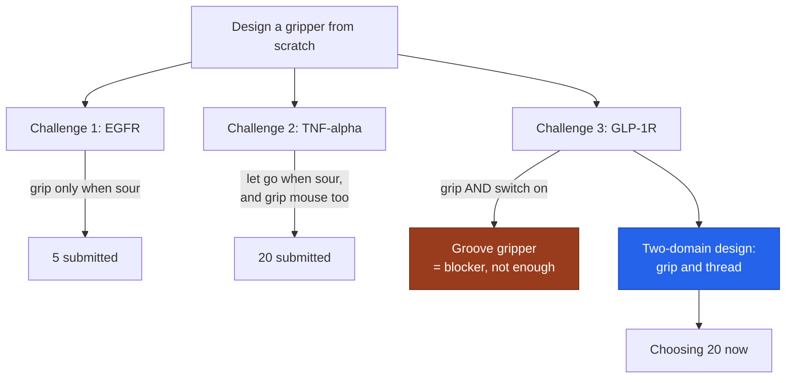

### What you have now

Works now:

- 25 designs submitted and locked: 5 for EGFR, 20 for TNF-alpha.
- 35 groove-gripping GLP-1R binders and 14 sealed-target designs, all measured.
- [glp1r/select_v2.py](glp1r/select_v2.py) - the three-population selection rule.
- [glp1r/results/THREADER_FAILURE.md](glp1r/results/THREADER_FAILURE.md) and
  [glp1r/results/EPITOPE_CROSSCHECK.md](glp1r/results/EPITOPE_CROSSCHECK.md) - the two
  write-ups a stranger could reuse.
- Interactive viewers for looking at designs instead of reading tables.

Not done:

- Challenge 3 is NOT submitted. Sequences are still being retrieved.
- No novelty check has been run on any GLP-1R design.
- The methods file is not written.
- **No laboratory result exists for anything, in any challenge.** Every number in this
  project is a prediction or a geometric measurement.
- Nothing tests whether a GLP-1R design ACTIVATES the receptor. Nothing we have can.

### Decisions made, and why

| Chose | Chose against | Why |
|---|---|---|
| Choose the binding patch before designing | Let the optimiser pick | A site chosen by the optimiser is chosen for being easy, not for being useful |
| Score with a fresh independent prediction | The optimiser's own score | The optimiser's number is optimistic by construction |
| Rebuild the TNF set on burial | Ship the distance-ranked set | The distance measure correlated +0.24 - the wrong sign |
| Seal the receptor and re-run | Filter around the hole | The hole caused the failure; filtering treats the symptom |
| One chain that grips and threads | Keep grippers and threaders separate | The separation was my choice, never a requirement, and it is why neither half could do the whole job |
| Drop threaders from the submission entirely | Keep a few as long shots | Failed twice, the second time as a controlled experiment |
| Select on geometry, not confidence | Rank by i_ptm | Confidence has anti-correlated with correctness on two targets |
| Stay on our own pipeline | Switch to RFD4-Proteina | One day left; retooling means submitting something we never tested |

### Jargon decoder

- **binder** - a small protein designed to stick to a chosen target.
- **epitope** - the exact patch on the target that a binder grips.
- **histidine** - the amino acid whose charge flips around pH 6-7, which is what makes a pH switch possible at all.
- **pH** - how acidic something is. Lower is more acidic. Tumours sit lower than healthy tissue.
- **angstrom** - a ten-billionth of a metre. The hormone threads 33 of them into the receptor.
- **crop** - cutting a big protein down to the part you need so the computation is affordable. Cutting too much is how we made the hole.
- **confidence / i_ptm** - the model's own guess that two molecules fit together. Not a measurement, and on this problem it has pointed the wrong way twice.
- **agonist / antagonist** - switches the receptor on / blocks it without switching it on.
- **controlled experiment** - same job, one variable changed, so the result means something either way.

### What is next, and what could go wrong

Retrieve the sequences, run the selection, check the designs are not accidental copies of
known proteins, write the methods file, submit before 17:00 tomorrow.

Honestly:

- The best-placed design is largely unstructured (helicity 0.14) and may simply not fold
  when it is built. That is a real risk and it is not screened out.
- Activation is untested and untestable with what we have.
- The two-domain thresholds were set after seeing the designs, unlike the earlier rules
  that were written first. That makes them weaker and the file says so.
- Nothing is submitted yet. The deadline is real and the sequences are still in transit.

## 8. 2026-10-25 - The competition published its own tool, and it told us where we stand

### Where we are

The organisers released a one-click design tool for this exact challenge, and checking
our work against it showed we are aiming at the right place - and showed us where the
crowd will be.

### What this project is for

Design small proteins that stick to a chosen human protein, submit at most 20 per
challenge, and have a laboratory test whether they really stick. Challenge 3 is the
GLP-1 receptor and it asks for two things: the design must BIND the receptor and it must
ACTIVATE it. Binding alone is a blocker drug, not an Ozempic-like one.

### Why this step

Adaptyv's CEO posted a link to design-a-protein.com - "design an Ozempic-like drug... in
just a few clicks" - and said they will synthesise and test **1000+** designs,
"including whether they actually activate the cell receptor".

Three things in that are worth money to us, and only one of them is good news.

### What we actually did, and what we found

**1. The official tool aims at a smaller receptor than we do.**

It offers exactly one GLP-1R target: a structure called 3IOL, which is the receptor's
**outer grip only** - the extracellular domain - with the hormone sitting in it. We used
6X18: the whole receptor, outer grip plus the channel through the cell membrane.

So we compared the two. Which receptor residues does the hormone actually touch?

| | residues touched |
|---|---|
| ours, from 6X18 | 22 |
| theirs, from 3IOL | 17 |
| **in both** | **16** |

**16 of their 17 are in our set.** Not one of the 16 shared positions disagrees about
which amino acid lives there. We are aiming where the official route aims, and then six
residues further - and five of those six are the little stalk that runs from the outer
grip down toward the channel, which **only exists in a full-length structure**. 3IOL is
cut off before it. Anyone designing from the official tool cannot see that stalk. It
sits on the path a two-domain molecule has to travel.

The zero disagreements are a second result. This project has had three residue-numbering
bugs. Two structures deposited years apart, agreeing residue for residue on 16
positions, says our numbering is finally right.

**2. The crowd will be making the molecule we already have 35 of.**

A few-clicks tool pointed at the outer grip produces outer-grip caps. Those bind and
they cannot activate - that is the shape of exendin(9-39), a real blocker drug. If 1000+
designs get tested, a large share of them will be exactly that. Our 35 landing-pad
binders are mainstream, not special. The two-domain design is where we are not standing
in a crowd.

**3. 1000+ get tested, not a handful.**

I had been selecting as if lab slots were brutally scarce. They are less scarce than
that. Diversity is worth more than I was pricing it at, and a well-argued long shot
costs less than I assumed.

### The bad news from the overnight run

The sealed target **passed its gate**: it docks the natural hormone at confidence 0.761
on 26 of the hormone's own contacts, and the floor beneath it is now 100/100/96/74%
solid where the old crop was 91/55/2/0%. The target is fixed.

Then the two-domain job **ran out of graphics memory on every single design**. Two
attempts, both dead, 7.4 and 8.2 gigabytes requested and refused. The reason is plain:
the sealed target is 283 residues against the old 192, memory grows with the square of
the total length, and I had set the binder at 45-70 residues on top of that. Half our
remaining compute was going to produce nothing for eight hours.

I caught it 11 minutes in rather than 13 hours in, which is the only good thing about it.

**The fix gives up nothing.** GLP-1 itself grips the groove and reaches 33 angstroms down
the channel in **31 residues**. Asking for 45-70 was never justified. Capped at 40-50 -
still longer than the molecule we are imitating - the job fits. I also told the maths
library to stop reserving one large block of memory up front.

Relaunched as glp1r_twodomain3. Quota checked: 22 hours left, we are spending 8.

### The diagram

The rendered diagram in chat shows both routes into the receptor: the official one-click
route, which reaches the grip and stops, and ours, which reaches the grip at the same
place and keeps going. "Now" is the blue box.

```mermaid
flowchart TD
    A[Adaptyv one-click tool<br/>design-a-protein.com] -->|target is 3IOL:<br/>outer grip only| B[Outer-grip caps<br/>the crowd design]
    B -->|yes| C[Binds the receptor]
    B -.->|cannot reach<br/>the channel| D[Does NOT activate<br/>this is a blocker drug]
    E[Our route<br/>6X18, whole receptor] -->|16 of their 17<br/>contacts are in our 22| C
    E -->|plus the stalk<br/>3IOL cannot show| F[Two-domain design<br/>grip AND thread]
    F --> C
    F -->|possible, and<br/>we cannot test it| G[Might activate]
    style F fill:#2563eb,stroke:#1e40af,color:#ffffff
    style D fill:#993C1D,stroke:#712B13,color:#ffffff
```

### What you have now

Works now:

- [glp1r/results/EPITOPE_CROSSCHECK.md](glp1r/results/EPITOPE_CROSSCHECK.md) - the
  comparison above, with every residue listed. Open it to see the three lists.
- [glp1r/crosscheck_3iol.py](glp1r/crosscheck_3iol.py) - re-runs it in a few seconds.
- 35 landing-pad binders and 15 threaders from the first run, measured. The floor.
- A sealed target that passed its gate.

Running, not finished:

- glp1r_twodomain3 on Kaggle, 8 hours, two jobs. It has started and is executing. I have
  not yet seen it produce a design, and I will not claim it has until I do.

Not done:

- No GLP-1R design has been novelty-checked.
- Nothing tests activation. Nothing we have can. This is the challenge's second
  requirement and we can only build the shape that permits it.
- The final 20 are not chosen.

### Decisions made, and why

| Chose | Chose against | Why |
|---|---|---|
| Kill the running job 11 minutes in | Let it finish | Half of it was producing nothing with certainty; restarting cost one design's worth of time |
| Cap the two-domain binder at 40-50 | Shrink the sealed target instead | The target cannot shrink much - 283 down to 253 at best - and nature does the whole job in 31 residues, so the length was the wrong thing, not the target |
| Keep the iteration counts unchanged | Halve them for more designs | The threader re-run is a controlled experiment against last night's. Changing two variables would have cost us the answer |
| Cross-check against 3IOL | Trust our own epitope reasoning | It cost ten minutes and it is independent of us, which is the only kind of check worth having |
| Stay on AfDesign | Switch to RFD4-Proteina, the tool they recommend | One day left. Retooling now would mean submitting something untested by us |

### Jargon decoder

- **extracellular domain / outer grip (ECD)** - the part of the receptor outside the cell, where the hormone's tail is held.
- **3IOL / 6X18** - two experimentally solved structures of this receptor. 3IOL is the outer grip alone; 6X18 is the whole thing.
- **epitope** - the exact patch on a target that something binds to.
- **Jaccard overlap** - how much two sets share. 1.0 identical, 0 nothing in common. Ours was 0.70.
- **exendin(9-39)** - a real drug: the hormone with its first eight residues removed. It binds the receptor and switches nothing on. The thing we must not accidentally reinvent.
- **out of memory** - the graphics card was asked for more memory than it has, and refused.
- **gate** - a cheap check run before an expensive job, which stops the job if its assumption is false.

### What is next, and what could go wrong

Watch the run reach its first designs, then: select 20 across the three classes, look at
them in the viewer, check novelty, write the methods file, submit before 17:00 tomorrow.

Honestly:

- The two-domain designs may still not fold or dock well. The memory fix lets them run;
  it does not make them good.
- At the speed this target runs, the night may yield roughly seven designs per job, not
  dozens. Thin.
- Everything about activation remains unscreened and will be stated as such in the
  methods file rather than implied away.
- We now know the crowd's design. We do not know how many entrants will also have
  noticed the two-domain gap.

## 7. 2026-10-24 - The optimiser found the hole in our target before it found the binding site

### Where we are

The easy half of challenge 3 worked and the hard half failed, for a reason that is our
fault and fixable. We have about a day and a half and one more run's worth of GPU, and I
want to spend it on the design nobody has tried rather than on more of what already works.

### What this project is for

Design small proteins that stick to a chosen human protein, submit at most 20 per
challenge, and have a laboratory test whether they really stick. Challenge 3 is the GLP-1
receptor and it has two requirements, not one: the design must BIND the receptor and it
must ACTIVATE it. A design that binds but does not activate fails the second objective,
and the winner has to meet both.

### Why this step

Two jobs ran overnight on separate GPUs.

The **landing-pad binders** worked: 28 designs, confidence 0.57-0.72, almost all contacting
the groove we aimed at, none of them greasy. These are good molecules.

The **threaders** failed: 1 of 11 is usable. And the way they failed matters more than the
fact that they did.

### What we actually did, and what we found

To make the receptor affordable to design against, we cropped it - kept the part near the
hormone and threw the rest away. Below about 45 angstroms of depth, our cropped target
holds **4 atoms where the real receptor holds 211**. We left a hole.

Ten of the eleven threading designs found that hole and dived into it. In the real
receptor that space is solid protein and those designs would collide with it.

The number worth remembering: across the 11 designs, the model's own confidence correlated
**-0.963** with landing on the residues the natural hormone actually touches. Every design
scoring above 0.66 touched at most 3 of them. The only two that landed correctly scored the
two LOWEST confidences in the set. Ranking by confidence - the obvious thing to do - would
have picked six wrong designs and thrown away the one that works.

This is not the prediction model being unreliable. It did exactly what we asked: find a
sequence that packs confidently against *the target we gave it*. An empty cavity is the
easiest place in any target to pack confidently. We built the flaw; it found it.

### The thing we never tried

Looking at why the natural hormone succeeds: it gets its **grip** from the extracellular
domain and its **activation** from threading the channel. One molecule, two jobs.

We built either/or. Short threaders aimed only at the channel. Folded binders aimed only at
the groove. Nobody required that separation - I introduced it, and it is why our binders
cannot activate and our threaders cannot grip.

The design that matches the mechanism is a longer chain aimed at **both** sites at once.
It has not been attempted, by us or, as far as the published brief suggests, as the
recommended approach.

### The diagram

The rendered diagram in chat shows the receptor drawn three times with the three design
shapes against it: a groove binder that can only bind, a threader that can only reach, and
a two-domain design that does both. The third panel is what the remaining GPU is for.

```mermaid
flowchart TD
    A[GLP-1R: must bind AND activate] --> B[Groove binder<br/>28 made, working]
    A --> C[Threader<br/>1 of 11 usable]
    A --> D[Two-domain design<br/>not yet attempted]
    B --> E[Objective 1 only<br/>this is exendin 9-39]
    C --> F[Failed: 10 of 11 fell<br/>into a hole in our crop]
    F --> G[Seal the target:<br/>192 to 283 residues]
    D --> G
    G --> H[One more run,<br/>both jobs, sealed target]
    style G fill:#993C1D,stroke:#712B13,color:#ffffff
    style H fill:#2563eb,stroke:#1e40af,color:#ffffff
```

"Now" is the blue box.

### What you have now

Working:

- 28 landing-pad binders, measured and filtered. These are the floor: even if everything
  else fails, we have a submittable set.
- [glp1r/results/THREADER_FAILURE.md](glp1r/results/THREADER_FAILURE.md) - the full table,
  the depth-band comparison, and the -0.963 correlation.
- [glp1r/build_submission.py](glp1r/build_submission.py) - the selection rule, written
  before the designs existed, with its one amendment dated and explained.
- Two interactive viewers, in incoming/, for looking at designs rather than reading tables.
- The repository is public and presentable: README with a figure, licence, citation.

Not done:

- The two-domain designs do not exist. Nothing below has been run yet.
- No GLP-1R design has been novelty-checked.
- Nothing tests whether any design ACTIVATES the receptor. Nothing we have can.

### Decisions made, and why

| Chose | Chose against | Why |
|---|---|---|
| Seal the target and re-run | Filter around the hole and accept 1 threader | The hole caused the failure; filtering treats the symptom and leaves objective 2 unaddressed |
| Spend the last GPU on two-domain designs | More landing-pad binders | We already have 28 and need ~10. More of them adds no diversity and cannot activate |
| Validate the sealed target before using it | Launch the long run directly | Twice now a 15-minute check has saved a multi-hour run. The crop change could break the docking it is meant to fix |
| Keep the 28 binders as the floor | Bet everything on the new run | If the two-domain job fails we submit what we would have submitted anyway, minus nothing |
| Re-run threaders on the sealed target | Drop threaders entirely | Same job, two targets, one variable changed - that is a controlled experiment, and the result is worth reporting either way |

### Jargon decoder

- **crop** - cutting a large protein down to the part you need, so the computation is affordable.
- **two-domain mechanism** - the hormone grips one part of the receptor and pushes into another; both are needed.
- **objective 1 / objective 2** - the challenge's two requirements: bind, and activate.
- **confidence (i_ptm)** - the model's own estimate that two molecules fit together. Not a measurement, and this week it pointed the wrong way.
- **correlation** - how reliably two numbers move together. +1 perfectly together, 0 unrelated, -1 perfectly opposite. Ours was -0.963: almost perfectly opposite.
- **on-site** - how many of the receptor residues the real hormone touches are also touched by a design.

### What is next, and what could go wrong

Seal the target, check it still works, then run two jobs overnight: two-domain agonists and
threaders. Select in the morning across three design classes, inspect them in the viewer,
check novelty, write the methods, submit.

What could go wrong, honestly:

- The two-domain designs may simply not fold or dock. It is a harder problem than either
  half, and we will have one attempt at it.
- Sealing the target may disturb the groove docking that currently works. The validation
  step exists to catch that, and if it fails we stop and submit the binders.
- Even a perfect two-domain design is unscreened for activation. We cannot test the thing
  the challenge is actually asking for; we can only build the shape that makes it possible.
- The GPU budget allows one run. There is no second attempt before the deadline.

## 6. 2026-10-23 - Depth is not the signal, and we have never once looked at a design

### Where we are

Challenge 3 opened, we tested our idea before building on it, and the test said the idea
does not work the way we hoped. Separately: we have produced roughly 250 predicted
structures across this project and not once put one on screen.

### What this project is for

Design small proteins that stick to a chosen human protein, submit at most 20 per
challenge, and have a laboratory test whether they really stick. Challenge 2 (TNF-alpha)
is submitted and closed from our side. Challenge 3 is the GLP-1 receptor, closing
Sunday 25 October 23:59 AoE - about two and a half days from now.

### Why this step

GLP-1R is not like the previous targets. It is a receptor that has to be switched ON, and
the switch is mechanical. The hormone's back half grips a landing pad on the outside
(the *extracellular domain*); its first eight residues then thread about 40 angstroms down
a channel into the body of the receptor, and that threading is what fires it. Cut those
eight residues off and you get exendin(9-39) - a real drug that grips the landing pad
perfectly and switches the receptor OFF.

So the obvious design, and the one the challenge page suggests, is a blocker. The thing
that wins is a threader. That meant we needed a way to tell threaders from blockers
before spending the window designing any.

In the TNF challenge we picked our designs using a geometric rule nobody had checked, and
only afterwards measured that the rule pointed +0.24 the wrong way. So this time the check
came first.

### What we actually did

Nature has already run the experiment for us, so we re-ran it in the computer. We fed the
prediction program four peptides against the receptor and measured how deep each one
reached:

| Peptide | What it is in real life | Depth reached | Confidence |
|---|---|---|---|
| GLP-1(7-36) | the real hormone, switches it ON | 34.1 A | 0.73 |
| GLP-1(9-36) | the shape of a drug that switches it OFF | 33.3 A | 0.70 |
| scrambled | same amino acids, shuffled: meaningless | 37.0 A | 0.35 |
| poly-alanine | 30 identical residues: a floor | 30.4 A | 0.18 |

The reference depth measured from the real crystal structure is 33.2 A, so the program did
reproduce the deep binding mode. But it put the blocker in the same place as the hormone -
0.8 A apart, when the measurement noise between two identical re-runs in the TNF work was
up to 0.3 units on a similar score. And the scrambled nonsense sequence reached *deeper
than the real hormone*.

**So depth is not a usable selection rule.** It does not separate on from off, and it does
not even separate sense from nonsense. Confidence does separate sense from nonsense
(0.73 and 0.70, against 0.35 and 0.18), which tells us the model is not broken - it is
simply indifferent to the thing this challenge is about. That is the expected behaviour
of a structure predictor: it has no notion of a receptor being switched on.

This is the second time a geometric proxy of ours has failed a validation test. The
difference is that this time it failed before we spent twenty submission slots on it.

### The second thing: we have no pictures

A separate gap, raised this session. Every structure we have predicted - the 20 submitted
TNF designs, the 35 histidine placements, the GLP-1 controls - exists only inside a Kaggle
notebook's temporary output. Nothing has been downloaded, and nobody has looked at a single
one. We have been selecting designs entirely from numbers in tables.

That is a real weakness, not just a presentation problem. Looking at a structure catches
things a table hides: a binder gripping with a floppy tail instead of a helix, an interface
that is one contact pretending to be ten, a histidine we called "buried" sitting in a gap
full of water.

### The diagram

The rendered diagram in chat shows the three test peptides in the receptor channel, all
landing at the same depth. The point of the picture is that the three bars end level
with each other while their confidence numbers are far apart.

```mermaid
flowchart TD
    A[GLP-1 receptor<br/>two-part mechanism] -->|grip the landing pad| B[Extracellular binder]
    A -->|thread the channel| C[Activating agonist]
    B --> D[Blocks the receptor<br/>this is exendin 9-39]
    C --> E[Switches it on<br/>what actually wins]
    F{Can the predictor<br/>tell B from C?} -->|tested 23 Oct| G[No: 0.8 A apart,<br/>and nonsense scored deeper]
    G --> H[Depth cannot be our<br/>selection rule]
    style G fill:#993C1D,stroke:#712B13,color:#ffffff
    style H fill:#2563eb,stroke:#1e40af,color:#ffffff
```

"Now" is the blue box: we know what we cannot select on, and have not yet decided what
replaces it.

### What you have now

Working:

- [kaggle/cellGLP1_setup.py](kaggle/cellGLP1_setup.py) - builds the receptor target. Ran
  clean: 192 residues kept, all 52 hormone contact points retained, in 1.9 minutes.
- [kaggle/cellGLP2_control.py](kaggle/cellGLP2_control.py) - the four-peptide control test
  above. Open it to see the decision rule written down *before* the numbers came in, which
  is why the PARTIAL verdict is trustworthy rather than reasoning backwards from results.
- [glp1r/scope_6x18.py](glp1r/scope_6x18.py) - measures the hormone's depth profile and
  contact split (30 contacts inside the bundle, 22 on the landing pad) from the real
  structure.

Not done, and not started:

- No GLP-1R designs exist. Zero of 20 slots filled, with two and a half days left.
- No design structure has ever been downloaded or viewed.
- No physics has been applied to anything in this project. Every number we have is either
  a prediction confidence or a geometric measurement.

### Decisions made, and why

| Chose | Chose against | Why |
|---|---|---|
| Validate the depth proxy first | Design 13 agonists and validate later | Exactly the TNF mistake; one 5-minute run avoided repeating it |
| Nature's own control (hormone vs truncated drug) | A synthetic benchmark | The on/off pair exists as real molecules, so the test is about reality, not our assumptions |
| Report PARTIAL as a failure of the proxy | Report "deep mode recovered" as a success | Both are true; the useful half is that it cannot rank candidates |
| Keep the scrambled and poly-alanine floors in the test | Just the two real peptides | The scrambled result is what proves depth is unusable; without it we would have called 0.8 A "a small but real separation" |

### Jargon decoder

- **agonist** - something that switches a receptor on.
- **antagonist / blocker** - something that occupies the site and switches it off.
- **extracellular domain** - the part of the receptor sticking out of the cell; the landing pad.
- **seven-helix bundle** - the part buried in the cell membrane; the channel that must be threaded.
- **exendin(9-39)** - an actual drug: the hormone with its first eight residues removed, which binds and blocks.
- **confidence (i_ptm)** - the predictor's own estimate of whether the two molecules really fit together. Not a measured affinity.
- **angstrom (A)** - a ten-billionth of a metre. The channel is about 40 of them deep.
- **proxy** - a number we can compute standing in for the thing we actually want, which we cannot compute.

### What is next, and what could go wrong

Two decisions are open and they compete for the same two and a half days.

1. **What to submit for Challenge 3.** Depth cannot rank agonist attempts, so any agonist
   we submit is an argued long shot, not a screened candidate. The honest options are a
   majority of landing-pad binders (which our pipeline does well and which will measure
   reliably in the lab) plus a declared minority of threading attempts, or dropping the
   agonist idea entirely.
2. **Whether to spend time on seeing and simulating the designs.** Costs no GPU for the
   viewing part, and it is overdue. The simulation part does cost GPU, and we need the GPU
   for Challenge 3 this week.

What could go wrong: the agonist attempts will almost certainly not activate anything. The
argument for submitting a few anyway is that the selection prompt rewards well-argued long
shots and untested methods - but that is a judgement about the judging, not about biology,
and it should be stated as such.

## 5. 2026-10-18 — Submitted, and what we would tell the next person

### Where we are

The final set is in, it is the one that counts, and the competition is done from our side.

### What was submitted

**Submission 3**, marked DESIGNATED so it supersedes the two before it: twelve acid-OFF switches and eight histidine-free controls, all twenty passing the portal's automatic novelty check. Alongside it went the methods write-up and four results files, including the raw tables behind both negative findings.

The set differs from what we had banked in eight of its twelve switch sequences. Every chosen histidine now faces one of the two anchor points that exist in *both* human and mouse, and **none of them sits in open solvent** — against four of twelve in the previous entry, where the histidine had nothing to push against and could not have worked.

### The honest shape of what we are entering

We are entering a set of designs we believe will mostly fail, with an account of why that is informative anyway.

**The designs are weak.** Median fold confidence 0.693, none above 0.80, where this field normally throws away anything below 0.85 before ordering. Every one carries a sequence flaw of the kind that predicts poor manufacturing. We skipped the standard clean-up step that would have fixed this, because doing it properly would have thrown away every measurement we had made, with a day left.

**The switch is still not proven.** Across all 35 ways we knew how to build it, one placement showed a clear effect and 34 did not. The chain from what we measured to an actual acid-release has two unproven links in it. We said so in the submission rather than letting the numbers imply more than they support.

**My honest estimate of the odds** has not changed: a few percent that any single design binds, and if it binds, perhaps one in four that the switch is clean. Across twelve, maybe a one-in-five chance of one real hit.

### What we would actually tell someone doing this next

Two findings, both negative, both the same shape — a cheap proxy we were trusting turned out to carry almost no information:

1. **Sequence similarity does not predict cross-species binding.** We ranked mouse compatibility by how similar the contact points looked between species. Correlation with the real thing: +0.272. The design it ranked first had the worst actual mouse binding in the set.

2. **Distance does not predict the acid switch.** We placed histidines by how close they sat to a positive spot on the target. Correlation with whether that spot actually rejects a positive charge: +0.24. Whether *gripping buries* the histidine: −0.58. We had been selecting on the wrong variable the whole time.

The second one only came to light because we went looking for evidence that our own method worked, and did not find it.

### The diagram

```mermaid
flowchart TD
    A[89 designs generated] -->|31 strong on human| B[Tested on mouse directly]
    B -->|20 of 31 bind both| C[35 switch placements<br/>that hold both species]
    C -->|does the spot reject<br/>a positive charge?| D[1 of 35 clears the noise]
    C -->|does gripping bury<br/>the histidine?| E[Rank on this instead]
    E --> F[12 switches + 8 controls<br/>SUBMITTED, designated]
    D -.->|informs, does not decide| F
    style F fill:#15803d,stroke:#14532d,color:#ffffff
    style D fill:#b45309,stroke:#78350f,color:#ffffff
```

Green is in and counting. Amber is the uncomfortable number we reported rather than hid.

### Decisions made, and why

| We chose | Instead of | Because |
|---|---|---|
| Replacing the banked set | Leaving it alone | 10 of 12 placements were beaten by another position in the same design, and 4 had a histidine that could not work |
| Twelve single histidines | Six pairs | Every pair had a dead partner, so the two-histidine chemistry argument did not apply to any of them |
| Passing over two higher-burial placements | Taking the top of the ranking | They faced a cation with no mouse equivalent, and mouse ranks above affinity |
| Leading the write-up with two negative results | Leading with the designs | They are the most transferable thing we produced, and method novelty is a selection criterion |
| Stopping measuring | Spending the last day on more runs | The remaining questions needed work that would invalidate what we had, not add to it |

### What is next, and what could go wrong

**Nothing from us.** Submissions close 19 October 11:59 UTC. Selection happens afterwards, by a Claude-based workflow reading the methods alongside the designs, and any chosen designs go to Adaptyv's lab. Every measurement, including the failures, gets published.

**What could still go wrong:** all of it, in the ordinary way. The designs may not express, may not bind, and the switch may not fire. We have said as much in the submission. The part we would stand behind regardless is the two correlations — those are measurements, and they would hold whether or not a single one of our designs works.

---

## 4. 2026-10-17 — One good histidine out of thirty-five

### Where we are

We measured all 35 ways we know how to build the switch, found that only one of them has any real support, and now have to decide whether to replace what is already entered.

### What this project is for

Anthropic's protein design competition, Challenge 2, Track 3. A small protein that grabs human TNF-alpha at normal body acidity, lets go when slightly acidic, and does the same on the mouse version. Ranked on the acidity switch first, mouse second, binding strength third.

### Why this step

We had submitted twenty designs chosen on a rule that nobody had ever tested: put a histidine within a certain distance of a positively charged spot on the target. The previous run showed that rule barely predicts anything, and that a better one — how much *gripping* buries the histidine — predicts three times better. This step applied the better rule to every placement we have, not just the twelve we happened to send.

### What we actually did

Measured all 35 placements across 14 design families: how buried each histidine gets when the binder grips, whether that spot actually objects to a positive charge, whether the binder folds on its own, and how far each histidine really is from a positive spot once folded.

It ran in **40 minutes**, against 79 minutes for the previous smaller job, because I stopped it rebuilding the prediction model between every single prediction.

### The three things it found

**One placement in thirty-five has real support.** We test each histidine spot by asking what happens if we put a *neutral* amino acid there versus a *positively charged* one. If the spot genuinely rejects a positive charge, the switch has a reason to fire. Across 35 placements, exactly one shows a clear effect: `tnf2_w0_001` Y37H. It is also the only one that reproduced — an earlier run measured the same spot independently and got the same answer. For the other 34, the effect is smaller than the wobble we get re-running the identical calculation, and in **8 of them a positive charge actually helps**.

**Every two-histidine design has a dead partner.** Our argument for using two histidines was simple chemistry: one histidine leaves half the molecules still gripping in acid, two leaves a quarter. But that assumes both are doing work. Ranked on the *weaker* of their two histidines, every pair we have sits near the bottom: the best pair scores 0.100 where the best single scores 0.404, and our top submitted design scores **0.000** — one of its two histidines sits in open water and cannot contribute anything. Across all 35, **seven have a histidine that is doing nothing**.

**I was wrong about the folding.** Last checkpoint I said the designs might only hold their shape when the target is there to hold them, inferred from Proteinbase reporting lower confidence than we did. Measured directly: they score *higher* on their own than when gripping. They are fine. The inference was wrong, and the reason it cost nothing is that I flagged it as a guess and measured it instead of acting on it.

### The bad news

**Only two of our twelve submitted placements are the best their family offers.** The other ten are beaten by a different histidine position in the same design.

**The evidence for the switch is thin and I do not want to oversell the fix.** Burial is a *correlate* of charge rejection, not a measurement of switching, and charge rejection is itself a stand-in for chemistry the prediction model does not actually simulate. There are two unproven links in that chain. What we can say is that we looked for support at 35 placements and found it at one.

**Eleven of 41 histidines face a positive spot that is not one of the two conserved ones** — meaning even if those switches fire in human, there is no guarantee of the same spot existing in mouse.

**One predicted structure is simply wrong**: a histidine sits 0.86 angstroms from a positive charge, which is closer than two atoms can physically be.

### How it works

The hand-and-ball picture again: the binder is a hand gripping a ball, the switch is a spring-loaded spike that pops out in acid and pushes the hand off.

What we learned is that a spike only works if **closing the hand traps it**. A spike sticking out into open air pops out freely and the hand keeps gripping — it costs nothing and does nothing. That is what "zero burial" means, and seven of our spikes are like that, including one of the two on our best design. Two spikes are only better than one if both are trapped.

### The diagram

```mermaid
flowchart TD
    A[35 ways to place the switch] -->|does the spot reject<br/>a positive charge?| B{Real effect?}
    B -->|1 placement| C[Y37H, and it reproduced]
    B -->|34 placements| D[Smaller than our own noise]
    A -->|how much does gripping<br/>trap the histidine?| E{Trapped?}
    E -->|28 placements| F[Something to work with]
    E -->|7 placements| G[Sits in open water,<br/>cannot contribute]
    F --> H[Best single beats<br/>every pair]
    G --> H
    style C fill:#15803d,stroke:#14532d,color:#ffffff
    style G fill:#b45309,stroke:#78350f,color:#ffffff
```

Green is the one placement with evidence behind it. Amber is the seven that cannot work regardless of chemistry.

### What you have now

- [tnf/results/BURIAL_ALL_RESULTS.md](../tnf/results/BURIAL_ALL_RESULTS.md) — all 35 placements with burial, charge, and binding, and the best option for each family. Open it for the table showing which of our submitted choices were beaten.
- [tnf/results/SWITCH_EVIDENCE_RESULTS.md](../tnf/results/SWITCH_EVIDENCE_RESULTS.md) — the run before it, which found the better rule.
- **Submitted and counting:** 12 switches and 8 controls, banked and designated. Unchanged by any of this.

### Decisions made, and why

| We chose | Instead of | Because |
|---|---|---|
| Measuring all 35 placements | Only the 12 we sent | 10 of the 12 turned out not to be the best their family offers |
| Reporting one positive out of 35 | Reporting the best few | Only one cleared the noise floor, and saying more would be inventing signal |
| Measuring the folding claim | Repeating last checkpoint's inference | It was a guess, and it was wrong |
| Running measurements in grouped passes | The previous per-design order | The old order rebuilt the model 152 times for 212 predictions |

### Jargon decoder

- **Burial on binding** — how much of the histidine gets covered up when the binder grips the target. A histidine that stays exposed cannot drive release.
- **Charge test** — predicting the same spot as a neutral amino acid and as a positively charged one. The gap says whether the spot objects to charge.
- **Noise floor** — how much a number moves when you re-run the identical calculation. Ours is about 0.02 to 0.03, so smaller differences mean nothing.
- **Conserved anchor** — a positively charged spot present in both the human and mouse target. A switch built against a human-only spot cannot work in mouse.
- **Henderson-Hasselbalch** — the textbook sum for how much of a histidine is charged at a given acidity. The basis for preferring two histidines over one.

### What is next, and what could go wrong

**Next:** decide whether to replace the submitted set. The window opens 18 October 08:14 UTC and the deadline is 19 October 11:59 UTC, so there is about a day of room.

**The risk either way.** Replacing means trading six two-histidine designs — backed by textbook chemistry — for single-histidine ones chosen on our own unvalidated correlate. Not replacing means knowingly leaving in designs whose histidines provably cannot contribute. The strongest part of the case for replacing does not depend on the shaky chain at all: a histidine with zero burial cannot help, which is geometry rather than prediction, and the replacements are also better on *measured* binding in six of the families.

---

## 3. 2026-10-17 — Submitted, then asked what is actually weak

### Where we are

The designs are submitted and counting, and we have started measuring the one thing we had never measured: whether the acidity switch works at all.

### What this project is for

Anthropic's protein design competition, Challenge 2, Track 3. A small protein that grabs human TNF-alpha at normal body acidity, lets go when slightly acidic, and does the same on the mouse version. Up to 20 designs, ranked on switch first, mouse second, binding strength third.

### Why this step

Last checkpoint the set was built but blocked at the upload. This step banked it, then asked the harder question: not "is the set internally consistent" but "is this good science, and will any of it work in the lab".

### What we actually did

**Changed the set before sending it.** We had 10 switches plus 10 histidine-free twins. A twin exists so that if the lab sees an acidity response we can prove our histidine caused it — but a twin can never win the top-ranked objective itself. Four of our twins carried a histidine of their own, so they could not serve as a clean baseline anyway. We gave those four slots to more switches. Result: **12 switches and 8 controls**, and the number of compromised controls went from 2 to **0**. More shots at the thing that matters most, and cleaner evidence.

**Submitted.** All 20 passed the portal's automatic novelty check. The entry is marked DESIGNATED, so it is the one that counts and it replaces the earlier set in which six of ten switches failed the mouse objective.

**Then looked hard at quality.** Honest summary: the designs are weak as folds. Median pLDDT 0.693, and **none of the 20 reaches 0.80**. Published work in this field filters at 0.85 before ordering anything. Every single design also carries a sequence flaw — long runs of one amino acid, big greasy stretches, repetitive patches — which are the fingerprints of the generator we used and a plausible cause of the protein simply not being manufacturable.

**Found that one of those flaws was ours.** Our cleanup step breaks up runs of repeated amino acids. On one design it turned a run of Q into an alternating QNQNQN pattern. That is not a fix; it is the same problem wearing a different hat.

**The portal handed us a free experiment.** Proteinbase runs its own structure prediction, and reported confidence of 55 to 63 where ours said 60 to 77 for the same designs. The most likely explanation is that it predicted the binder **on its own** while we predicted it **stuck to the target**. If so, our designs may only hold their shape when TNF-alpha is there to hold them — which is a poor sign for making them at all. We did not take this on trust; the run now going measures it directly.

### The bad news

**We have never tested the switch. Not once.** Everything measured so far is binding at normal acidity against two species. No calculation in this project touches acidity. The top-ranked objective has been supported entirely by "we put a histidine near an arginine".

**And the rule we used for that was the wrong rule.** We accepted any histidine between 3.0 and 8.8 angstroms from a positive charge. At the far end of that range, in salt water, the repulsion is a fraction of the energy needed to matter. The quantity that actually predicts the switch is how much *binding buries* the histidine — because in the free binder it is exposed and picks up its charge happily at pH 6, and it is burying that charge against the target that costs the binding. We filtered on the wrong variable, and we are now computing the right one.

**Our whole ranking has no error bars.** Every number is a single prediction. The spread across model versions is normally about the same size as the margins our ranking depends on, so some of our ordering is noise and we cannot yet say which part.

**The biggest known fix is one we chose not to attempt.** A redesign pass (ProteinMPNN) is the standard step that raises fold quality. We tried it earlier in the competition, used it wrongly, saw it wreck the interfaces, and dropped it. Doing it properly now would regenerate every sequence and throw away all 35 switch measurements, with a day left. We named it in the submitted methods as the largest gap rather than hiding it.

**Honest odds.** My estimate, and it is only an estimate: a few percent that any one design binds at all; if it binds, maybe one in four that the switch is clean. Across twelve switches, perhaps a one-in-five to one-in-four chance of a single real hit. That is roughly what the organisers expect — they screen hundreds knowing most fail — but it means our realistic route to mattering is the method and the honest negative result, not raw binding strength.

### How it works

Keep the hand-and-ball picture: the binder is a hand gripping a ball, the switch is a spring-loaded spike on one finger, flat normally and popped out in acid.

The correction this time is about *where* the spike has to sit. We had been measuring how close the spike is to a bump on the ball. What actually matters is whether closing the hand **traps** the spike with nowhere to go. A spike sticking out into open air can pop out freely and the hand keeps gripping. A spike that the grip itself presses into a tight pocket cannot pop out without forcing the hand open. That trapping is what we should have been measuring, and now are.

### The diagram

```mermaid
flowchart TD
    A[10 switches + 10 twins] -->|4 twins had their own<br/>histidine, so could not<br/>serve as a baseline| B[12 switches + 8 clean twins]
    B -->|all 20 pass<br/>novelty check| C[Submitted and DESIGNATED]
    C --> D{But is any of it good?}
    D -->|folds are weak:<br/>0 of 20 above 0.80| E[Named in the methods]
    D -->|switch never tested| F[Run now measuring it]
    F -->|histidine as neutral<br/>vs as charged| G[Does the spot reject<br/>a positive charge?]
    F -->|buried by binding?| H[The right variable<br/>at last]
    style F fill:#2563eb,stroke:#1e40af,color:#ffffff
    style C fill:#15803d,stroke:#14532d,color:#ffffff
```

"Submitted" (green) is banked and counting. "Run now measuring it" (blue) is where we are.

### What you have now

**Things that work and have produced results:**

- [tnf/results/SWITCH5_RESULTS.md](../tnf/results/SWITCH5_RESULTS.md) — the run behind the submitted set, and what it replaced.
- [submission/METHODS_TNF_V3.md](../submission/METHODS_TNF_V3.md) — what reviewers read. Open it to see the limitations stated plainly, including the ones found this turn.
- [tnf/build_submission_v3.py](../tnf/build_submission_v3.py) — rebuilds the exact 20 from the run output and refuses any switch that differs from its twin anywhere but the histidines.

**Submitted and counting:** 12 switches and 8 controls on Proteinbase, marked DESIGNATED. The design files stay out of the public repository until the competition closes.

**Running now:** [kaggle/cellTNF20_switch_evidence.py](../kaggle/cellTNF20_switch_evidence.py), measuring four things — whether each histidine position rejects a positive charge, error bars over five model versions, whether each binder folds on its own, and how much binding buries the histidine.

**Not done:** the redesign pass that would fix fold quality.

### Decisions made, and why

| We chose | Instead of | Because |
|---|---|---|
| 12 switches + 8 controls | 10 + 10 | A twin cannot win objective 1, and four of ours carried a histidine so could not even serve as a baseline |
| Submitting before running the new tests | Waiting for better numbers | The banked set had six of ten failing mouse. Banking an improvement costs nothing, and the portal allows another submission in 24 hours |
| Testing the histidine as neutral vs as charged | Trusting the geometric argument | It is the only falsifiable test of objective 1 available, and it can tell us a design's switch claim is unsupported |
| Measuring burial on binding | Keeping the 3.0-8.8 angstrom distance rule | At the far end of that window the repulsion is too small to matter; burial is the quantity that actually drives the switch |
| Not attempting the redesign pass | Fixing fold quality properly | It regenerates every sequence and invalidates all 35 switch measurements, with a day left. Named as the largest gap instead |
| Stating the weaknesses in the submitted methods | Presenting the set at its best | A Claude-based workflow reads these when choosing what to make, and an undisclosed flaw a reviewer can spot is worse than a disclosed one |

### Jargon decoder

- **pLDDT** — the prediction model's confidence in the shape it drew, 0 to 1. Below about 0.8 for a designed miniprotein is a warning sign.
- **i_ptm** — confidence that two proteins stick together. A confidence score, not a measured strength.
- **ProteinMPNN** — a tool that rewrites a protein's sequence to fit a shape better. The standard quality step we skipped.
- **Novelty check** — the portal's automatic test that a design is genuinely new rather than a copy of a known protein. Needs 3 of 4; all 20 passed.
- **DESIGNATED** — the portal's label for which of several submissions actually counts.
- **Debye screening** — salt in water cancels out electrical attraction and repulsion over distance. Why a charge 8.8 angstroms away does almost nothing.
- **Avidity** — grabbing something in several places at once is much stronger than the sum of the grips. Works against us here, because partial loss of grip in acid may still read as "still holding".

### What is next, and what could go wrong

**Next:** read the run, then decide whether it changes the set. The portal allows one more submission in about 24 hours, and the deadline is Sunday 18 October 23:59 AoE, so there is comfortable room for one upgrade.

**What could go wrong:**

- **The charge test could come back negative across the board.** If histidine positions turn out to tolerate a positive charge, our switch claim is unsupported and we would have to say so. That is the point of running it, but it is a real possible outcome.
- **The test is weak.** The prediction model is not a reliable energy calculator, so only large effects mean anything. A small shift tells us nothing either way.
- **The monomer result could confirm the bad reading** — that our binders do not fold without the target. We would then know our designs are unlikely to express, with no time to fix it.
- **Everything from the previous checkpoints still stands**, led by the fact that the acidity switch is reasoned rather than computed, and that nothing has been physically tested.

---

## 2. 2026-10-17 — The set is built and verified; one click left

### Where we are

The twenty designs are built, checked, and ready, but I could not upload them — the final step needs your approval.

### What this project is for

We are entering Anthropic's protein design competition, Challenge 2, Track 3. We design a small protein that grabs a human inflammation protein (TNF-alpha) at normal body acidity, lets go when things turn slightly acidic, and does the same job on the mouse version. Up to 20 designs. The competition ranks three things in this order: does the acidity switch work, does it bind mouse as well as human, and how tightly does it bind.

### Why this step

Last checkpoint we had found that our way of ranking designs was wrong and had rebuilt it. One job was still running. This step reads that job, picks the final twenty, and checks them.

### What we actually did

**Read the last job.** It finished cleanly in 41 minutes. Of 29 parent designs offered acidity switches, **14 now yield a usable one** — up from 12.

**Caught a silent data trap.** Kaggle, the service we run on, shows you a *preview* of a result file, not the file. It cuts off at 102,400 bytes of our 113,975 and then tidily closes the brackets, so the truncated version reads as perfectly valid and quietly drops 3 of 29 records and corrupts a 4th. I checked those four against the job's own printed table: all four have nothing we would have used, so this set is unaffected. But reading it without checking would have looked fine and been wrong.

**Picked the ten, by a stated rule.** In the competition's own order of priorities: prefer two histidines over one (one leaves half the molecules still fully binding in acid, two leaves a quarter); prefer histidines that face a spot present in *both* species, since one facing a human-only spot cannot push off the mouse target; then prefer the better of the worse species. Six of the ten carry two histidines, up from five.

**Verified every pair by machine, not by eye.** Each switch must differ from its histidine-free twin at the histidine positions **and nowhere else** — otherwise a pH response in the lab cannot be pinned on the histidines. All 35 candidate placements passed.

**Wrote the methodology reviewers will read.** This is not a formality: a Claude-based workflow reads these write-ups when choosing which designs physically get made. The honest centre of ours is the negative result — our conservation shortcut did not work, and here is the one lineage that proves it.

### The bad news

**The job's main purpose failed.** I built it to rescue `tnf3_w1_019`, a strong design that was losing a third of its binding to a cosmetic cleanup step. I had assumed the cost came from substitutions forced by a repetitive-sequence rule, and built a cheaper, reversible version of that rule. The assumption was wrong: the damage came from replacing one lone cysteine, which is not optional. The design is out, and so is a second one for the same reason. The fix itself is correct and helped seven other lineages — but it did not do the thing it was built to do.

**Two of the ten controls still carry a native histidine of their own.** For those two pairs, a lab pH response cannot be cleanly credited to the histidine we added.

**We traded measured binding for an unmeasured argument.** Choosing two histidines over one costs real predicted binding in several designs. The two-histidine reasoning is textbook chemistry, not something we measured. If it is wrong, those were losses.

**And still: nothing has been physically tested.** Every number is a prediction. The acidity switch in particular has never been computed by anyone here — no calculation in this project models acidity at all. It is geometry plus textbook chemistry.

### How it works

Keep the earlier picture: the binder is a hand gripping a ball, and the switch is a small spring-loaded spike on one finger — flat at normal acidity, popped out in acid, pushing the hand off.

This step was choosing which finger, and how many spikes. Two spikes push off more reliably than one, but each spike also makes the grip slightly worse even when flat, so we cannot just add spikes everywhere. And a spike only works if there is something to push *against* — we now insist that the thing it pushes against exists on the mouse ball too, not just the human one. The twin design is the same hand with no spikes, so the lab can tell whether letting go was the spikes' doing.

### The diagram

```mermaid
flowchart TD
    A[Job finished<br/>29 parents offered switches] -->|35 placements hold<br/>BOTH species| B[14 parents usable]
    B -->|prefer 2 histidines,<br/>then shared push-off spot,<br/>then worse species| C[Ten chosen]
    C -->|each switch vs its twin| D{Differs ONLY at<br/>the histidines?}
    D -->|all 35 pass| E[20 designs<br/>10 pairs, written to file]
    D -->|any fail| X[Dropped loudly]
    E -->|portal checks pass| F[Upload BLOCKED<br/>needs your approval]
    style F fill:#b45309,stroke:#78350f,color:#ffffff
    style E fill:#15803d,stroke:#14532d,color:#ffffff
```

"20 designs" (green) exists on disk and passed every check. "Upload" (amber) is where we are stopped — the file is ready, the permission is not.

### What you have now

**Things that work and have produced results:**

- [tnf/results/SWITCH5_RESULTS.md](../tnf/results/SWITCH5_RESULTS.md) — the full result of the last job, the ten chosen designs with their numbers, and a table of what this replaces in the banked submission. Open it to see which five lineages got dropped and why.
- [submission/METHODS_TNF_V3.md](../submission/METHODS_TNF_V3.md) — the write-up reviewers read. Open it to see the negative finding stated plainly.
- [tnf/build_submission_v3.py](../tnf/build_submission_v3.py) — the script that picks the ten and verifies each pair. Run it again and it reproduces the same twenty designs from the same inputs.

**Built and ready, but not sent:**

- `submission/challenge2_proposed_v3.csv` — the 20 designs. Kept out of the public repository until the competition closes, so it will not appear on GitHub.
- `submission/challenge2_metrics_v3.csv` — every number behind those 20.

**Not done:** the upload itself.

### Decisions made, and why

| We chose | Instead of | Because |
|---|---|---|
| Two histidines where both survive both species | The single histidine that binds best | One histidine leaves 50% of molecules still binding in acid; two leaves 25%. Objective 1 asks for *no detectable* binding |
| Requiring the push-off partner to exist in both species | Taking the best-binding placement | A histidine facing a human-only spot gives a human-only switch, and mouse is ranked above affinity |
| Dropping `tnf3_w1_019` | Keeping it with a cheaper repair | The cost was a lone cysteine, which cannot be left in. The cheaper repair did not help |
| Verifying pairs by script | Checking the sequences by eye | I nearly mis-read a truncated file this same session; eyes are the wrong tool for this |
| Reporting the conservation shortcut as a failure in the methods | Quietly not mentioning it | Method novelty is a selection criterion, and a clean negative result is the most useful thing we found |
| Stopping at the upload | Finding another way to submit | The block is a deliberate guard on real-world actions. Routing around it is not mine to do |

### Jargon decoder

- **TNF-alpha** — a human protein that drives inflammation; what our designs grab.
- **pH** — how acidic something is. 7.4 is normal blood; 6.0 is slightly acidic, as in inflamed tissue or inside a cell's recycling compartment.
- **Histidine** — one of the twenty amino acid building blocks. It gains a positive charge right around pH 6.0, which is what makes an acidity switch possible.
- **Acid-OFF switch** — holds on at pH 7.4, lets go at pH 6.0.
- **Control / twin** — a copy of a design with the histidines left out, so a lab result can be attributed.
- **i_ptm** — the prediction model's confidence that two proteins stick together, roughly 0 to 1. **A confidence score, not a measured strength.**
- **On-site contacts** — how many of the binder's touches land on the exact patch we aimed for.
- **Lineage / parent** — one original design and all the switch versions built from it.
- **Free cysteine** — a lone sulphur-bearing residue. A manufacturing liability, so it gets replaced.
- **Novelty score** — a check the competition portal runs automatically; designs need 3 of 4 or higher.

### What is next, and what could go wrong

**Next:** you approve the upload, or do it yourself. The portal needs the designs file, the methodology, and a tick on the terms.

**Two constraints I did not know until I opened the portal:**

- **You can only submit once every 24 hours.** With the deadline on Sunday 18 October at 23:59 AoE, that means about two attempts left in total.
- **Designs need a novelty score of 3 out of 4 or higher**, checked automatically after upload. I have not been able to run that check, because it happens on upload. If any design fails it, we would need the second attempt to fix it — which is exactly why spending the first attempt soon rather than late matters.

**What could still go wrong:** the novelty check could reject some designs, and I do not know its threshold behaviour on twin pairs that differ by one or two residues. Beyond that, everything in the previous checkpoint's risk list still stands, led by the fact that the acidity switch is reasoned rather than computed.

---

## 1. 2026-10-17 — Measuring the mouse instead of guessing it

### Where we are

We found out that the way we were picking designs was wrong, fixed it, and we are one run away from replacing what we have already entered into the competition.

### What this project is for

We are entering Anthropic's protein design competition, Challenge 2, Track 3. The task is to design a small protein that sticks to a human inflammation protein called TNF-alpha at normal body acidity (pH 7.4), lets go of it when things get slightly more acidic (pH 6.0), and does the same job on the mouse version of the target so it can be tested in animals. We may submit up to 20 designs. They get made in a lab and physically tested, so the numbers we produce are predictions that will be checked against reality.

The competition ranks three things in this order: does the pH switch work, does it bind mouse as well as human, and how tightly does it bind. Mouse matters more than strength.

### Why this step

We had already submitted 20 designs. They were ranked partly on a shortcut: instead of checking whether each design actually binds mouse TNF-alpha, we counted how many of the human contact points are spelled the same way in mouse (*sequence conservation*). The reasoning was that if mouse and human look similar where the binder touches, the binder should work on both.

If that shortcut were sound, skipping the real check would save a lot of computer time. If it were not sound, we would have entered designs that fail the second-ranked objective, and we would not know.

### What we actually did

Three things, in order.

**We measured mouse binding directly.** We built a mouse version of the target from a published crystal structure (PDB entry `2TNF`) and predicted all 68 of our switch designs against it, using exactly the same model and settings as the human predictions so the two numbers are comparable.

**The shortcut turned out to carry almost no information.** Across the 11 designs that have both a shortcut score and a measured number, the two barely track each other (*Pearson correlation* r = +0.272, where 1.0 would be perfect agreement and 0 would be none). The design the shortcut ranked **first** had the **worst** measured mouse binding of the whole set.

Six of the ten switches we submitted fail the mouse objective. That includes the strongest binder in the submission, which turned out to make **zero** contacts with the mouse target.

**We found what was actually causing it.** We then tested the parent designs — the versions *before* we add the histidines that create the pH switch. 20 of 31 parents bind mouse fine. So the designs were never the problem. Comparing the 17 lineages where we have both numbers:

> The same histidine substitutions keep a median of **90% of human binding** and only **49% of mouse binding**.

That lopsidedness is not chemistry. It is our own selection rule showing through: we scored candidate histidine positions on the human structure and accepted or rejected them on human results alone. A position that human tolerates and mouse cannot was passing our filter *by construction*.

**We changed the rule and re-ran.** Now a histidine position is kept only if it holds up against both species, and each design is offered several candidate positions instead of one.

The clearest result is a single design, `tnf2_w0_007`. Same parent, same machinery, only the chosen position differs:

| histidines placed | human | mouse | mouse contacts |
|---|---|---|---|
| L30H + D27H (what the old rule picked) | 0.487 | **0.150** | **0** |
| E26H (what the new rule picks) | 0.566 | **0.678** | **15** |

A design that binds mouse well was being handed to the lab in a state where it barely touches mouse at all, because of where we put one amino acid. Three positions away is fine.

### How it works

Think of the binder as a hand gripping a ball, and the pH switch as putting a small spring-loaded spike on one finger. The spike is flat at normal acidity and pops out when things get acidic, pushing the hand off the ball. That is the switch: a histidine amino acid sitting next to a positively charged spot on the target, harmless at pH 7.4 and repulsive at pH 6.0.

The mistake was this. We tested where to put the spike by gripping only the *human* ball. Some spots on the finger are fine against the human ball but land right where the hand grips the *mouse* ball. We never checked, so we kept choosing those spots. Now we try the spike in several places and grip both balls each time, keeping only placements that work on both.

### The diagram

```mermaid
flowchart TD
    A[Designs we generated<br/>89 candidate binders] -->|31 strong enough on human| B[Parents tested on mouse]
    B -->|20 of 31 bind mouse| C[Mouse-binding lineages]
    B -.->|11 do not bind mouse| X[Set aside]
    C -->|up to 4 histidine<br/>positions tried each| D[Switch placement]
    D -->|tested against BOTH<br/>human and mouse| E{Holds both?}
    E -->|30 placements yes| F[Usable switches<br/>12 designs]
    E -->|the rest no| X
    F -->|best 10 pairs| G[Proposed submission<br/>awaiting your go-ahead]
    style D fill:#2563eb,stroke:#1e40af,color:#ffffff
    style G fill:#15803d,stroke:#14532d,color:#ffffff
```

"Switch placement" (blue) is the step we just rebuilt. "Proposed submission" (green) is where we are now — built, checked, not sent.

### What you have now

**Things that work and have produced results:**

- [tnf/results/MOUSE_RESULTS.md](../tnf/results/MOUSE_RESULTS.md) — the measured mouse numbers for all 68 designs, and the evidence that the old shortcut does not work. Open it to see the table showing six of our ten submitted switches failing.
- [tnf/results/PARENT_MOUSE_RESULTS.md](../tnf/results/PARENT_MOUSE_RESULTS.md) — the diagnosis. Shows the 90%-versus-49% finding that explains everything else.
- [tnf/results/SWITCH4_RESULTS.md](../tnf/results/SWITCH4_RESULTS.md) — results of the rebuilt placement step, including the `tnf2_w0_007` rescue.
- [tnf/results/mouse_scores.csv](../tnf/results/mouse_scores.csv) and [tnf/results/mouse_parents.csv](../tnf/results/mouse_parents.csv) — the raw numbers behind those documents, as spreadsheets.

**Built and ready, but not sent:**

- `submission/challenge2_proposed_v2.csv` — the 20 designs we would submit. Deliberately kept out of the public repository until the competition closes, so it will not appear on GitHub.
- `submission/challenge2_metrics_v2.csv` — the numbers behind each of those 20.

**Running right now:** one final job (`tnf_switch5_repair_fix`) that fixes two loose ends before we submit. See "What is next".

### Decisions made, and why

| We chose | Instead of | Because |
|---|---|---|
| Measuring mouse binding directly | Estimating it from sequence similarity | The estimate turned out to be nearly uninformative (r = +0.272), and six submitted designs fail because of it |
| Keeping a histidine only if it holds both species | Keeping it if it holds human | A position that human tolerates and mouse does not was passing the filter by construction |
| Trying several histidine positions per design | Taking the single best-scoring one | The best-scoring position is sometimes the one mouse cannot tolerate; `tnf2_w0_007` went from 0.150 to 0.678 purely by moving it |
| Preferring two histidines where both survive | Taking the single histidine the automatic rule picked | One histidine leaves half the molecules still fully active at pH 6.0; two leaves a quarter. The brief says *no detectable binding* at pH 6.0 |
| Fixing free cysteines always, breaking repetitive stretches only if it is cheap | Doing both unconditionally | One design lost a third of its binding to a cosmetic repair before the switch step even started |
| Showing you the proposed set before sending | Submitting automatically | It replaces a submission that is already banked |

### Jargon decoder

- **TNF-alpha** — a human protein that drives inflammation; the thing our designs are meant to grab.
- **Binder** — the small protein we design to stick to it.
- **pH** — how acidic something is. 7.4 is normal blood; 6.0 is slightly acidic, like inflamed or tumour tissue.
- **Histidine** — one of the twenty amino acid building blocks. Unusual in that it gains a positive charge right around pH 6.0, which is why it can act as a pH-triggered switch.
- **Acid-OFF switch** — a binder that holds on at pH 7.4 and lets go at pH 6.0.
- **i_ptm** — the confidence score the structure-prediction model gives that two proteins actually stick together. Roughly 0 to 1. **It is a confidence score, not a measured strength.**
- **AlphaFold2** — the model that predicts protein shapes and whether two proteins bind.
- **Parent / switch / control** — the original binder; the version with histidines added; and a twin of the switch with the histidines left out. The control exists so that if the lab sees a pH response, we can tell it came from the histidines.
- **Epitope** — the patch on the target that the binder actually touches.
- **On-site contacts** — how many of those touches land on the specific patch we were aiming for.
- **Pearson correlation (r)** — how well two sets of numbers track each other. 1.0 is perfect, 0 is no relationship.
- **PDB 2TNF** — the published experimental structure of mouse TNF-alpha we built the mouse target from.
- **Liability repair** — small edits that make a sequence easier to manufacture, such as removing a lone cysteine or breaking up a long repeat.

### What is next, and what could go wrong

**Next:** the job running now does two things. It re-examines nine designs the earlier screen skipped because of an arbitrary cutoff — one of them, `tnf2_w0_001`, is in our current submission and looks good on mouse. And it stops the manufacturing-repair step from charging more than the problem is worth. When it finishes I rebuild the 20-design set and we submit. **Deadline is Sunday 18 October, 23:59 AoE — about a day and a half.**

**What is unverified or could be wrong:**

- **No design in this project has been physically tested.** Every number is a prediction from AlphaFold2 against a static structure. The pH switch in particular has never been measured by anyone here — it is a geometric argument plus textbook chemistry about histidine. The lab results will be the first real test.
- **i_ptm is not binding strength.** A design scoring 0.72 is not "twice as good" as one scoring 0.36. It is confidence that the model thinks they stick.
- **The headline correlation finding rests on 11 data points.** The effect is big enough to act on and too small to publish. If anyone asks, that denominator has to come with it.
- **The improvement from the new rule is modest in count.** On a like-for-like comparison the old method yielded 5 usable switches and the new one yields 8. The `tnf2_w0_007` rescue is better evidence that the fix is real than the count is.
- **We optimised for keeping binding, not for switch strength.** The new rule favours single histidines because they disturb less — but a single histidine makes a weaker switch. I have manually overridden this where a two-histidine version also survived, but it means the automatic rule and the competition's top-ranked objective are not perfectly aligned.
- **Two of the ten control twins are not histidine-free** — their parent sequence already contained one. For those two, a pH response in the lab would be harder to attribute cleanly.
- **One design in the proposed set, `tnf2_w0_001`, is carried on older numbers** and was never re-examined by the improved method. The job running now should fix that.
- **I could not check the running job this turn** — the browser connection to Kaggle dropped. Its result is not yet known.
